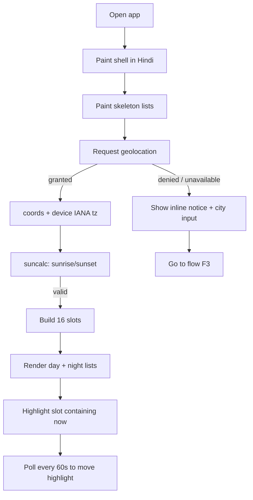
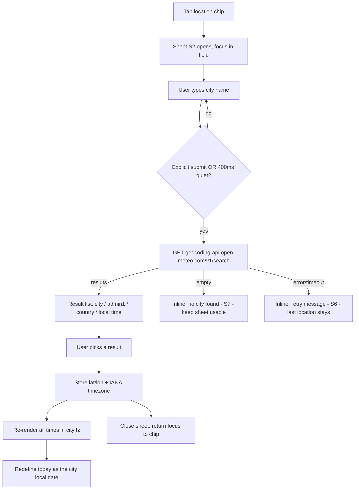
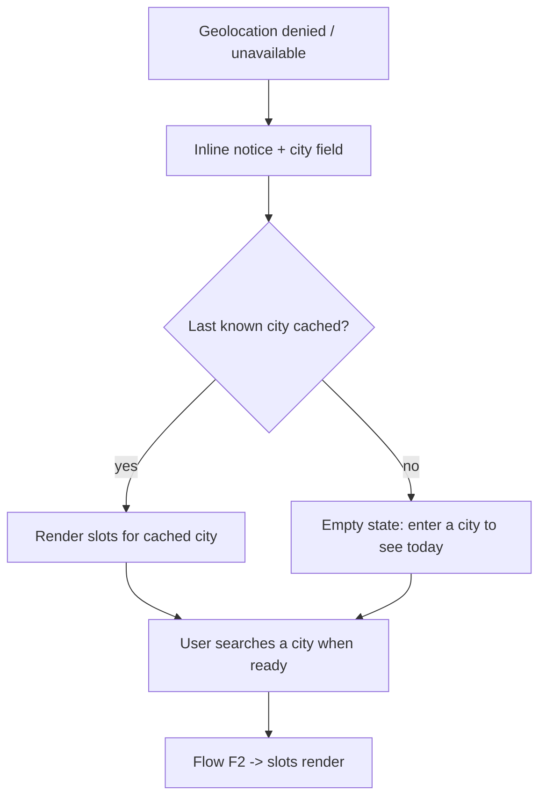
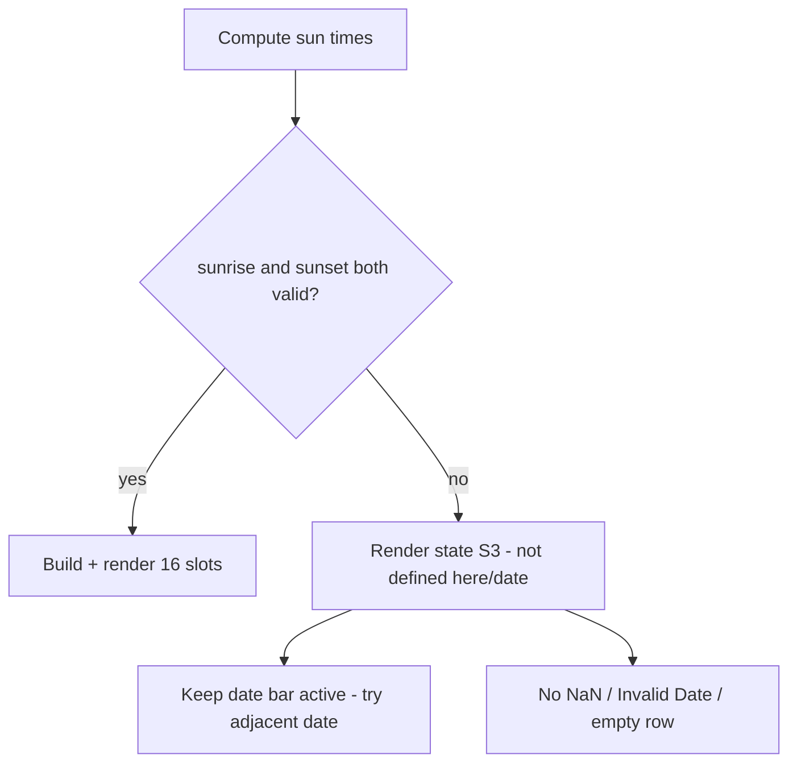
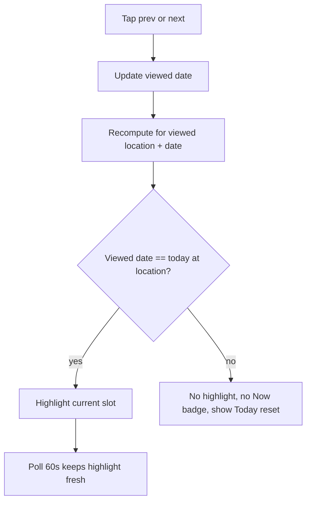
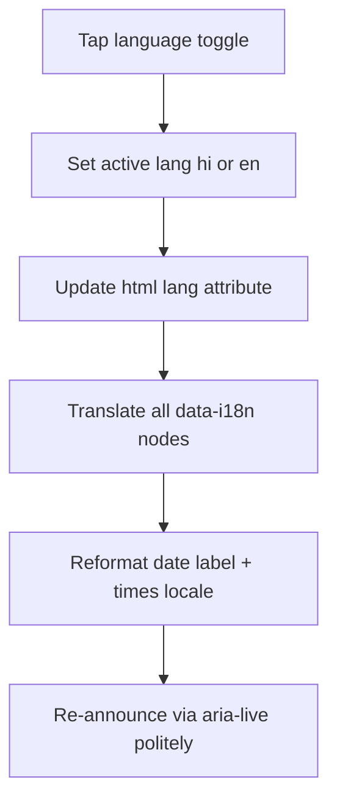

# 03 — UX Specification (flows, screens, design system)

Project: **Choghadiya Refactor** · Owner: ux-designer · Date: 2026-10-14 · Version: **v1.0.1**
Upstream: `docs/00-brief.md` (client intent), `docs/01-research.md` (§5 pinned algorithm), `docs/02-prd.md` (US-1..US-19, NFRs), `docs/TEAM_CHARTER.md`.
Downstream: architect (`docs/04-architecture.md`, `docs/05-plan.md`), frontend-dev, `docs/06-threat-model.md`.

Design stance: **one screen, three control surfaces (header / today view / city sheet), zero backend.** Mobile-first at 360 px, single column, no horizontal scroll. Hindi is the default language; every string below is specified in both languages.

---

## 1. Information architecture

### 1.1 Sitemap (single route, no navigation depth)

```
/  (index.html — only route; static; no router, no hash state in v1)
├── Header (sticky)
│   ├── Brand + page title            (US-12)
│   ├── Language toggle  [हिं | EN]   (US-11)
│   └── Location chip (opens sheet)   (US-4, US-5)
├── Date bar
│   ├── ‹ previous day                (US-13 AC2)
│   ├── Date label  +  "Today" badge  (US-12, US-13)
│   ├── › next day                    (US-13 AC1)
│   └── "आज/Today" reset (conditional) (US-13)
├── Day section  "दिन · Day"  (sunrise → sunset)   8 slot rows  (US-12 AC1)
│   └── sunrise/sunset small print                              (PRD Q3 default)
├── Night section "रात · Night" (sunset → next sunrise)  8 slot rows (US-12 AC1)
├── Not-defined message (conditional, replaces both sections)   (US-9)
├── Footer
│   ├── Privacy one-liner + geocoder attribution                (US-17)
│   └── Sunrise-convention note (±1–2 min)                      (PRD Q6/A2)
└── No-JS message (<noscript>)                                  (NFR-B3)

Overlay (not a route): City search sheet  (US-5, US-8, US-10, US-17 AC1)
```

### 1.2 Screen inventory

| # | Screen / surface | Type | Card ids | Primary stories |
|---|------------------|------|----------|-----------------|
| S1 | Today view (day + night lists) | page, default | t_e61f3b78 | US-1, US-12, US-14, US-15, US-16 |
| S2 | City search sheet | modal `<dialog>` | t_e61f3b78 | US-5, US-8, US-10, US-17 |
| S3 | Not-defined state (polar / no sunrise) | page state | t_e61f3b78 | US-9 |
| S4 | Loading skeleton | page state | t_e61f3b78 | US-4, NFR-P1 |
| S5 | Geolocation-denied notice (inline banner) | component | t_e61f3b78 | US-8 |
| S6 | Geocoder-failure inline error | component in S2 | t_e61f3b78 | US-10 |
| S7 | No-city-found inline error | component in S2 | t_e61f3b78 | US-5 AC5 |

Everything is CSS/JS state inside one `index.html`. No screen has its own URL in v1 (shareable URLs are explicitly deferred, PRD §4.2).

### 1.3 Element → story traceability (every screen references its stories)

| Element | Stories |
|---------|---------|
| Day list / night list (8 + 8 rows, name + start–end) | US-1, US-12 AC1–AC2, US-3 |
| Date bar prev/next + date label | US-12, US-13 AC1–AC2 |
| "Today" badge | US-12 |
| Current-slot highlight (border + label + aria-current) | US-14 AC1–AC4 |
| Quality word + glyph (never colour-only) | US-15 AC1–AC2, NFR-A2 |
| Language toggle | US-11 AC1–AC5 |
| Location chip + city sheet | US-4, US-5, US-8, US-10 |
| Geolocation-denied banner | US-8 AC1–AC2 |
| Not-defined message | US-9 AC1–AC2 |
| Privacy one-liner + attribution | US-17 AC1–AC3 |
| Sunrise/sunset print + convention note | US-6 AC2, PRD Q3, Q6, A2 |
| Keyboard/focus/labels/landmarks | US-18 AC1–AC4, NFR-A3–A6 |
| Responsive behaviour | US-16 AC1–AC3, NFR-B2 |

---

## 2. User flows

### F1 — First visit with geolocation granted (primary path, P1)

1. User opens `https://time.gitick.com/` on an Android phone.
2. Page paints immediately in **Hindi** with a loading skeleton for the two lists (US-11 AC1, NFR-P1).
3. Browser shows its native geolocation permission prompt (triggered after first paint, never blocking it).
4. User allows. App gets coordinates, resolves device IANA timezone from `Intl.DateTimeFormat().resolvedOptions().timeZone` (US-7 AC3).
5. App computes sunrise/sunset for the location's local date and renders the 16 slots; the slot containing "now" is highlighted (US-14 AC1).
6. User scrolls, reads quality words, optionally toggles to English (US-11 AC2).
7. Highlight refreshes every ≤ 60 s while the tab is visible (PRD Q2 default).



### F2 — Geocoding + resolved location (city lookup, P2)

1. User taps the **location chip** in the header ("📍 मेरी लोकेशन / My location" when geolocated, "📍 शहर चुनें / Choose city" otherwise).
2. Sheet S2 opens with focus in the city field; the privacy one-liner is visible above the field (US-17 AC1).
3. User types ≥ 2 characters. **No request is issued per keystroke** (US-5 AC4). A request fires on explicit submit (Enter / "खोजें / Search"), or after a ≥ 400 ms quiet period following the most recent keystroke — never against Nominatim (research §7).
4. Results list appears: each row shows `City`, `admin1`, `country` and the local time, so a user searching "London" sees which London (US-5 AC1).
5. User selects a result. The app stores `lat`, `lon` and the **returned IANA timezone** and closes the sheet (US-5 AC2).
6. All times re-render in the **searched city's** clock, and "today" is the **city's** local date (US-5 AC3, US-7 AC1, US-3 AC3).
7. The location chip now reads the city name with a "✕" affordance to clear and re-search.



### F3 — Geolocation denied / unavailable (degradation, never a dead end)

1. Permission is denied, times out, or the context is insecure (US-8 AC1–AC2).
2. App does **not** show an error wall. The today view still renders as soon as a location exists (cached last city, if any).
3. An inline notice appears under the header: "लोकेशन उपलब्ध नहीं — शहर लिखें / Location unavailable — enter a city", with the city field directly reachable.
4. User types a city → flow F2 continues from step 3.
5. If no city has ever been chosen, the two lists are replaced by a friendly empty state (S5-empty) that still shows the date bar and the city field.



### F4 — Polar / undefined sunrise or sunset (US-9)

1. Location + date produce `null`/`Invalid Date` sunrise or sunset (latitude ≥ ~66.5° on some dates — research R3).
2. Both list sections are replaced by message S3.
3. **Nothing** renders `NaN`, `Invalid Date`, `undefined` or an empty row (US-9 AC2). The date bar still works, so the user can step to an adjacent date where the sun does rise.
4. Language toggle still works; the message is in both dictionaries.



### F5 — Date navigation & highlight semantics (US-13, US-14 AC3)

1. User taps "‹" / "›". The date label updates and both lists re-render for that date at the **viewed location** (US-13 AC1–AC2).
2. If the viewed date ≠ today at the viewed location, **no** row is marked current, no "अभी / Now" badge is shown, and the aria-current attribute is absent (US-13 AC3, US-14 AC3).
3. Stepping back to the today date restores the highlight automatically.
4. A "आज / Today" reset control appears whenever the viewed date is not today.



### F6 — Language toggle (US-11)

1. Toggle shows `हिं | EN` as a two-option segmented control; the active option has `aria-pressed="true"` / `aria-checked`.
2. Tapping updates **every** string from the dictionary with no reload, targeting < 100 ms (US-11 AC2, NFR-P2).
3. `<html lang>` flips between `hi` and `en` (US-11 AC5).
4. Date formatting switches locale too: `hi-IN` renders `बुधवार, 14 अक्टूबर 2026`; `en-IN` renders `Wednesday, 14 October 2026`. Slot times remain 24-hour in both locales (chosen deliberately — see §7 note).
5. The choice is applied for the session only. **No persistence in v1** (no cookies, NFR-PR3); every new visit starts in Hindi.



---

## 3. Screen-by-screen specification

### S1 — Today view (default screen)

**Purpose.** Answer in one glance: *is now good, and when is the next good window, for where I am?* (P1 job story, PRD §2).

**Layout, top to bottom** (mobile 360 px):

```text
┌────────────────────────────────────────────┐
│  ☀ चौघड़िया            [ हिं ][ EN ]        │  header, sticky, 56px
│  📍 मुंबई, महाराष्ट्र  ⌄                     │  location chip (44px target)
├────────────────────────────────────────────┤
│  ‹       बुधवार, 14 अक्टूबर 2026       ›    │  date bar, 48px
│                [ आज ]                       │  today badge / reset pill
├────────────────────────────────────────────┤
│  दिन · Day                    सूर्योदय 06:32 │  day heading + rise
│  ┌──────────────────────────────────────┐  │
│  │ लाभ Labh      06:32 – 08:00   लाभ    │  │  slot row = <li><button>
│  │ ● ─────── ▮ अभी अमृत Amrit 08:00–09:28│  │  current row (2px left border,
│  │ काल Kaal      09:28 – 10:56    हानि   │  │   "अभी / Now" badge, tinted bg)
│  │ शुभ Shubh     10:56 – 12:25    शुभ    │  │
│  │ … 3 more …                            │  │
│  └──────────────────────────────────────┘  │
│  सूर्यास्त 18:17                            │  small print
├────────────────────────────────────────────┤
│  रात · Night                  सूर्यास्त 18:17│
│  (8 rows, same row component, marked रात)  │
│  अगला सूर्योदय 06:33                        │
├────────────────────────────────────────────┤
│  शहर खोजने पर लिखा नाम Open-Meteo/GeoNames │  privacy one-liner
│  Geocoding by Open-Meteo / GeoNames         │  attribution
│  सूर्योदय/सूर्यास्त गणना ±1–2 मिनट भिन्न हो  │  convention note
│  सकते हैं                                   │
└────────────────────────────────────────────┘
```

**Components.** Header (brand, title, language toggle, location chip) · Date bar (prev, label, next, today reset) · Section heading (day/night label + boundary time) · Slot list (`<ol>` of 8 `<li>`, each containing a `<button>` row) · Quality chip (word + glyph) · Current badge · Small print (sunrise/sunset, next sunrise) · Footer (privacy, attribution, convention).

**Slot row anatomy** (single row = one button, whole row is the tap/keyboard target, min height 56 px):

| Zone | Content | Notes |
|------|---------|-------|
| 1 | Quality tone bar / tint | Decorative; the only colour-coded part |
| 2 | Slot name, both scripts in the active language + transliteration when HI | `लाभ · Labh` when HI, `Labh` when EN |
| 3 | Time range | 24-hour, in the viewed location's tz |
| 4 | Quality word + glyph | `शुभ/Shubh` ✓ ✓✓, `हानि/Neutral` ○, `अशुभ/Inauspicious` ✕ |
| 5 | "अभी / Now" badge | Only when the row is current (US-14) |

> **Row click behaviour:** v1 has no per-slot detail screen (deferred: countdown, panchang detail). To keep keyboard operability and a ≥44 px touch target honest, the row carries a `<button>` with `aria-expanded` and toggles an inline expanded line showing **only** the quality meaning ("व्यापार, धन, अध्ययन के लिए शुभ / Good for business, trade, finance, learning"). This is pure disclosure of already-known data — no new content, no new scope, no extra network.

**States**

| State | Trigger | What the user sees | Stories |
|-------|---------|--------------------|---------|
| Loading | First paint until location + sun times resolve | Header + date bar interactive; two skeleton blocks of 8 shimmer rows with `aria-busy="true"` on the list container and a visually hidden "लोड हो रहा है / Loading" live region | US-4, NFR-P1 |
| Success (today) | Location known, valid sun times, viewed date = today | 16 rows; current row highlighted with tint + 2 px accent left border + "अभी / Now" badge + `aria-current="true"` | US-12, US-14 AC1 |
| Success (other date) | Viewed date ≠ today | Same rows, no highlight, no badge; "आज / Today" reset pill visible | US-13 AC3, US-14 AC3 |
| Empty (no location yet) | Geolocation denied/unavailable and no cached city | Header + date bar + notice S5 + inline city field; lists replaced by one calm line "आज का चौघड़िया देखने के लिए शहर चुनें / Choose a city to see today's Choghadiya" | US-8 AC1 |
| Not defined | `sunrise`/`sunset` null/Invalid | State S3 replaces both sections; **no** `NaN`, `Invalid Date`, empty row | US-9 AC1–AC2 |
| Error (geocoder) | Search request fails | Inline S6 inside the sheet only; last successful location stays rendered and usable | US-10 AC1 |
| Offline / no network | Core calc needs no network (NFR-P4) | Slots render normally; only city search shows S6 | NFR-P4, US-10 |

**Validation.** The only user input in the app is the city text field: trim whitespace; require ≥ 2 characters; max 64 characters; letters, spaces, `.` `-` `'` and Unicode (Devanagari/Gujarati) allowed — no other restriction, since the field is a query, not an identifier. Reject empty submit silently (button stays enabled, focus returns to field with message "शहर का नाम लिखें / Enter a city name" in the S7 slot).

**UX copy** — see the full bilingual table in §6.

---

### S2 — City search sheet (modal)

**Purpose.** Manual fallback that must be as good as the primary path (US-5, US-8, US-10, US-17 AC1).

**Implementation note for frontend-dev:** use `<dialog>` + `showModal()`; it provides focus containment, backdrop, and Esc-to-close for free. Trap is not hand-rolled. On open, focus moves to the field; on close, focus returns to the location chip (US-18 AC2).

Wireframe:

```text
┌────────────────────────────────────────────┐
│  शहर चुनें / Choose a city            ✕    │
│  ────────────────────────────────────────  │
│  ℹ खोजा गया शहर का नाम Open-Meteo/GeoNames │  privacy one-liner (US-17 AC1)
│    को भेजा जाता है। लोकेशन सेव नहीं होती।   │
│  ┌──────────────────────────────┐ ┌──────┐ │
│  │ लंदन                         │ │खोजें│ │  input + submit (44px each)
│  └──────────────────────────────┘ └──────┘ │
│  • लंदन, England, United Kingdom  14:20    │  result row: name, admin1,
│  • लंदन, Ontario, Canada         09:20     │  country, city-local time
│  • London, Kentucky, USA         09:20     │  (disambiguates same-name cities)
│  ────────────────────────────────────────  │
│  बंद करें                                    │
└────────────────────────────────────────────┘
```

**States.** Empty (no query yet: show 3 recent cities from an in-memory session list, no request) · Loading (submit pressed; submit button shows a text+spinner state, `aria-busy="true"`, field stays editable) · Success (result list of up to 8 rows; first row focusable by Tab, `↑/↓` optional but not required) · No results (S7: "कोई शहर नहीं मिला — वर्तनी जाँचें / No city found — check the spelling", sheet stays open and usable) · Error (S6: "खोज नहीं हो सकी। दोबारा कोशिश करें / Search failed. Try again" + a "दोबारा / Retry" button that re-submits the same query).

**Rule the developers must not break:** exactly one network request per explicit submit (or one per 400 ms quiet period). Never a request per keystroke, and **never** type-ahead against Nominatim (US-5 AC4, research §7).

---

### S3 — Not-defined state (polar / no sunrise-sunset)

```text
┌────────────────────────────────────────────┐
│  ‹       बुधवार, 14 अक्टूबर 2026        ›  │   date bar stays live
├────────────────────────────────────────────┤
│         ⓘ  इस जगह और इस तारीख पर            │
│         चौघड़िया उपलब्ध नहीं                 │
│         (यहाँ सूर्योदय/सूर्यास्त नहीं होता)   │
│                                            │
│         Choghadiya is not defined at       │
│         this location/date                 │
│         (no sunrise/sunset occurs here)    │
│                                            │
│         [ ‹ पिछला दिन ]  [ अगला दिन › ]      │   adjacent-date escape hatch
└────────────────────────────────────────────┘
```

Both languages are shown at once here on purpose: a user at 70° N may be reading in a language they did not set, and a single hard failure string is not worth a bug report. No slot row, no `NaN`, no `Invalid Date` (US-9 AC2).

---

### S4 — Loading skeleton

Two blocks of 8 grey rows, 56 px each, `background: var(--surface-2)`, shimmer **disabled** under `prefers-reduced-motion: reduce`. The list container carries `aria-busy="true"` and a visually hidden `<p role="status">लोड हो रहा है / Loading…</p>`. Target: visible within 1.5 s (NFR-P1); the skeleton is not shown at all if location + computation resolve before first paint (the common case, since it is local math).

### S5 — Geolocation-denied notice (inline banner)

```text
ℹ लोकेशन उपलब्ध नहीं — शहर लिखें
  Location unavailable — enter a city            [ शहर चुनें / Choose city ]
```

Presented as `role="status"` (not `role="alert"`) — it is informative, not urgent, and should not interrupt a screen reader mid-sentence. Colour is not the only cue (glyph `ℹ` + text). The action button opens S2 and is a ≥44 px target.

### S6 — Geocoder error (inside S2)

`⚠ खोज नहीं हो सकी। दोबारा कोशिश करें / Search failed. Try again` + `[ दोबारा / Retry ]`. The previously resolved location is untouched and remains rendered behind the sheet (US-10 AC1). `role="alert"` is correct here because the user just acted and expects a result.

### S7 — No city found (inside S2)

`कोई शहर नहीं मिला — वर्तनी जाँचें / No city found — check the spelling`. The field keeps its value, the sheet stays open, the app remains usable (US-5 AC5).

---

## 4. Design system

Tokens are the contract for `style.css`. Values are given in hex; the light theme is the default, the dark theme is applied by `@media (prefers-color-scheme: dark)` **and** by an explicit `[data-theme="dark"]` hook so the architect can decide whether to expose a manual switch (v1: follow the OS; no manual switch, to keep scope tight).

### 4.1 Colour tokens

| Token | Light | Dark | Use |
|-------|-------|------|-----|
| `--bg` | `#FAF7F2` | `#121212` | Page background (warm off-white / near-black) |
| `--surface` | `#FFFFFF` | `#1E1E1E` | Cards, slot list panel, sheet |
| `--surface-2` | `#F1ECE3` | `#262626` | Skeleton rows, date-bar rail, hover fill |
| `--text` | `#1A1A1A` | `#ECECEC` | Body text |
| `--text-muted` | `#5C5C5C` | `#ADADAD` | Times, small print, boundaries |
| `--border` | `#E2DACE` | `#333333` | Row separators, sheet edges |
| `--brand` | `#9A3412` | `#F0A868` | Header accents, primary button fill |
| `--brand-contrast` | `#FFFFFF` | `#1A0F08` | Text on `--brand` |
| `--day-accent` | `#7A2C0E` | `#FFB59A` | "दिन / Day" section heading |
| `--night-accent` | `#1F3A6E` | `#A9C6FF` | "रात / Night" section heading |
| `--qual-auspicious` | fg `#0F5132` / bg `#E3F1E6` | fg `#9FE7B4` / bg `#12331F` | Shubh, Labh |
| `--qual-amrit` | fg `#0B3D62` / bg `#E1EEF9` | fg `#A9D6FF` / bg `#0E2A44` | Amrit (top tier, distinct from the other auspicious pair) |
| `--qual-neutral` | fg `#6B3A00` / bg `#FDF0DC` | fg `#FFD9A3` / bg `#3A2A12` | Char |
| `--qual-inauspicious` | fg `#8A1B1B` / bg `#FCE9E7` | fg `#FFB4AB` / bg `#3B1A1A` | Udveg, Kaal, Rog |
| `--current-bg` | `#FFE8D6` | `#4A2A10` | Current slot row fill |
| `--current-fg` | `#7A2C0E` | `#FFD9A3` | Current slot accent text/border |
| `--focus` | `#9A3412` | `#8FB4FF` | Focus ring (2 px solid + 2 px offset) |
| `--danger` | `#8A1B1B` | `#FFB4AB` | Inline error text |

**Colour is never the only signal** (US-15 AC1, NFR-A2). Tiers are additionally carried by the quality word and a glyph: `✓✓ Amrit`, `✓ Shubh/Labh`, `○ Char`, `✕ Udveg/Kaal/Rog`. Script-ready text glyphs are used deliberately in preference to emoji so rendering is identical across Android, iOS and desktop.

### 4.2 Contrast verification (computed, not assumed)

All text pairs below were computed with the WCAG relative-luminance formula (`L = 0.2126R + 0.7152G + 0.0722B` on linearised sRGB) and **all 32 pairs pass** — 30 text pairs at ≥ 4.5:1 and 2 focus-ring pairs at ≥ 3:1 (NFR-A3). Lowlights from the run:

| Pair | Ratio | Required |
|------|-------|----------|
| `--text` on `--bg` (light) | 16.29 | 4.5 |
| `--text-muted` on `--surface-2` (light, worst muted case) | 5.68 | 4.5 |
| Quality inauspicious (light) | 7.97 | 4.5 |
| `--text` on `--bg` (dark) | 15.86 | 4.5 |
| `--text-muted` on `--surface-2` (dark, worst case) | 6.74 | 4.5 |
| `--current-fg` on `--current-bg` (light) | 8.10 | 4.5 |
| `--focus` on `--bg` (light) | 6.84 | 3.0 (UI) |
| `--focus` on `--bg` (dark) | 9.05 | 3.0 (UI) |

The verification script is reproducible: `/Users/vishu/.hermes/profiles/ux-designer/cache/scratch/contrast2.py` (32 pairs, `FAILS: 0`). Frontend-dev should re-run it if any token value changes.

### 4.3 Type scale

Base 16 px; Hindi needs more line-height and slightly more size than Latin at the same nominal px, so Devanagari sizes up within the same step.

| Token | Size / line-height | Weight | Use |
|-------|--------------------|--------|-----|
| `--font-family` | `system-ui, -apple-system, "Segoe UI", Roboto, "Noto Sans Devanagari", "Nirmala UI", sans-serif` | 400 | Body; the Devanagari fallbacks are explicit so Hindi never falls back to tofu on Windows/older Android |
| `--fs-2xl` | 28 / 1.25 (HI 32 / 1.35) | 700 | Page title in the header |
| `--fs-xl` | 20 / 1.3 | 600 | Section heading "दिन · Day", date label |
| `--fs-lg` | 18 / 1.4 | 600 | Slot name when HI (Devanagari needs the extra step) |
| `--fs-base` | 16 / 1.5 | 400–600 | Slot name EN, times, controls, inputs |
| `--fs-sm` | 14 / 1.5 | 400 | Quality word, day/night marker |
| `--fs-xs` | 12 / 1.4 | 400 | Sunrise/sunset small print, footer, privacy line |

Fonts are system fonts only — **no webfont, no external font request** (keeps NFR-P1/P3 and NFR-PR1 intact; a Google Fonts call would add a third-party origin and a render-blocking dependency).

### 4.4 Spacing & radii

4 px base grid: `--sp-1` 4 · `--sp-2` 8 · `--sp-3` 12 · `--sp-4` 16 · `--sp-5` 20 · `--sp-6` 24 · `--sp-8` 32 · `--sp-12` 48.
Radii: `--r-sm` 6 px (chips) · `--r-md` 10 px (rows, buttons) · `--r-lg` 16 px (panel, sheet) · `--r-full` 999 px (pills, badges).
Elevation: one shadow token only, `0 1px 2px rgba(0,0,0,.06), 0 4px 12px rgba(0,0,0,.05)`; dark theme uses `0 1px 2px rgba(0,0,0,.4)`.

### 4.5 Components (spec → CSS class)

| Component | Class | Spec |
|-----------|-------|------|
| Slot list | `.slot-list` | `<ol>`, `list-style: none`, panel with `--surface`, `--r-lg`, dividers `--border` |
| Slot row | `.slot` | 56 px min-height, 3-zone grid (`1fr auto auto`), 16 px inline padding; hover/active fill `--surface-2`; whole row is a `<button>` with `text-align: start` |
| Slot row — current | `.slot[aria-current="true"]` | `--current-bg` fill, 2 px inset left border in `--current-fg`, `--current-fg` for the badge text |
| Quality chip | `.quality` | Pill, 14 px, `--fs-sm`, tinted bg per tier, leading glyph |
| Now badge | `.badge-now` | Pill, 12 px, uppercase-ish, `अभी / Now`, on `--current-bg` |
| Language toggle | `.lang-toggle` | Two-option segmented control, each option min 44 × 44 px, `aria-pressed`, active option filled `--brand` |
| Location chip | `.loc-chip` | Pill button, min-height 44 px, leading 📍, trailing `⌄`, ellipsised city name at 320 px |
| Date bar | `.datebar` | Grid `auto 1fr auto`, 48 px, prev/next buttons 44 × 44 px with `aria-label`s, label centred `--fs-xl` |
| Today pill | `.today-pill` | Appears only when the viewed date ≠ today; `--brand-contrast` on `--brand` |
| Skeleton row | `.skeleton` | 56 px, `--surface-2`, animated only when `prefers-reduced-motion: no-preference` |
| Inline notice | `.notice` | `role="status"`, `--surface-2`, 12 px, glyph + text + optional action button |
| Inline error | `.error` | `role="alert"`, `--danger` text on `--surface`, 12 px |
| Sheet | `dialog.sheet` | `::backdrop` `rgba(0,0,0,.4)`, panel `--surface`, `--r-lg` top corners only on mobile (bottom sheet under 600 px, centred card above) |

### 4.6 Motion

Two transitions only: sheet enter/exit (200 ms ease-out, transform + opacity) and slot-row background on date change (150 ms). **Everything wrapped in `@media (prefers-reduced-motion: no-preference)`.** No transition is ever required to understand state (nothing animates the current-slot marker — it is present or absent).

---

## 5. Responsive behaviour

Breakpoints: `--bp-sm` 600 px · `--bp-md` 900 px · `--bp-lg` 1200 px. Content max-width 640 px, centred; mobile is the primary target (US-16 AC1–AC3, NFR-B2).

| Width | Layout | Notes |
|-------|--------|-------|
| 320–419 px (floor band) | Single column; slot row collapses to **two zones**: name on line 1, time on line 2, quality chip right-aligned | US-16 AC3 floor; no horizontal scroll; header allows the location chip to truncate. The collapse threshold is **420 px, not 360 px**, because the English tier words ("✓✓ Most auspicious") overflow the three-zone grid at 360–390 px — measured, see §10 |
| 420–599 px (primary) | Single column, full 3-zone slot rows, bottom sheet for city search, sticky header 56 px | US-16 AC1 — one-handed reach: all controls live in the top 56 px or are single-column and short |
| 600–899 px | Single column, sheet becomes a centred card; date bar and header land on the same visual row | Desktop-ish width, still one reading column |
| 900–1199 px | Two-column **slot area** (day and night side by side), container widens to 960 px max | Side-by-side day/night is the one place wide screens earn their space; keep the reading column comfortable per list |
| ≥1200 px | Max-width 960 px, two-column day/night, generous outer margin | US-16 AC2 — centred, not stretched; never full-bleed tables |

Touch targets: all interactive controls ≥ 44 × 44 CSS px (NFR-A5). Text zoom: layout survives 200 % zoom without loss of content or function (NFR-A6) — the two-column layout collapses to one at ≥ 200 % via the same 900 px rule.

---

## 6. UX copy (bilingual dictionary — the contract for i18n)

Hindi strings are the default-rendered ones; English is the toggle. Every user-facing string in the app appears in this table — the frontend must implement the dictionary with these exact keys, and QA can use this table as the 100 %-coverage source for M4 (US-11 AC3).

| Key | Hindi (hi, default) | English (en) | Where |
|-----|---------------------|--------------|-------|
| `app.title` | चौघड़िया | Choghadiya | Header |
| `app.subtitle` | आज का शुभ मुहूर्त | Today's auspicious timings | Header (visually hidden at < 360 px) |
| `lang.toggle.label` | भाषा | Language | Toggle `aria-label` |
| `lang.hi` | हिं | हिं | Toggle option (same in both languages) |
| `lang.en` | EN | EN | Toggle option (same in both languages) |
| `loc.my` | मेरी लोकेशन | My location | Location chip when geolocated |
| `loc.choose` | शहर चुनें | Choose city | Location chip when not geolocated |
| `loc.change` | लोकेशन बदलें | Change location | Chip `aria-label` |
| `loc.clear` | लोकेशन हटाएँ | Clear location | Chip trailing ✕ `aria-label` |
| `date.prev` | पिछला दिन | Previous day | `aria-label` on ‹ |
| `date.next` | अगला दिन | Next day | `aria-label` on › |
| `date.today` | आज | Today | Reset pill + badge on the date label |
| `section.day` | दिन | Day | Day heading |
| `section.night` | रात | Night | Night heading |
| `section.rise` | सूर्योदय | Sunrise | Small print |
| `section.set` | सूर्यास्त | Sunset | Small print |
| `section.nextRise` | अगला सूर्योदय | Next sunrise | Night small print |
| `slot.now` | अभी | Now | Current-slot badge |
| `quality.amrit` | अमृत | Amrit | Slot name + quality |
| `quality.shubh` | शुभ | Shubh | Slot name + quality |
| `quality.labh` | लाभ | Labh | Slot name + quality |
| `quality.char` | चर | Char | Slot name + quality (canonical EN key per PRD A3) |
| `quality.rog` | रोग | Rog | Slot name + quality |
| `quality.kaal` | काल | Kaal | Slot name + quality |
| `quality.udveg` | उद्वेग | Udveg | Slot name + quality |
| `tier.auspicious` | शुभ | Auspicious | Quality tier word |
| `tier.mostAuspicious` | सर्वश्रेष्ठ | Most auspicious | Amrit tier word |
| `tier.neutral` | सामान्य | Neutral | Char tier word |
| `tier.inauspicious` | अशुभ | Inauspicious | Tier word |
| `meaning.amrit` | यात्रा, व्यापार, शुभ कार्य के लिए सर्वोत्तम | Best for travel, business, auspicious work | Row expand |
| `meaning.shubh` | पूजा, विवाह, धार्मिक कार्य के लिए शुभ | Good for worship, weddings, religious work | Row expand |
| `meaning.labh` | व्यापार, धन, अध्ययन के लिए शुभ | Good for business, trade, finance, learning | Row expand |
| `meaning.char` | यात्रा, दैनिक कार्य के लिए सामान्य | Neutral — travel, routine work | Row expand |
| `meaning.rog` | विवाद, बीमारी; नए काम से बचें | Avoid conflict, illness; don't start new work | Row expand |
| `meaning.kaal` | हानि, देरी; नए काम से बचें | Loss, delay; avoid new starts | Row expand |
| `meaning.udveg` | चिंता; केवल सरकारी काम | Anxiety; only government work | Row expand |
| `city.sheetTitle` | शहर चुनें | Choose a city | Sheet heading |
| `city.fieldLabel` | शहर का नाम | City name | Input `aria-label` / `<label>` |
| `city.placeholder` | जैसे: लंदन, जयपुर | e.g. London, Jaipur | Input placeholder (not the only label) |
| `city.submit` | खोजें | Search | Submit button |
| `city.retry` | दोबारा | Retry | S6 button |
| `city.close` | बंद करें | Close | Sheet close button |
| `city.noResults` | कोई शहर नहीं मिला — वर्तनी जाँचें | No city found — check the spelling | S7 |
| `city.error` | खोज नहीं हो सकी। दोबारा कोशिश करें | Search failed. Try again | S6 |
| `city.required` | शहर का नाम लिखें | Enter a city name | Field validation |
| `city.resultsCount` | {n} परिणाम मिले | {n} results found | Live region after search |
| `geo.denied` | लोकेशन उपलब्ध नहीं — शहर लिखें | Location unavailable — enter a city | S5 notice |
| `geo.loading` | लोकेशन पता कर रहे हैं… | Finding your location… | S4 status |
| `empty.noLocation` | आज का चौघड़िया देखने के लिए शहर चुनें | Choose a city to see today's Choghadiya | S1 empty state |
| `undefined.polar` | इस जगह और इस तारीख पर चौघड़िया उपलब्ध नहीं | Choghadiya is not defined at this location/date | S3 |
| `undefined.reason` | यहाँ सूर्योदय/सूर्यास्त नहीं होता | no sunrise/sunset occurs here | S3 detail |
| `undefined.tryAdjacent` | पिछला दिन | Previous day | S3 escape hatch |
| `loading.status` | लोड हो रहा है | Loading | Visually hidden `role="status"` |
| `privacy.line` | शहर खोजने पर लिखा गया नाम Open-Meteo/GeoNames को भेजा जाता है। लोकेशन सेव नहीं होती। | A searched city name is sent to Open-Meteo/GeoNames. Location is never stored. | Sheet + footer (US-17 AC1) |
| `attribution.geocoding` | Geocoding by Open-Meteo / GeoNames | Geocoding by Open-Meteo / GeoNames | Footer (US-17 AC2) |
| `convention.note` | सूर्योदय/सूर्यास्त की गणना में ±1–2 मिनट का अंतर संभव है | Sunrise/sunset may differ by ±1–2 min from a printed panchang | Footer (US-6 AC2, PRD Q6) |
| `footer.noTracking` | कोई अकाउंट नहीं · कोई ट्रैकिंग नहीं · कोई बैकएंड नहीं | No account · no tracking · no backend | Footer (US-17 AC3, NFR-PR1/PR3) |
| `noscript` | इस ऐप को चलाने के लिए JavaScript चालू करें | Please enable JavaScript to use this app | `<noscript>` (NFR-B3) |

Notes for implementers:
- `lang.hi` / `lang.en` are intentionally identical in both dictionaries — the toggle must never relabel itself into an unreadable state.
- The 7 slot names follow PRD A3: **Char** (EN) / **चर** (HI). No Gujarati "Chal" variant in v1.
- Placeholder text is never the only label (US-18 AC4).

---

## 7. Accessibility notes (WCAG 2.2 AA)

### 7.1 Structure, semantics, landmarks

```html
<html lang="hi">                     <!-- flips to "en" on toggle — US-11 AC5 -->
  <header>  banner — brand, h1, language toggle, location chip
  <main>
    <section aria-labelledby="day-h">   <h2 id="day-h">दिन · Day</h2>  <ol>…8 <li>… </ol>
    <section aria-labelledby="night-h"> <h2 id="night-h">रात · Night</h2> <ol>…8 <li>… </ol>
  <footer>  contentinfo — privacy, attribution, convention
```

Exactly one `<h1>` (the brand/title). Section headings are `<h2>`, never styled divs (US-18 AC4). The city sheet is `<dialog>` with `aria-labelledby` pointing at its visible heading.

### 7.2 Keyboard & focus

| Control | Order | Keys |
|---------|-------|------|
| Language toggle (2 options) | 1 | `Tab` in, `←/→` or `Enter/Space` to choose, `aria-pressed` reflects state |
| Location chip | 2 | `Enter/Space` opens S2 |
| ‹ Previous day | 3 | `Enter/Space`; also `Alt+←` as a documented convenience |
| › Next day | 4 | `Enter/Space`; also `Alt+→` |
| Today pill (conditional) | 5 | `Enter/Space` |
| Slot rows × 16 | 6…21 | `Enter/Space` toggles the inline meaning line (`aria-expanded`) |
| Sheet: field → submit → results → close | on open | Focus moves to field; `Esc` closes; `Tab` is contained by `<dialog>`; on close focus returns to the location chip |

- Visible focus on **every** interactive element: `outline: 2px solid var(--focus); outline-offset: 2px` — never `outline: none` (US-18 AC2), and never removed for mouse users either (keeps the bar simple and honest).
- No keyboard trap anywhere. `<dialog>` provides containment by design; nothing custom is layered on top.
- Focus is never moved without user action **except** on sheet open/close, where it is required (and returns whence it came).

### 7.3 Screen reader behaviour

- Current slot: `aria-current="true"` on the row button plus the visible "अभी / Now" badge, so the state is announced and visible (US-14 AC1).
- Quality is announced as text: the accessible name of a row reads e.g. "अमृत, 08:00 से 09:28, शुभ, अभी" — name, time, tier, current state, in that order.
- The list container is `aria-busy="true"` while loading; a `role="status"` live region announces `loading.status`, then `city.resultsCount` after a search.
- S5 geolocation notice is `role="status"` (polite); S6 geocoder error is `role="alert"` (the user just acted and expects a result). Getting this split wrong either interrupts users or hides a failure.
- Decorative glyphs (📍, ⌄, tone bars) are `aria-hidden="true"`; the meaningful quality glyphs are inside the accessible name as words, not as raw characters.
- The `lang` attribute flips with the toggle so screen readers switch pronunciation (US-11 AC5).

### 7.4 Colour, contrast, motion, size

- No state, tier, or action is colour-only (US-15 AC1–AC2): every tier has a word + glyph, the current row has a badge + border + text, errors have a glyph + text.
- Contrast: all 30 text pairs ≥ 4.5:1 and both focus rings ≥ 3:1 — computed, §4.2 (NFR-A3, US-18 AC3).
- Touch targets ≥ 44 × 44 px (NFR-A5, US-16 AC1); slot rows are 56 px.
- 200 % zoom and `text-size-adjust` respected; the layout collapses to one column rather than clipping (NFR-A6).
- All motion is opt-in behind `prefers-reduced-motion`; no information is conveyed by animation.
- Dark mode follows `prefers-color-scheme`; both themes are verified at the same contrast bar.

### 7.5 QC checklist for frontend-dev / QA (maps to US-18 and M7)

1. axe scan: 0 critical/serious — M7.
2. Full tab-through with a visible focus ring on all 21+ interactive elements.
3. Language toggle updates `<html lang>`, all strings, and the date format with no reload in < 100 ms.
4. Current-row accessible name contains slot name, time range, tier, and "now" when applicable.
5. Sheet: opens with focus in the field, `Esc` closes, focus returns to the chip.
6. 320 px viewport: no horizontal scroll (US-16 AC3).
7. 200 % zoom: no clipped text, no lost control.
8. `prefers-reduced-motion: reduce`: no animation runs.
9. Both themes: re-run the contrast script.
10. Polar case: no `NaN`/`Invalid Date` anywhere in the DOM (US-9 AC2).

---

## 8. Worked example used throughout this document

All times, slot names and copy above were produced by an independent NOAA solar calculation for **Mumbai (19.0760 N, 72.8777 E) on Wednesday 2026-10-14**, IST (UTC+5:30) — see `/Users/vishu/.hermes/profiles/ux-designer/cache/scratch/example.py`:

```
sunrise 06:32  sunset 18:17  next sunrise 06:33
dayLen 11h44.6m -> slot 88.1 min
nightLen 12h15.7m -> slot 92.0 min

DAY   (Wed → dayStart 2 "Labh"): 06:32–08:00 Labh · 08:00–09:28 Amrit · 09:28–10:56 Kaal ·
      10:56–12:25 Shubh · 12:25–13:53 Rog · 13:53–15:21 Udveg · 15:21–16:49 Char · 16:49–18:17 Labh
NIGHT (Wed → Udveg, Shubh, Amrit, Char, Rog, Kaal, Labh, Udveg):
      18:17–19:49 Udveg · 19:49–21:21 Shubh · 21:21–22:53 Amrit · 22:53–00:25 Char ·
      00:25–01:57 Rog · 01:57–03:29 Kaal · 03:29–05:01 Labh · 05:01–06:33 Udveg
```

The Wednesday day and night names match research §5.2/§5.3 exactly, which is a useful independent sanity check that the fixture the frontend-dev and QA use for screenshots agrees with the pinned algorithm (US-2). The **night** rows after midnight (22:53 → 06:33) belong to **Wednesday's** night list per US-3 — the fixture deliberately crosses midnight so the date-boundary rule is exercised by any UI screenshot taken from it.

Times are shown 24-hour in both locales: Indian English print convention is 24-hour, and a 12-hour format would need a locale-conditional `AM/PM` that Hindi renders as `पूर्वाह्न/अपराह्न`, doubling string width on a 360 px row with no comprehension benefit for this audience.

---

## 9. Open items and handoffs

1. **Architect (t_f057a99b)** must fix the concrete surface this spec assumes: single `index.html` route, `<dialog>` for the sheet, `style.css` token names exactly as in §4.1, `app.js` splitting pure calculation (`buildSchedule`) from rendering, and the CSP `connect-src` allowance for `https://geocoding-api.open-meteo.com` (the only network origin in v1) — security's `docs/06-threat-model.md` depends on that origin list.
2. **Frontend-dev**: implement the dictionary keys in §6 verbatim; M4's string-coverage check keys off that table. Insert third-party city names as **text** (`textContent`), never as HTML (NFR-S2) — the result rows in §3/S2 are the exact place that risk lives.
3. **Devops**: favicon fix is a UX-visible defect (PRD Q7 default: minimal, valid, emoji-free) and cache-busting is called out in US-19 AC3 / research R7.
4. **QA**: use the §8 fixture for the screenshot suite; use the §7.5 list as the accessibility test script.
5. **Client questions still open** (PRD §9) with defaults already applied here: Q1 "Char" (not "Chal") ✓, Q2 auto-advance highlight via ≤ 60 s poll ✓, Q3 sunrise/sunset small print ✓, Q4 inline privacy line + footer credit ✓, Q6 convention note ✓, Q7 emoji-free favicon ✓. None of these blocked this spec; if the client reverses Q4 or Q7 the change is a one-line copy/asset swap.
6. **Not designed in v1** (deliberately, per PRD §4.2/§8): slot countdown, "next auspicious window" hint, shareable URLs, favourites, PWA/offline, notifications, panchang detail, Rahu Kaal, Gujarati. The row-expand disclosure in §3 is the only place where a future countdown or detail view would attach without redrawing the information architecture.

---

## 10. Rendered wireframe, what was verified, and implementation gotchas

A runnable wireframe lives at **`docs/ux/wireframes.html`** (one self-contained file, no build, no dependency; open it directly in a browser). It uses the §4.1 tokens verbatim, the §8 Mumbai fixture, and `NOW` pinned to 08:40 so the highlighted slot is deterministic. The language toggle, theme toggle, city sheet, slot-row meaning expansion, `Esc`-to-close and focus-return are all live; the remaining states (S3 polar, S5 denied/empty, S4 skeleton, S6/S7) are rendered below the Today view so all of them can be reviewed on one page.

**What was actually rendered and measured** (headless Chromium via CDP, `Emulation.setDeviceMetricsOverride`):

| Check | Result |
|-------|--------|
| 8 + 8 slot rows rendered, fixture matches research §5.2/§5.3 | pass (`8 day rows, 8 night rows`) |
| Current slot = Amrit 08:00–09:28 with `aria-current="true"` | pass; computed background `rgb(255,232,214)` = `--current-bg`, inset border present |
| Accessible name of the current row | `अमृत, Amrit, 08:00 – 09:28, सर्वश्रेष्ठ, अभी` (name, time, tier, current state) |
| Language toggle | `<html lang>` flips `hi`→`en`, date relabels to `Wednesday, 14 October 2026`, all `data-i18n` nodes re-render, tiers read `Most auspicious` / `Inauspicious` / `Neutral` |
| Theme | light `#FAF7F2`/`#1A1A1A` and dark `#121212`/`#ECECEC` both applied from the same tokens |
| 320 / 390 / 430 px | `scrollWidth == clientWidth` at every width (no horizontal scroll, US-16 AC3); at 320 px rows collapse to the two-zone layout and the date label wraps instead of clipping |
| ≥900 px | `.panes` resolves to two 452 px columns — day and night side by side |
| `<dialog>` sheet | opens with focus in the city field, `Esc` closes, focus returns to the location chip |

**Two defects the rendering caught (both are now specified, and both are easy to re-introduce):**

1. **Slot-row overflow in English at 360–430 px.** With the three-zone row (`minmax(0,1fr) auto auto`) and the English tier words, the row measured `scrollWidth 372 / clientWidth 356` at 390 px — the "Most auspicious" chip bled 15 px past the panel edge while the *document* still reported no horizontal scroll (the panel's `overflow:hidden` hid it). Fix: the two-zone collapse band is **≤ 419 px**, not ≤ 359 px, and the row grid uses `minmax(0, 1fr)` so the name column can shrink. After the fix: `row 356/356`, chip 357 < panel 374 at 390 px.
2. **`[hidden]` loses to a component's `display`.** The "आज / Today" reset pill carried `hidden` but still rendered, because `.today-pill{display:inline-block}` out-specifies the UA's `[hidden]{display:none}`. Fix: ship an explicit `[hidden]{display:none !important}` reset in `style.css`. This will bite again on any element that has both a `display` rule and a JS-driven `hidden` toggle (the meaning line in §3 has the same shape).

Both fixes are live in the wireframe, so the file can be used as the reference implementation for these two rules. Frontend-dev should treat the wireframe as illustrative, not as production code: it duplicates a small part of the §6 dictionary inline, which production must centralise in the single i18n dictionary file (US-19 AC1).

---

## 11. Revision log

| Version | Date | Author | Change |
|---------|------|--------|--------|
| v1.0 | 2026-10-14 | ux-designer | Initial UX spec from PRD + research: IA, 6 flows, 7 screens/states, design system with computed contrast, responsive breakpoints, bilingual copy table, WCAG 2.2 AA notes. |
| v1.0.1 | 2026-10-14 | ux-designer | Added §10: rendered wireframe measurements + the two layout defects found by rendering (420 px row-collapse band; `[hidden]` specificity reset). |
