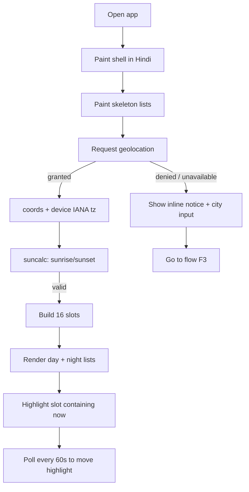
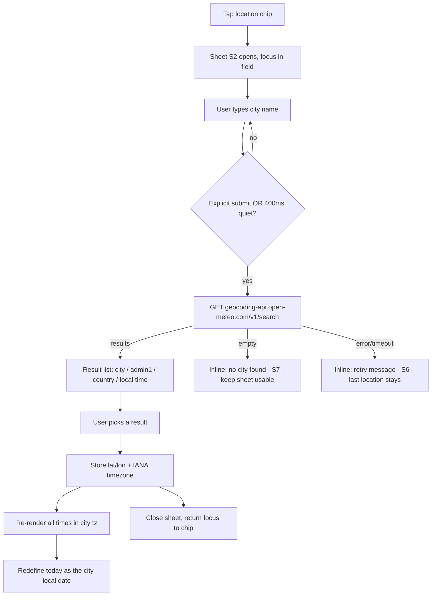
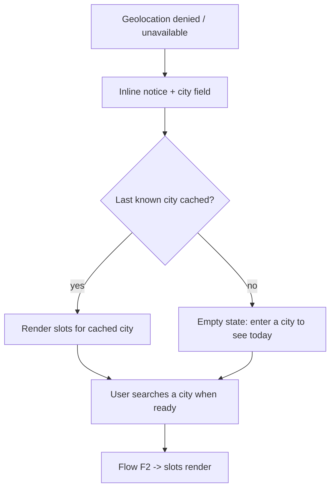
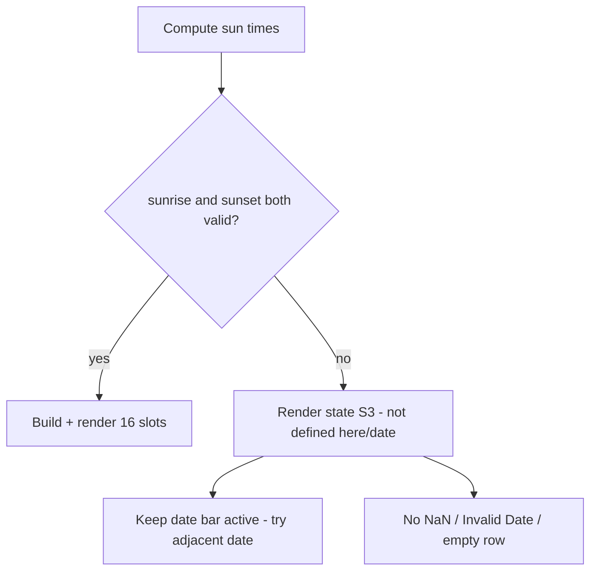
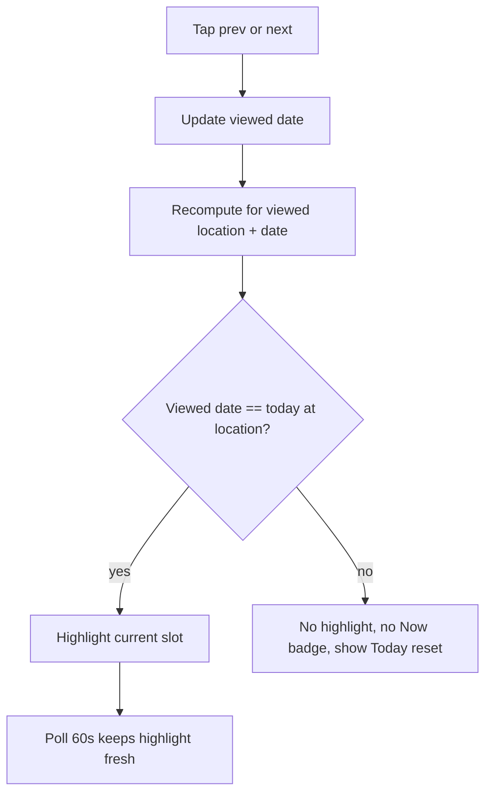
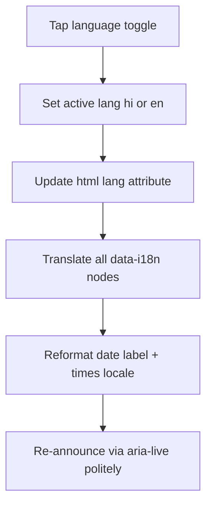
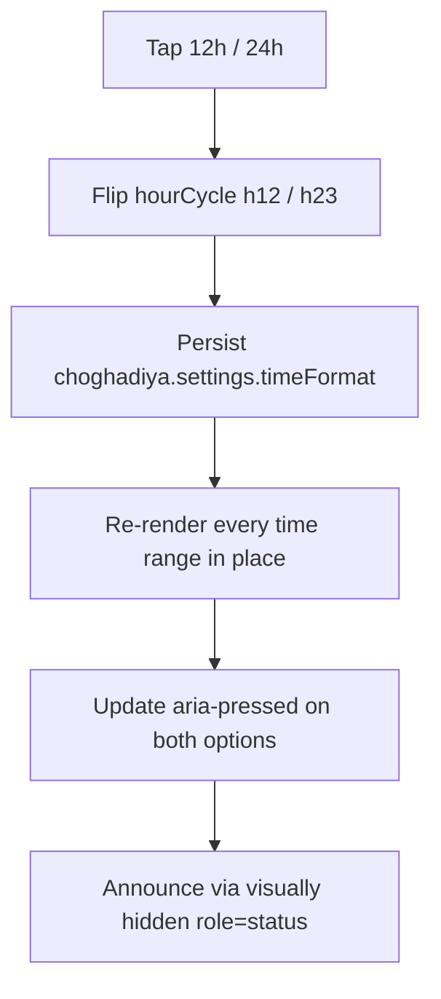
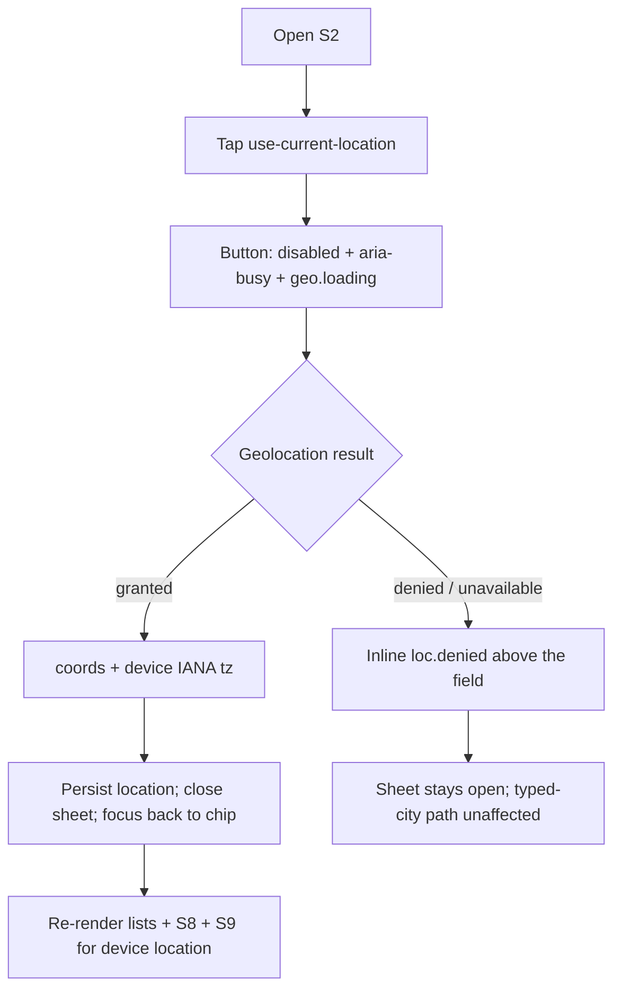
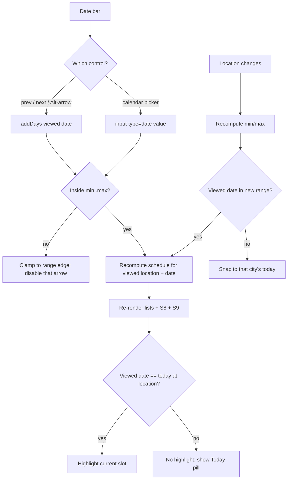

# 03 — UX Specification (flows, screens, design system)

Project: **Choghadiya Refactor** · Owner: ux-designer · Date: 2026-10-14 · Version: **v1.1.2 (v2.3.0 GATE-2 copy fixes — F9/F8/F3, §6.1e)**
Upstream: `docs/00-brief.md` (client intent + 2026-10-14 change log items 1–7), `docs/01-research.md` (§5 pinned algorithm; **§11** inauspicious periods, **§12** choghadiya meanings, **§13** geocoder attribution), `docs/02-prd.md` (US-1..US-19, NFRs), `docs/04-architecture.md` **§16** + `docs/adr/009` (v2.3.0 module contracts), `docs/TEAM_CHARTER.md`.
Downstream: architect (`docs/05-plan.md` §8), frontend-dev (FE-0..FE-6), qa-engineer, security-engineer, `docs/06-threat-model.md`.

**v2.3.0 addendum (this revision).** §6.1 (staged copy deck), §3.8–§3.9 (two new screens: S8 inauspicious periods, S9 detail panel), §3.10 (amendments to S1/S2), §4.7–§4.9 (tokens/contrast/components), §7.2–§7.5 extensions, §9 handoffs. **§6 is the 122-key i18n contract.** The v2.3.0 rows were staged in §6.1 *outside* the parsed §6 block while §6 stayed frozen at 58 keys; the FE-0 card (`t_c62f0530`) has since merged them in one atomic commit — 64 new keys appended to §6 and the two value changes applied in place, so the i18n contract test (`tests/i18n.test.js`, which parses §6 and hard-locks the count) now locks **122** keys. Two §6 rows changed **value** in v2.3.0 (`privacy.line`, `attribution.geocoding`) — see §6.1b; the key count is unaffected by them. **v1.1.2** applies the GATE-2 copy fixes (F9 localStorage-truthful `privacy.line`, F8 attribution hyperlinks, F3 tier-neutral overlap wording) — see §6.1e; §6 stays at **122 keys** with no renames (only three rows' values change).

Design stance: **one screen, three control surfaces (header / today view / city sheet), zero backend.** Mobile-first at 360 px, single column, no horizontal scroll. Hindi is the default language; every string below is specified in both languages.

---

## 1. Information architecture

### 1.1 Sitemap (single route, no navigation depth)

```
/  (index.html — only route; static; no router, no hash state in v1)
├── Header (sticky)
│   ├── Brand + page title            (US-12)
│   ├── Language toggle  [हिं | EN]   (US-11)
│   ├── Time-format toggle [12h|24h]  (CR1, v2.3.0 — §3.10)
│   └── Location chip (opens sheet)   (US-4, US-5)
├── Date bar
│   ├── ‹ previous day                (US-13 AC2)
│   ├── Date label  +  "Today" badge  (US-12, US-13)
│   ├── › next day                    (US-13 AC1)
│   ├── 📅 Calendar picker (native input, ±10 days) (CR4, v2.3.0 — §3.10)
│   └── "आज/Today" reset (conditional) (US-13)
├── Day section  "दिन · Day"  (sunrise → sunset)   8 slot rows  (US-12 AC1)
│   └── sunrise/sunset small print                              (PRD Q3 default)
├── Night section "रात · Night" (sunset → next sunrise)  8 slot rows (US-12 AC1)
├── Inauspicious-periods block (conditional)   S8   (CR5, v2.3.0)
├── Choghadiya detail panel                    S9   (CR6, v2.3.0)
├── Not-defined message (conditional, replaces both sections)   (US-9)
├── Footer
│   ├── Privacy one-liner + geocoder attribution                (US-17; copy replaced in v2.3.0 — §6.1b)
│   └── Sunrise-convention note (±1–2 min)                      (PRD Q6/A2)
└── No-JS message (<noscript>)                                  (NFR-B3)

Overlay (not a route): City search sheet  (US-5, US-8, US-10, US-17 AC1)
                       └── "Use my current location" button  (CR2, v2.3.0 — §3.10)
```

Page order is fixed and matters for §7.2's focus order: **header → date bar → day list → night list → S8 periods block → S9 detail panel → footer**.

### 1.2 Screen inventory

| # | Screen / surface | Type | Card ids | Primary stories |
|---|------------------|------|----------|-----------------|
| S1 | Today view (day + night lists) | page, default | t_e61f3b78 | US-1, US-12, US-14, US-15, US-16 |
| S2 | City search sheet | modal `<dialog>` | t_e61f3b78 | US-5, US-8, US-10, US-17 |
| S3 | Not-defined state (polar / no sunrise) | page state | t_e61f3b78 | US-9 |
| S4 | Loading skeleton | page state | t_e61f3b78 | US-4, NFR-P1 |
| S5 | Geolocation-denied notice (inline banner) | component | t_e61f3b78 | US-8 |
| S6 | Geocoder-failure inline error | component in S2 | t_e61f3b78 | US-10 |
| S7 | No-city-found inline error | component in S2 | t_e61f3b78 | US-5 AC5 |
| S8 | Inauspicious-periods block | section (page) | t_b7dd5ede → FE-5 `t_4d08f3fd` | CR5 (no PRD story — pulled into scope post-v1) |
| S9 | Choghadiya detail panel | section (page) | t_b7dd5ede → FE-6 `t_778b1ea0` | CR6 (no PRD story — pulled into scope post-v1) |

CR*n* = change-log item *n* of `docs/00-brief.md` (2026-10-14 post-release change request, target v2.3.0). US-*n* = `docs/02-prd.md` §5. S8/S9 have no PRD story id because the change request post-dates the PRD; they are traced to CR5/CR6 and to the M5 tickets in `docs/05-plan.md` §8.3 instead.

Everything is CSS/JS state inside one `index.html`. No screen has its own URL in v1 (shareable URLs are explicitly deferred, PRD §4.2).

### 1.3 Element → story traceability (every screen references its stories)

| Element | Stories |
|---------|---------|
| Day list / night list (8 + 8 rows, name + start–end) | US-1, US-12 AC1–AC2, US-3 |
| Date bar prev/next + date label | US-12, US-13 AC1–AC2 |
| "Today" badge | US-12 |
| Current-slot highlight (border + label + aria-current) | US-14 AC1–AC4 |
| Quality word + glyph (never colour-only) | US-15 AC1–AC2, NFR-A2 |
| Language toggle | US-11 AC1–AC5 |
| Location chip + city sheet | US-4, US-5, US-8, US-10 |
| Geolocation-denied banner | US-8 AC1–AC2 |
| Not-defined message | US-9 AC1–AC2 |
| Privacy one-liner + attribution | US-17 AC1–AC3 |
| Sunrise/sunset print + convention note | US-6 AC2, PRD Q3, Q6, A2 |
| Keyboard/focus/labels/landmarks | US-18 AC1–AC4, NFR-A3–A6 |
| Responsive behaviour | US-16 AC1–AC3, NFR-B2 |
| Time-format toggle (12h/24h, default 12h) | CR1 |
| "Use my current location" button | CR2, relates to US-4 AC1–AC2 / US-8 |
| Calendar picker (±10 days, clamped ‹/›) | CR4, relates to US-13 AC1–AC2 |
| Inauspicious-periods block (S8) | CR5 |
| Choghadiya detail panel (S9) — content, tier notes, overlap warning | CR6 |
| Rewritten privacy line + attribution credit | CR3 + CR7, replaces US-17 AC1–AC2 wording |
| Settings/cache persistence disclosure ("local session cache only") | CR7, `adr/009` |
| Row selection ↔ panel (§3 S1 "+ selection") | CR6, replaces the v1.0.1 row-expand disclosure |

---

## 2. User flows

### F1 — First visit with geolocation granted (primary path, P1)

1. User opens `https://time.gitick.com/` on an Android phone.
2. Page paints immediately in **Hindi** with a loading skeleton for the two lists (US-11 AC1, NFR-P1).
3. Browser shows its native geolocation permission prompt (triggered after first paint, never blocking it).
4. User allows. App gets coordinates, resolves device IANA timezone from `Intl.DateTimeFormat().resolvedOptions().timeZone` (US-7 AC3).
5. App computes sunrise/sunset for the location's local date and renders the 16 slots; the slot containing "now" is highlighted (US-14 AC1).
6. User scrolls, reads quality words, optionally toggles to English (US-11 AC2).
7. Highlight refreshes every ≤ 60 s while the tab is visible (PRD Q2 default).



### F2 — Geocoding + resolved location (city lookup, P2)

1. User taps the **location chip** in the header ("📍 मेरी लोकेशन / My location" when geolocated, "📍 शहर चुनें / Choose city" otherwise).
2. Sheet S2 opens with focus in the city field; the privacy one-liner is visible above the field (US-17 AC1).
3. User types ≥ 2 characters. **No request is issued per keystroke** (US-5 AC4). A request fires on explicit submit (Enter / "खोजें / Search"), or after a ≥ 400 ms quiet period following the most recent keystroke — never against Nominatim (research §7).
4. Results list appears: each row shows `City`, `admin1`, `country` and the local time, so a user searching "London" sees which London (US-5 AC1).
5. User selects a result. The app stores `lat`, `lon` and the **returned IANA timezone** and closes the sheet (US-5 AC2).
6. All times re-render in the **searched city's** clock, and "today" is the **city's** local date (US-5 AC3, US-7 AC1, US-3 AC3).
7. The location chip now reads the city name with a "✕" affordance to clear and re-search.



### F3 — Geolocation denied / unavailable (degradation, never a dead end)

1. Permission is denied, times out, or the context is insecure (US-8 AC1–AC2).
2. App does **not** show an error wall. The today view still renders as soon as a location exists (cached last city, if any).
3. An inline notice appears under the header: "लोकेशन उपलब्ध नहीं — शहर लिखें / Location unavailable — enter a city", with the city field directly reachable.
4. User types a city → flow F2 continues from step 3.
5. If no city has ever been chosen, the two lists are replaced by a friendly empty state (S5-empty) that still shows the date bar and the city field.



### F4 — Polar / undefined sunrise or sunset (US-9)

1. Location + date produce `null`/`Invalid Date` sunrise or sunset (latitude ≥ ~66.5° on some dates — research R3).
2. Both list sections are replaced by message S3.
3. **Nothing** renders `NaN`, `Invalid Date`, `undefined` or an empty row (US-9 AC2). The date bar still works, so the user can step to an adjacent date where the sun does rise.
4. Language toggle still works; the message is in both dictionaries.



### F5 — Date navigation & highlight semantics (US-13, US-14 AC3)

1. User taps "‹" / "›". The date label updates and both lists re-render for that date at the **viewed location** (US-13 AC1–AC2).
2. If the viewed date ≠ today at the viewed location, **no** row is marked current, no "अभी / Now" badge is shown, and the aria-current attribute is absent (US-13 AC3, US-14 AC3).
3. Stepping back to the today date restores the highlight automatically.
4. A "आज / Today" reset control appears whenever the viewed date is not today.



### F6 — Language toggle (US-11)

1. Toggle shows `हिं | EN` as a two-option segmented control; the active option has `aria-pressed="true"` / `aria-checked`.
2. Tapping updates **every** string from the dictionary with no reload, targeting < 100 ms (US-11 AC2, NFR-P2).
3. `<html lang>` flips between `hi` and `en` (US-11 AC5).
4. Date formatting switches locale too: `hi-IN` renders `बुधवार, 14 अक्टूबर 2026`; `en-IN` renders `Wednesday, 14 October 2026`. Slot times remain 24-hour in both locales (chosen deliberately — see §7 note).
5. The choice is applied for the session only. **No persistence in v1** (no cookies, NFR-PR3); every new visit starts in Hindi.



### F7 — Time-format toggle (CR1)

1. Header shows two segmented controls side by side: `[हिं | EN]` and `[12h | 24h]` (§3.10 for placement). **12h is the default** on a first visit (`choghadiya.settings.timeFormat`, `adr/009`).
2. Tapping `12h` / `24h` flips a single boolean; every visible time range re-renders in the same pass — both lists (16 rows), the sunrise/sunset small print, the next-sunrise line, the S8 period ranges and the S9 panel range (CR1, CR6).
3. No reload, no re-computation of sunrise/sunset (the underlying `Date` instants never change — only their display), target < 100 ms (NFR-P2). `formatTime(instant, tz, lang, { hourCycle })` is the only formatter; `{ hourCycle: 'h12' }` renders `hh:mm am|pm` and `{ hourCycle: 'h23' }` renders `hh:mm`, **identically in Hindi and English** (verified — `tests/choghadiya.test.js` lines 343–399 pin `'06:32 am'`, `'12:00 am'`, `'12:00 pm'`).
4. The choice is written through `session-store.js` and survives an in-tab reload; it is cleared on tab close unless GATE 2 flips `STORAGE_SCOPE` to `local` (`adr/009`).
5. The active option carries `aria-pressed="true"`; the group carries `aria-label` = `time.toggle.label`.



### F8 — "Use my current location" (CR2)

1. The user opens the location sheet S2 (CR2 button lives at the top of the sheet — §3.10).
2. Tap `loc.useCurrent` → button enters its **requesting** state: disabled, `aria-busy="true"`, label swaps to the existing `geo.loading` ("लोकेशन पता कर रहे हैं… / Finding your location…"), and the sheet stays open (the city field stays usable — a slow fix must never block typing).
3. **Granted**: coordinates + device IANA timezone resolve, the sheet closes, focus returns to the location chip, the chip relabels to `loc.my`, `loc.granted` is announced in the polite live region, and both lists re-render for the device location. A previously stored *typed* location is overwritten.
4. **Denied / unavailable / insecure context**: the button returns to rest and a sheet-local line appears above the field — `loc.denied` (`role="status"`, glyph `ℹ`, not a colour-only cue). The sheet stays open and the typed-city path still works; this is deliberately *not* the page-level `geo.denied` banner, which is about the startup auto-prompt and already tells the user to enter a city.
5. **Idempotent while in flight**: repeated taps do nothing (button disabled); no second `getCurrentPosition` call.
6. A stored location from a previous reload suppresses the *auto*-prompt (FE-1 AC, CR7a) but never this button — the button is the only way to re-request a device fix on demand, and it works after a denied auto-prompt too.



### F9 — Date picking & clamping (CR4, extends F5)

1. Date bar offers **four** controls: `‹`, the formatted date label, `›`, and the 📅 picker (§3.10). `‹`/`›`/`Alt+←`/`Alt+→` behave exactly as F5.
2. The picker's `min`/`max` are the **location civil date −10 / +10 days** (21 selectable days, inclusive), recomputed whenever the location changes.
3. Choosing a date inside the range is identical to stepping to it: label updates, both lists re-render for the viewed location + date, S8 and S9 re-render, and the current-slot highlight is dropped unless the viewed date is today at that location (US-13 AC3, US-14 AC3).
4. At a range edge, the picker's own `min`/`max` clamp the selection and the corresponding `‹` or `›` button renders **disabled** (`disabled` + `aria-disabled="true"` + a visible muted style) so the edge is perceivable without trying it. The Today pill (`date.today`) stays present whenever the viewed date ≠ today.
5. Changing the location re-clamps: if the viewed date is now outside the new ±10 window, the app snaps to that city's **today** (never a silently out-of-range date, never an empty screen).



---

## 3. Screen-by-screen specification

### S1 — Today view (default screen)

**Purpose.** Answer in one glance: *is now good, and when is the next good window, for where I am?* (P1 job story, PRD §2).

**Layout, top to bottom** (mobile 360 px):

```text
┌────────────────────────────────────────────┐
│  ☀ चौघड़िया     [ हिं ][ EN ] [ 12h ][ 24h ]│  header, sticky, 56px
│  📍 मुंबई, महाराष्ट्र  ⌄                     │  v2.3.0: two rows < 600 px (see §3.10)
├────────────────────────────────────────────┤
│  ‹    बुधवार, 14 अक्टूबर 2026    ›   [ 📅 ] │  date bar, 48px
│                [ आज ]                       │  v2.3.0 adds the calendar picker (§3.10)
├────────────────────────────────────────────┤
│  दिन · Day                 सूर्योदय 06:32 am │  day heading + rise (v2.3.0: 12h)
│  ┌──────────────────────────────────────┐  │
│  │ लाभ Labh   06:32 am – 08:00 am   लाभ  │  │  slot row = <li><button>
│  │ ● ─────── ▮ अभी अमृत Amrit 08:00 am –  │  │  current row (2px left border,
│  │                          09:28 am      │  │   "अभी / Now" badge, tinted bg)
│  │ काल Kaal   09:28 am – 10:56 am   हानि  │  │
│  │ शुभ Shubh  10:56 am – 12:25 pm   शुभ   │  │
│  │ … 3 more …                            │  │
│  └──────────────────────────────────────┘  │
│  सूर्यास्त 06:17 pm                        │  small print
├────────────────────────────────────────────┤
│  रात · Night               सूर्यास्त 06:17 pm│
│  (8 rows, same row component, marked रात)  │
│  अगला सूर्योदय 06:33 am                     │
├────────────────────────────────────────────┤
│  अशुभ काल                                │  S8 — §3.8 (v2.3.0)
│  वार वेला        12:24 pm – 01:52 pm       │  name · range · one-line
│    हर वार का दिन का एक निश्चित हिस्सा…      │  explanation per row
│  काल वेला        09:28 am – 10:56 am       │
│  काल रात्रि      03:28 am – 05:00 am       │
│  इन अशुभ कालों में शुभ कार्य शुरू न करें…   │  rule line
│  ये पारंपरिक मान्यताएँ हैं, खगोलीय तथ्य नहीं। │  disclaimer (small print)
├────────────────────────────────────────────┤
│  चौघड़िया का विवरण                        │  S9 — §3.9 (v2.3.0)
│  अमृत · 08:00 am – 09:28 am     [ वर्तमान ]│  heading + badge
│  यह चौघड़िया अभी चल रहा है।                 │  note
│  अर्थ: अमृत का अर्थ है अमृत यानी सर्वोत्तम… │  meaning
│  इसके लिए शुभ: कोई भी शुभ कार्य · यात्रा …  │  good for
│  इससे बचें: इसमें करने से बचने वाला …       │  avoid
│  दिन व रात: दिन और रात दोनों में अमृत शुभ… │  day & night
├────────────────────────────────────────────┤
│  खोजा गया शहर नाम निर्देशांक ढूँढने के लिए  │  privacy one-liner
│  Open-Meteo को भेजा जाता है। सर्वर पर कुछ  │  (rewritten, §6.1b)
│  संग्रहीत नहीं होता…                        │
│  स्थान खोज Open-Meteo द्वारा · डेटा        │  attribution
│  GeoNames से · CC BY 4.0                    │  (rewritten, §6.1b)
│  सूर्योदय/सूर्यास्त गणना ±1–2 मिनट भिन्न हो  │  convention note
│  सकते हैं                                   │
└────────────────────────────────────────────┘
```

**Components.** Header (brand, title, language toggle, **time-format toggle**, location chip) · Date bar (prev, label, next, **calendar picker**, today reset) · Section heading (day/night label + boundary time) · Slot list (`<ol>` of 8 `<li>`, each containing a `<button>` row) · Quality chip (word + glyph) · Current badge · Small print (sunrise/sunset, next sunrise) · **S8 inauspicious-periods block** · **S9 detail panel** · Footer (privacy, attribution, convention).

**Slot row anatomy** (single row = one button, whole row is the tap/keyboard target, min height 56 px):

| Zone | Content | Notes |
|------|---------|-------|
| 1 | Quality tone bar / tint | Decorative; the only colour-coded part |
| 2 | Slot name, both scripts in the active language + transliteration when HI | `लाभ · Labh` when HI, `Labh` when EN |
| 3 | Time range | 24-hour, in the viewed location's tz |
| 4 | Quality word + glyph | `शुभ/Shubh` ✓ ✓✓, `हानि/Neutral` ○, `अशुभ/Inauspicious` ✕ |
| 5 | "अभी / Now" badge | Only when the row is current (US-14) |

> **Row behaviour (v2.3.0 — CR6, replaces the v1.0.1 row-expand disclosure).** Each row is a `<button>` that **selects** the slot into the detail panel S9 (`aria-pressed`, `aria-controls="choghadiya-panel"`): tapping a row shows that choghadiya in the panel, tapping the *same* row again deselects and the panel returns to the live current slot. The v1.0.1 inline expanded meaning line is **removed** — the panel now carries meaning/good-for/bad-for (its content supersedes it, and showing the same copy twice on one screen is worse than one tap). The whole row stays the tap target (min 56 px), and the selected row's visual state is defined in §4.9 and must remain distinct from the `aria-current` "Now" row (§3.9). Full behaviour, states and the off-today "select a slot" prompt: **§3.9**.

**States**

| State | Trigger | What the user sees | Stories |
|-------|---------|--------------------|---------|
| Loading | First paint until location + sun times resolve | Header + date bar interactive; two skeleton blocks of 8 shimmer rows with `aria-busy="true"` on the list container and a visually hidden "लोड हो रहा है / Loading" live region | US-4, NFR-P1 |
| Success (today) | Location known, valid sun times, viewed date = today | 16 rows; current row highlighted with tint + 2 px accent left border + "अभी / Now" badge + `aria-current="true"` | US-12, US-14 AC1 |
| Success (other date) | Viewed date ≠ today | Same rows, no highlight, no badge; "आज / Today" reset pill visible | US-13 AC3, US-14 AC3 |
| Empty (no location yet) | Geolocation denied/unavailable and no cached city | Header + date bar + notice S5 + inline city field; lists replaced by one calm line "आज का चौघड़िया देखने के लिए शहर चुनें / Choose a city to see today's Choghadiya" | US-8 AC1 |
| Not defined | `sunrise`/`sunset` null/Invalid | State S3 replaces both sections; **no** `NaN`, `Invalid Date`, empty row | US-9 AC1–AC2 |
| Error (geocoder) | Search request fails | Inline S6 inside the sheet only; last successful location stays rendered and usable | US-10 AC1 |
| Offline / no network | Core calc needs no network (NFR-P4) | Slots render normally; only city search shows S6 | NFR-P4, US-10 |

**Validation.** The only user input in the app is the city text field: trim whitespace; require ≥ 2 characters; max 64 characters; letters, spaces, `.` `-` `'` and Unicode (Devanagari/Gujarati) allowed — no other restriction, since the field is a query, not an identifier. Reject empty submit silently (button stays enabled, focus returns to field with message "शहर का नाम लिखें / Enter a city name" in the S7 slot).

**UX copy** — see the full bilingual table in §6.

---

### S2 — City search sheet (modal)

**Purpose.** Manual fallback that must be as good as the primary path (US-5, US-8, US-10, US-17 AC1).

**Implementation note for frontend-dev:** use `<dialog>` + `showModal()`; it provides focus containment, backdrop, and Esc-to-close for free. Trap is not hand-rolled. On open, focus moves to the field; on close, focus returns to the location chip (US-18 AC2).

Wireframe:

```text
┌────────────────────────────────────────────┐
│  शहर चुनें / Choose a city            ✕    │
│  ────────────────────────────────────────  │
│  [ 📍 मेरी वर्तमान लोकेशन उपयोग करें ]     │  v2.3.0 CR2 button (full-width, 44px)
│  ℹ खोजा गया शहर नाम निर्देशांक ढूँढने के    │  privacy one-liner
│    लिए Open-Meteo को भेजा जाता है।          │  (rewritten, §6.1b)
│    सर्वर पर कुछ संग्रहीत नहीं होता…         │
│  ┌──────────────────────────────┐ ┌──────┐ │
│  │ लंदन                         │ │खोजें│ │  input + submit (44px each)
│  └──────────────────────────────┘ └──────┘ │
│  • लंदन, England, United Kingdom  02:20 pm │  result row: name, admin1, country,
│  • लंदन, Ontario, Canada         09:20 am  │  city-local time in the CURRENT
│  • London, Kentucky, USA         09:20 am  │  time format (CR1) — disambiguates
│  ────────────────────────────────────────  │
│  बंद करें                                    │
└────────────────────────────────────────────┘
```

**States.** Empty (no query yet: show 3 recent cities from an in-memory session list, no request) · Loading (submit pressed; submit button shows a text+spinner state, `aria-busy="true"`, field stays editable) · Success (result list of up to 8 rows; first row focusable by Tab, `↑/↓` optional but not required) · No results (S7: "कोई शहर नहीं मिला — वर्तनी जाँचें / No city found — check the spelling", sheet stays open and usable) · Error (S6: "खोज नहीं हो सकी। दोबारा कोशिश करें / Search failed. Try again" + a "दोबारा / Retry" button that re-submits the same query).

**Rule the developers must not break:** exactly one network request per explicit submit (or one per 400 ms quiet period). Never a request per keystroke, and **never** type-ahead against Nominatim (US-5 AC4, research §7).

---

### S3 — Not-defined state (polar / no sunrise-sunset)

```text
┌────────────────────────────────────────────┐
│  ‹       बुधवार, 14 अक्टूबर 2026        ›  │   date bar stays live
├────────────────────────────────────────────┤
│         ⓘ  इस जगह और इस तारीख पर            │
│         चौघड़िया उपलब्ध नहीं                 │
│         (यहाँ सूर्योदय/सूर्यास्त नहीं होता)   │
│                                            │
│         Choghadiya is not defined at       │
│         this location/date                 │
│         (no sunrise/sunset occurs here)    │
│                                            │
│         [ ‹ पिछला दिन ]  [ अगला दिन › ]      │   adjacent-date escape hatch
└────────────────────────────────────────────┘
```

Both languages are shown at once here on purpose: a user at 70° N may be reading in a language they did not set, and a single hard failure string is not worth a bug report. No slot row, no `NaN`, no `Invalid Date` (US-9 AC2).

---

### S4 — Loading skeleton

Two blocks of 8 grey rows, 56 px each, `background: var(--surface-2)`, shimmer **disabled** under `prefers-reduced-motion: reduce`. The list container carries `aria-busy="true"` and a visually hidden `<p role="status">लोड हो रहा है / Loading…</p>`. Target: visible within 1.5 s (NFR-P1); the skeleton is not shown at all if location + computation resolve before first paint (the common case, since it is local math).

### S5 — Geolocation-denied notice (inline banner)

```text
ℹ लोकेशन उपलब्ध नहीं — शहर लिखें
  Location unavailable — enter a city            [ शहर चुनें / Choose city ]
```

Presented as `role="status"` (not `role="alert"`) — it is informative, not urgent, and should not interrupt a screen reader mid-sentence. Colour is not the only cue (glyph `ℹ` + text). The action button opens S2 and is a ≥44 px target.

### S6 — Geocoder error (inside S2)

`⚠ खोज नहीं हो सकी। दोबारा कोशिश करें / Search failed. Try again` + `[ दोबारा / Retry ]`. The previously resolved location is untouched and remains rendered behind the sheet (US-10 AC1). `role="alert"` is correct here because the user just acted and expects a result.

### S7 — No city found (inside S2)

`कोई शहर नहीं मिला — वर्तनी जाँचें / No city found — check the spelling`. The field keeps its value, the sheet stays open, the app remains usable (US-5 AC5).

---

### S8 — Inauspicious-periods block (v2.3.0, CR5)

**Purpose.** Answer "are there windows today I should avoid?" for the *viewed date + viewed location*, with the traditional period names and one line of what each means. Post-v1 scope (CR5), so there is no PRD story — the contract lives in `docs/01-research.md` §11 (definitions + per-weekday tables, live-verified against Drik) and `docs/04-architecture.md` §16.2 (`computeInauspicious`).

**Data contract consumed** (FE-5 reads this; it computes nothing itself): `computeInauspicious(dateISO, location)` → `{ defined, reason?, vaarVela, kaalVela, kaalRatri, vaarVelaPeriods, kaalVelaPeriods, kaalRatriPeriods }` — the three scalar fields are the **first** occurrence (`{start,end} | null`, kept for callers that need one), and the three `*Periods` arrays are **every** occurrence (Saturday legitimately has two Kaal Velas and two Kaal Ratris, `docs/01` §11.3). **S8 renders from the `*Periods` arrays** — using the scalars would silently drop Saturday's second window. Polar/undefined sun → `defined:false, reason:'solar-undefined'`; never throws. The engine accepts both `timezone` and `timeZone` on the location object. `overlappingPeriod(slot, periods)` → `'vaarVela' | 'kaalVela' | 'kaalRatri' | null` reads the same arrays (so a slot overlapping Saturday's *second* Kaal Vela is still caught) and is consumed by S9 (§3.9), not by S8.

**Naming rule (must not be broken).** Copy, keys and labels use **Vaar Vela / Kaal Vela / Kaal Ratri** only. Do **not** label them "Yamagandam / Gulika / night Rahu Kaal": per `docs/01` §11.0 that mapping is wrong on 6 of 7 weekdays, and `docs/04` §16.2 repeats the ban. This is an honest-copy requirement, not a style preference.

**Placement.** One full-width block **below the night list and above the detail panel** (§1.1 page order). Rationale: it is a *date-level* fact (not a slot-level one), so it belongs outside the slot lists; and it precedes the detail card because "these windows are avoided" is the more urgent reading of the two. At ≥900 px the period rows become a two-column grid (`grid-template-columns: repeat(2, minmax(0, 1fr))`), the rule line and disclaimer spanning both columns.

**Wireframe (320–599 px, Mumbai fixture 2026-10-14):**

```text
┌────────────────────────────────────────────┐
│  अशुभ काल                                   │  <h2> (same type step as दिन/रात)
│  ┌──────────────────────────────────────┐  │  .period (panel row)
│  │ वार वेला          12:24 pm – 01:52 pm│  │  name (--fs-base 600) + range (current format)
│  │ हर वार का दिन का एक निश्चित हिस्सा —  │  │  explanation (--fs-sm, --text-muted)
│  │ परंपरा में इसमें शुरू किया मांगलिक काम │  │
│  │ फलदायी नहीं माना जाता।                │  │
│  └──────────────────────────────────────┘  │
│  ┌──────────────────────────────────────┐  │
│  │ काल वेला          09:28 am – 10:56 am│  │
│  │ दिन का काल चौघड़िया — वार वेला से भी  │  │
│  │ अधिक अशुभ माना जाता है।               │  │
│  └──────────────────────────────────────┘  │
│  ┌──────────────────────────────────────┐  │
│  │ काल रात्रि        03:28 am – 05:00 am│  │  crosses midnight → date suffix
│  │ · गुरुवार, 15 अक्टूबर 2026           │  │  (--fs-xs, see below)
│  │ रात का लाभ चौघड़िया, जिसे परंपरा काल   │  │
│  │ रात्रि मानकर नई शुभ शुरुआत टालती है।   │  │
│  └──────────────────────────────────────┘  │
│  इन अशुभ कालों में शुभ या मांगलिक कार्य    │  rule line (periods.note)
│  शुरू न करें; यदि कोई अशुभ काल किसी शुभ    │
│  चौघड़िया पर पड़े तो उसे भी टालें।          │
│  ये पारंपरिक मान्यताएँ हैं, खगोलीय तथ्य      │  disclaimer (periods.disclaimer,
│  नहीं।                                      │  --fs-xs, --text-muted)
└────────────────────────────────────────────┘
```

**Row anatomy.**

| Zone | Content | Notes |
|------|---------|-------|
| 1 | Period name (`periods.vaarVela` / `.kaalVela` / `.kaalRatri`) | `--fs-base`, 600; **not** a link, not a button — nothing here is tappable |
| 2 | Time range, in the app's **current time format** and the viewed location's zone | `formatTime(p.start, tz, lang, { hourCycle })`, same formatter as every other time on the page (CR1) |
| 3 | Explanation, one line (`periods.<name>.desc`) | `--fs-sm`, `--text-muted`; wraps to 2–3 lines at 320 px (never truncated) |
| 4 | Civil-date suffix, only when the period ends on a **later** civil date than the viewed date | Only Kaal Ratri can (`docs/01` §11.3). Rendered with the existing exported `formatDate(dateISO + 1, tz, lang)` in `--fs-xs` after a `·`; at 320 px it wraps to its own line. Without it the row reads `03:28 am – 05:00 am`, which a user would place on the wrong night |

**States**

| State | Trigger | What the user sees |
|-------|---------|--------------------|
| Normal | `Inauspicious.defined === true`, all three periods non-null | Heading + 3 rows + rule line + disclaimer |
| Partial | `Schedule.defined === true` but one period is `null` (`docs/01` §11.4: the anchors are evaluated per period, e.g. no `nextSunrise`) | That row shows the period name + `periods.notApplicable` **instead of** a range; the other rows render normally. No empty row, no `NaN`, no `Invalid Date` (US-9 AC2) |
| Not defined (polar) | `Schedule.defined === false` (S3 is showing) | The whole block is **not rendered** — S3 already says Choghadiya is not defined here/date, and a second "not defined" panel would be noise. The heading must not appear alone |
| Loading | Before location + sun times resolve | Block absent (no skeleton of its own); S4's two list skeletons are the page's only loading affordance |
| Saturday (double periods) | Day `"kaal"` twice / night `"labh"` twice (`docs/01` §11.3) | **Resolved at the engine level:** BE-A (`t_ae7c48a6`) already ships `vaarVelaPeriods` / `kaalVelaPeriods` / `kaalRatriPeriods` arrays alongside the first-occurrence scalars. S8 renders **every** interval, so Saturday shows two Kaal Vela rows and two Kaal Ratri rows. Rendering from the scalars would silently drop the second window — do not do it |

**Do not**: compute periods in the UI layer, invent a 4th period (Rahu Kaal is **not** in the `04` §16.2 engine — see §9 open item 1), colour-code the block (it is one shared "avoid" class, `--qual-inauspicious` text on `--surface`, contrast 9.32 / 9.82 — §4.8), or animate it.

---

### S9 — Choghadiya detail panel (v2.3.0, CR6)

**Purpose.** "What is this choghadiya good for, what should I avoid, and does anything bad overlap it?" Default content is the **live/current** choghadiya; tapping a row in either list shows that one (CR6).

**Selection model (the exact interaction contract).**

| Action | Result |
|--------|--------|
| Page load / reload (today at the viewed location) | Panel shows the **current** choghadiya, no tap needed; `panel.badge.current` visible; selection is **never persisted** (reload always returns to current — `adr/009`: `viewedDate` and selection are not stored) |
| Tap a slot row (other than the current one) | Panel re-renders for that slot; that row gets the selected visual state (§4.9); the live row keeps `aria-current="true"` + the "अभी / Now" row badge (exclusive to the live slot, unchanged from US-14) |
| Tap the **same** row again | Selection clears; panel returns to the current slot; `panel.note.tapAgain` disappears |
| Tap the row that *is* current, while another is selected | Panel returns to the current slot (same as deselecting) |
| Viewed date ≠ today at the viewed location | **No** slot is current, so the panel opens with the neutral prompt `panel.selectPrompt`; the first tap shows that slot; there is no auto-selected default |
| Date / location / language / time-format change | Panel re-renders from the new state: today → back to current; off-today → back to the prompt (selection does not survive a date change) |
| Slot boundary crossed while the page is open (US-14 AC4) | If the panel was showing the (previously) current slot it follows the new current slot; if the user had explicitly selected another slot, the selection is kept — the poll must not yank the panel away from an explicit choice |

**Placement.** Full-width card below the S8 block and above the footer (CR6 says "below the slot list"; §1.1 fixes its exact position relative to S8). Selected row → panel is a *same-page* update; the panel is **not** scrolled into view automatically (no surprise motion, and at 320 px the 16-row list plus the panel rarely fit on one screen anyway). Because the row button carries `aria-controls="choghadiya-panel"`, a screen-reader user can jump straight to it, and the panel's `role="status"` line announces the update.

**Wireframe — default (current slot), Mumbai fixture:**

```text
┌────────────────────────────────────────────┐
│  चौघड़िया का विवरण            [ वर्तमान ]   │  <h2> + panel.badge.current
│  अमृत · 08:00 am – 09:28 am                │  name · range (current time format)
│  यह चौघड़िया अभी चल रहा है।                 │  panel.note.current
│  ──────────────────────────────────────    │
│  अर्थ                                       │  panel.label.meaning
│  अमृत का अर्थ है अमृत यानी सर्वोत्तम — …    │  panel.amrit.meaning
│  इसके लिए शुभ                               │  panel.label.goodFor
│  कोई भी शुभ कार्य · यात्रा · व्यापार …      │  panel.amrit.goodFor
│  इससे बचें                                  │  panel.label.badFor
│  इसमें करने से बचने वाला कोई विशेष काम …    │  panel.amrit.badFor
│  दिन व रात                                 │  panel.label.nuance
│  दिन और रात दोनों में अमृत शुभ माना जाता है।│  panel.amrit.nuance
└────────────────────────────────────────────┘
```

**Wireframe — overlap warning variant** (inserted directly under the name/range line, above the tier note; the ⚠ is paired with text, never colour-only):

```text
┌────────────────────────────────────────────┐
│  चौघड़िया का विवरण            [ वर्तमान ]   │
│  रोग · 12:25 pm – 01:53 pm                 │
│  ⚠ इस चौघड़िया के भीतर वार वेला पड़ रही है  │  panel.note.overlay.vaarVela
│    — इस समय शुभ काम शुरू न करें।            │  (.kaalVela / .kaalRatri variants)
│  यह अशुभ चौघड़िया है — …                    │
```

The warning line is emitted when `overlappingPeriod(slot, inauspicious)` returns a slug — i.e. the **selected slot's interval contains or overlaps a period interval** (§16.2 half-open containment). It is shown for *any* selected slot, not only auspicious ones (a Rog slot overlapped by Kaal Vela still gets the warning; the copy is neutral about the slot's own tier). The key is chosen by the returned slug: `panel.note.overlay.<slug>`. There is deliberately **no** `{period}` interpolation key — see §6.1 note 5. The copy is deliberately **tier-neutral** (F3, §6.1e): it names the slot, never calls it शुभ / "otherwise-good", because the warning fires for auspicious, neutral and inauspicious slots alike.

**Wireframe — off-today, nothing selected:**

```text
┌────────────────────────────────────────────┐
│  चौघड़िया का विवरण                          │  no badge (nothing is current today)
│  विवरण देखने के लिए कोई चौघड़िया चुनें      │  panel.selectPrompt (neutral, --text-muted)
└────────────────────────────────────────────┘
```

**Wireframe — user-selected non-current slot:** as the default variant but **without** `panel.badge.current`, with `panel.note.tapAgain` in place of `panel.note.current`, and the tier note (`panel.note.auspicious` / `.neutral` / `.inauspicious`) always present.

**Field labels are always visible.** `panel.label.*` render as small (`--fs-xs`, `--text-muted`, uppercase-ish when EN) headings above each value; the values are `--fs-base` for `goodFor` / `badFor` (they are the actionable lines), `--fs-sm` for `meaning` / `nuance`. `goodFor` / `badFor` arrive as **one string each**, items separated by ` · ` (U+00B7) — render them as one wrapping paragraph, optionally as a `<ul>` by splitting on ` · ` (splitting is allowed, re-wording is not — `docs/01` §12.1).

**States**

| State | Trigger | What the user sees |
|-------|---------|--------------------|
| Current (default, today) | View is today at the viewed location | Badge + `panel.note.current` + tier note + 4 content fields; the live row also shows "अभी / Now" |
| Selected (today) | User tapped a non-current row | No badge; `panel.note.tapAgain`; tier note; selection visual state on that row |
| Off-today, nothing selected | Viewed date ≠ today | `panel.selectPrompt` only (no badge, no tier note, no fields) |
| Off-today, selected | User tapped a row | Full content for that slot + tier note + `panel.note.tapAgain`; still no `aria-current` anywhere (US-14 AC3) |
| Overlap | `overlappingPeriod()` returns a slug for the shown slot | Warning line under the name/range (§above) |
| Not defined (polar) | `Schedule.defined === false` | Panel not rendered (S3 owns the screen); the row buttons do not exist either |

**Accessibility.** The panel is a `<section aria-labelledby="panel-h">` with `<h2 id="panel-h">` = `panel.heading`. It is **not** an `aria-live` region (a whole card announcing itself on every tap is noise); instead a visually hidden `<p role="status">` carries `panel.status.updated` after a selection change. The panel exposes no interactive control other than the slot rows — no close button, no tabs (less is more; deselect by re-tapping the row or reloading). Focus never moves to the panel on tap (the user keeps their place in the list).

---

### S10 — v2.3.0 amendments to S1 and S2 (CR1, CR2, CR4)

Three new controls attach to screens that already exist. Everything else in S1/S2 stands.

**(a) Time-format toggle (CR1) — header, adjacent to the language toggle.**

Both toggles are the same component (`.segmented`: a `role="group"` holding 2 `min 44 × 44` options with `aria-pressed`), so the header reads as a small settings cluster: `[हिं | EN] [12h | 24h]`. Placement, justified: the two controls are the same *kind* of thing (a display preference applied instantly, pinned for the session), the user who wants 12h is often the user who just switched language, and keeping them adjacent means one scan of one corner. The card left this to UX; no other placement was as cheap.

```text
320–599 px                                  ≥600 px
┌────────────────────────────────────┐     ┌──────────────────────────────────────────────┐
│ ☀ चौघड़िया   [हिं|EN] [12h|24h]   │     │ ☀ चौघड़िया    [हिं|EN] [12h|24h]   📍 मुंबई ⌄ │
│ 📍 मुंबई, महाराष्ट्र ⌄             │     └──────────────────────────────────────────────┘
└────────────────────────────────────┘
```

| | Behaviour |
|---|---|
| Semantics | `<div class="segmented" role="group" aria-label="समय प्रारूप / Time format">` with two `<button type="button" aria-pressed="true|false">` options |
| Active state | `aria-pressed="true"` + `--brand` fill + `--brand-contrast` text (7.31:1 light / 9.42:1 dark, §4.8); never colour-only (a pressed state is *also* announced) |
| Optional a11y name | `time.h12.a11y` / `time.h24.a11y` (`12-hour format` / `24-hour format`) as the option `aria-label`, because "12h" alone is terse for a screen reader |
| Effect | Re-renders **every** time on the page in place: 16 slot ranges, sunrise/sunset small print, next-sunrise line, S8 period ranges (+ date suffix), S9 range, and the S2 result-row city times (CR1) |
| Default | `12h` on a first visit; then the stored `choghadiya.settings.timeFormat` |
| Widths | Two options ≈ 90 px (measured, both languages, §4.9); the label text is identical in HI and EN, so the control never changes width on a language switch |

**Measured header geometry** (headless Chromium, `Emulation.setDeviceMetricsOverride`, Devanagari strings, `--fs-xl` brand):

| Viewport | Header | Layout | Brand | Language toggle | Time toggle | Location chip | Horizontal scroll |
|---|---|---|---|---|---|---|---|
| 320 px | 103 px (2 rows) | brand + both toggles / chip | 91 px | 90 × 46 | 90 × 46 | 288 × 44 (own row) | **none** (`scrollWidth 320 = clientWidth 320`) |
| 360 px | 103 px (2 rows) | same | 91 px | 90 × 46 | 90 × 46 | 328 × 44 | none |
| 420 px | 103 px (2 rows) | same | 91 px | 90 × 46 | 90 × 46 | 388 × 44 | none |
| 600 px | 55 px (1 row) | all four on one row | 233 px | 90 × 46 | 90 × 46 | 131 × 44 | none |

So: **one header row is not possible below ~600 px** — brand + both toggles already need 287 of the 288 px available at 320 px (measured), leaving no room for the chip, which then wraps to its own row. The chip must never be squeezed onto that row (it would truncate to `📍…`). Non-negotiable consequence, and the reason §7.5 gets a 320 px header check.

**Sticky budget.** With both rows sticky the chrome would be 212 px at 320 px (37 % of a 320 × 568 viewport) — unacceptable. Therefore, **below 600 px the header is not sticky and the date bar is sticky at `top: 0`** (109 px worst case, 19 %); at ≥600 px the existing single sticky block (55 + 61 = 116 px) is kept. The date bar is the control the user works with *while reading slots* (prev/next/today/picker); the header is identity + rare settings. If QA finds the pinned date bar still too tall, the fallback is `position: static` on it too (one line).

**(b) "Use my current location" (CR2) — inside S2, as its first control.**

```text
┌────────────────────────────────────────────┐
│  शहर चुनें / Choose a city            ✕    │
│  ────────────────────────────────────────  │
│  [ 📍 मेरी वर्तमान लोकेशन उपयोग करें ]     │  44 px tall, full width, --brand fill
│  ℹ खोजा गया शहर नाम निर्देशांक ढूँढने के …   │  privacy.line (rewritten, §6.1b)
│  ┌────────────────────────┐  ┌──────┐      │
│  │ लंदन                   │  │खोजें│      │
│  └────────────────────────┘  └──────┘      │
│  • लंदन, England, …  02:20 pm              │
```

| | Behaviour |
|---|---|
| Placement justification | The sheet is the *one* place the user goes to change location, so both ways to do it (device fix / typed city) live together, and the button works identically after a denied auto-prompt, an unavailable/insecure context, or a stored-location load. It is **not** duplicated on the chip: the chip's tap target is already the sheet opener and its label is the city name, and a second, differently-behaving tap zone inside a 44 px pill is a mis-tap generator. One entry point, one state machine, one string |
| Rest state | Full-width button, `min-height 44 px`, `--brand` fill, `--brand-contrast` text, leading `📍` (`aria-hidden`), label `loc.useCurrent` |
| Requesting | `disabled` + `aria-busy="true"`, label → existing `geo.loading`; the sheet stays open and the city field stays editable (a slow GPS fix must never block typing) |
| Granted | Sheet closes, focus returns to the location chip, chip → `loc.my`, `loc.granted` announced politely, whole page re-renders (lists + S8 + S9), stored typed location overwritten |
| Denied / unavailable | `loc.denied` appears directly above the city field as `role="status"` (glyph `ℹ`; `--danger` is **not** used — this is not an error, the typed path still works). Button returns to rest, still tappable (the user may have just fixed a permission) |
| Re-tap while in flight | No-op (button is disabled) |
| Focus order in the sheet | title → **use-current button** → city field → submit → results → close. Focus-on-open still lands in the **city field** (unchanged from v1.0.1 — typing a city is the sheet's primary purpose); the button is one `Shift+Tab` away |
| Interaction with the auto-prompt | The auto-prompt on first load is unchanged. A stored location suppresses the *auto*-prompt only (`adr/009`, FE-1); this button always re-requests |

**(c) Calendar date picker (CR4) — the date label itself is the picker.**

CTO decision to honour: a native `<input type="date">`, `min`/`max` = **location civil date ±10 days** (21 days inclusive), styled to the tokens, kept accessible. Design decision on top of it: the **formatted date label in the date bar is the picker's trigger**, rather than a separate icon button. Reasons: (1) at 320 px there is no room for a 4th 44 px control without truncating the date (measured: 4 controls leave the label 132 px, and the Hindi date needs 161–198 px); (2) the label is the natural affordance for "change the date", and it already has the 44 px hit area budget; (3) one control, not two, means one focus stop and one a11y name.

```text
┌──────────────────────────────────────────────┐
│  ‹   बुधवार, 14 अक्टूबर 2026  ⌄   ›          │  row 1: nav · label(=picker) · nav
│                  [ आज ]                      │  row 2: Today pill, only when ≠ today
└──────────────────────────────────────────────┘
```

```html
<div class="datebar">
  <button class="nav" aria-label="पिछला दिन">‹</button>
  <span class="picker-field">
    <label class="dlabel" id="date-label" for="datepicker">बुधवार, 14 अक्टूबर 2026</label>
    <span class="caret" aria-hidden="true">⌄</span>
    <input class="picker-input" id="datepicker" type="date"
           aria-label="तारीख चुनें" aria-describedby="date-label"
           min="2026-10-04" max="2026-10-24" value="2026-10-14">
  </span>
  <button class="nav" aria-label="अगला दिन">›</button>
  <button class="today-pill" hidden>आज</button>
</div>
```

| | Spec |
|---|---|
| Native input | `type="date"`, `min`/`max` from the location civil date ±10 (`addDays(today, ∓10)`), `value` = viewed date. The native control supplies the picker UI, the keyboard behaviour (`↑/↓`/typing) and the clamping for free |
| Styling | `.picker-input{position:absolute; inset:0; width:100%; height:100%; opacity:0; cursor:pointer}` inside `.picker-field{position:relative; flex:1 1 0; min-width:0}` — the input is transparent and exactly overlays the label, so a tap anywhere on the date text opens the native picker. The native input must **not** be `display:none`/`visibility:hidden` (that would remove it from the a11y tree and from clickability) |
| Visible text | Our own `formatDate()` output (locale-correct Hindi/English, long weekday form) — never the native `yyyy-mm-dd` or the browser's own short format, so the label stays identical on Android/iOS/desktop |
| A11y name | `<input aria-label="date.picker.label">` ("तारीख चुनें" / "Choose a date") + `aria-describedby` → the visible label span, so a screen reader hears "Choose a date, बुधवार, 14 अक्टूबर 2026" and still gets the native date semantics |
| Focus ring | `.picker-field:has(.picker-input:focus-visible) .dlabel{outline:2px solid var(--focus); outline-offset:2px}` — the ring is drawn on the visible label, because the focused element is transparent. `:has()` is supported in every browser in NFR-B1's scope |
| Focus order | `language toggle → time-format toggle → location chip → ‹ → date label/picker → › → Today pill → 16 row buttons → …` (the pill only exists when visible) |
| Range hint | `date.picker.range` as an extra `aria-describedby` target, rendered as `--fs-xs` `--text-muted` small print under the date bar at ≥600 px only (at 320 px it stays screen-reader-only, to keep the pinned chrome short) |
| Edge clamping | `min`/`max` clamp the native picker; simultaneously `‹` is `disabled` at `min` and `›` at `max` (`disabled` + `aria-disabled="true"`, `--text-muted` text, no hover fill) so the edge is perceivable without trial. `Alt+←/→` (already documented) clamps through the same code path |
| Location change | Recompute `min`/`max`; if the viewed date falls outside, snap to that city's today (§2 F9 step 5) |
| Fallback | If a target browser fights the overlay (e.g. an OS picker that will not open from a label click), the sanctioned fallback is a visible, token-styled native input replacing the label span on that browser only — never a custom JS calendar (scope, a11y cost) |

**Measured date-bar geometry** (worst case: Today pill visible, Hindi date, headless Chromium):

| Viewport | Date bar height | Date label | Picker hit area | Horizontal scroll |
|---|---|---|---|---|
| 320 px | 109 px (label row 44 + pill row 44 + padding) | 161 × 24 px at `--fs-base` (16 px, no truncation) | 184 × 44 px | none |
| 360 px | 109 px | 161 × 24 | 224 × 44 | none |
| 419 px | 109 px | 161 × 24 | 283 × 44 | none |
| 420 px | 109 px | 198 × 30 at `--fs-xl` (20 px) | 284 × 44 | none |
| 600 px | 61 px (pill inline) | 198 × 30 | 400 × 44 | none |
| 1280 px | 61 px | 198 × 30 | 1080 × 44 | none |

The label steps down from `--fs-xl` to `--fs-base` at ≤419 px because the 20 px Hindi date needs 198 px and the ≤419 px layout only affords 184 px at 320 px; the alternative — letting the label wrap to two lines inside a pinned bar — costs more vertical space than the 4 px of type it saves. `flex: 1 1 0` on `.picker-field` is load-bearing: with `flex-basis:auto` the field's intrinsic width pushes `›` onto its own row at 320 px (measured: date bar 157 px instead of 109 px).

**(d) 12-hour default (CR1) — what actually renders.** `formatTime(..., { hourCycle: 'h12' })` output is `hh:mm am|pm` — **Latin digits and ASCII `am`/`pm` in both languages**, no Devanagari `पूर्वाह्न/अपराह्न`, no locale divergence (verified: `tests/choghadiya.test.js` lines 343–399 pin `'06:32 am'`, `'12:00 am'`, `'12:00 pm'`, and `/^[0-9]{2}:[0-9]{2} [ap]m$/` for both `hi` and `en`). The `am`/`pm` token comes from `Intl` inside the formatter, exactly like the digits and the `:` — it is **not** dictionary copy and needs no i18n key. This supersedes §8's closing note ("Times are shown 24-hour in both locales"), which was the v1.0.1 rationale; the toggle now exists and 12h is the default.

---

## 4. Design system

Tokens are the contract for `style.css`. Values are given in hex; the light theme is the default, the dark theme is applied by `@media (prefers-color-scheme: dark)` **and** by an explicit `[data-theme="dark"]` hook so the architect can decide whether to expose a manual switch (v1: follow the OS; no manual switch, to keep scope tight).

### 4.1 Colour tokens

| Token | Light | Dark | Use |
|-------|-------|------|-----|
| `--bg` | `#FAF7F2` | `#121212` | Page background (warm off-white / near-black) |
| `--surface` | `#FFFFFF` | `#1E1E1E` | Cards, slot list panel, sheet |
| `--surface-2` | `#F1ECE3` | `#262626` | Skeleton rows, date-bar rail, hover fill |
| `--text` | `#1A1A1A` | `#ECECEC` | Body text |
| `--text-muted` | `#5C5C5C` | `#ADADAD` | Times, small print, boundaries |
| `--border` | `#E2DACE` | `#333333` | Row separators, sheet edges |
| `--brand` | `#9A3412` | `#F0A868` | Header accents, primary button fill |
| `--brand-contrast` | `#FFFFFF` | `#1A0F08` | Text on `--brand` |
| `--day-accent` | `#7A2C0E` | `#FFB59A` | "दिन / Day" section heading |
| `--night-accent` | `#1F3A6E` | `#A9C6FF` | "रात / Night" section heading |
| `--qual-auspicious` | fg `#0F5132` / bg `#E3F1E6` | fg `#9FE7B4` / bg `#12331F` | Shubh, Labh |
| `--qual-amrit` | fg `#0B3D62` / bg `#E1EEF9` | fg `#A9D6FF` / bg `#0E2A44` | Amrit (top tier, distinct from the other auspicious pair) |
| `--qual-neutral` | fg `#6B3A00` / bg `#FDF0DC` | fg `#FFD9A3` / bg `#3A2A12` | Char |
| `--qual-inauspicious` | fg `#8A1B1B` / bg `#FCE9E7` | fg `#FFB4AB` / bg `#3B1A1A` | Udveg, Kaal, Rog |
| `--current-bg` | `#FFE8D6` | `#4A2A10` | Current slot row fill |
| `--current-fg` | `#7A2C0E` | `#FFD9A3` | Current slot accent text/border |
| `--focus` | `#9A3412` | `#8FB4FF` | Focus ring (2 px solid + 2 px offset) |
| `--danger` | `#8A1B1B` | `#FFB4AB` | Inline error text |

**Colour is never the only signal** (US-15 AC1, NFR-A2). Tiers are additionally carried by the quality word and a glyph: `✓✓ Amrit`, `✓ Shubh/Labh`, `○ Char`, `✕ Udveg/Kaal/Rog`. Script-ready text glyphs are used deliberately in preference to emoji so rendering is identical across Android, iOS and desktop.

### 4.2 Contrast verification (computed, not assumed)

All text pairs below were computed with the WCAG relative-luminance formula (`L = 0.2126R + 0.7152G + 0.0722B` on linearised sRGB) and **all 32 pairs pass** — 30 text pairs at ≥ 4.5:1 and 2 focus-ring pairs at ≥ 3:1 (NFR-A3). Lowlights from the run:

| Pair | Ratio | Required |
|------|-------|----------|
| `--text` on `--bg` (light) | 16.29 | 4.5 |
| `--text-muted` on `--surface-2` (light, worst muted case) | 5.68 | 4.5 |
| Quality inauspicious (light) | 7.97 | 4.5 |
| `--text` on `--bg` (dark) | 15.86 | 4.5 |
| `--text-muted` on `--surface-2` (dark, worst case) | 6.74 | 4.5 |
| `--current-fg` on `--current-bg` (light) | 8.10 | 4.5 |
| `--focus` on `--bg` (light) | 6.84 | 3.0 (UI) |
| `--focus` on `--bg` (dark) | 9.05 | 3.0 (UI) |

The verification script is reproducible: `/Users/vishu/.hermes/profiles/ux-designer/cache/scratch/contrast2.py` (32 pairs, `FAILS: 0`). Frontend-dev should re-run it if any token value changes.

### 4.3 Type scale

Base 16 px; Hindi needs more line-height and slightly more size than Latin at the same nominal px, so Devanagari sizes up within the same step.

| Token | Size / line-height | Weight | Use |
|-------|--------------------|--------|-----|
| `--font-family` | `system-ui, -apple-system, "Segoe UI", Roboto, "Noto Sans Devanagari", "Nirmala UI", sans-serif` | 400 | Body; the Devanagari fallbacks are explicit so Hindi never falls back to tofu on Windows/older Android |
| `--fs-2xl` | 28 / 1.25 (HI 32 / 1.35) | 700 | Page title in the header |
| `--fs-xl` | 20 / 1.3 | 600 | Section heading "दिन · Day", date label |
| `--fs-lg` | 18 / 1.4 | 600 | Slot name when HI (Devanagari needs the extra step) |
| `--fs-base` | 16 / 1.5 | 400–600 | Slot name EN, times, controls, inputs |
| `--fs-sm` | 14 / 1.5 | 400 | Quality word, day/night marker |
| `--fs-xs` | 12 / 1.4 | 400 | Sunrise/sunset small print, footer, privacy line |

Fonts are system fonts only — **no webfont, no external font request** (keeps NFR-P1/P3 and NFR-PR1 intact; a Google Fonts call would add a third-party origin and a render-blocking dependency).

### 4.4 Spacing & radii

4 px base grid: `--sp-1` 4 · `--sp-2` 8 · `--sp-3` 12 · `--sp-4` 16 · `--sp-5` 20 · `--sp-6` 24 · `--sp-8` 32 · `--sp-12` 48.
Radii: `--r-sm` 6 px (chips) · `--r-md` 10 px (rows, buttons) · `--r-lg` 16 px (panel, sheet) · `--r-full` 999 px (pills, badges).
Elevation: one shadow token only, `0 1px 2px rgba(0,0,0,.06), 0 4px 12px rgba(0,0,0,.05)`; dark theme uses `0 1px 2px rgba(0,0,0,.4)`.

### 4.5 Components (spec → CSS class)

| Component | Class | Spec |
|-----------|-------|------|
| Slot list | `.slot-list` | `<ol>`, `list-style: none`, panel with `--surface`, `--r-lg`, dividers `--border` |
| Slot row | `.slot` | 56 px min-height, 3-zone grid (`1fr auto auto`), 16 px inline padding; hover/active fill `--surface-2`; whole row is a `<button>` with `text-align: start` |
| Slot row — current | `.slot[aria-current="true"]` | `--current-bg` fill, 2 px inset left border in `--current-fg`, `--current-fg` for the badge text |
| Quality chip | `.quality` | Pill, 14 px, `--fs-sm`, tinted bg per tier, leading glyph |
| Now badge | `.badge-now` | Pill, 12 px, uppercase-ish, `अभी / Now`, on `--current-bg` |
| Language toggle | `.lang-toggle` | Two-option segmented control, each option min 44 × 44 px, `aria-pressed`, active option filled `--brand` |
| Location chip | `.loc-chip` | Pill button, min-height 44 px, leading 📍, trailing `⌄`, ellipsised city name at 320 px |
| Date bar | `.datebar` | Grid `auto 1fr auto`, 48 px, prev/next buttons 44 × 44 px with `aria-label`s, label centred `--fs-xl` |
| Today pill | `.today-pill` | Appears only when the viewed date ≠ today; `--brand-contrast` on `--brand` |
| Skeleton row | `.skeleton` | 56 px, `--surface-2`, animated only when `prefers-reduced-motion: no-preference` |
| Inline notice | `.notice` | `role="status"`, `--surface-2`, 12 px, glyph + text + optional action button |
| Inline error | `.error` | `role="alert"`, `--danger` text on `--surface`, 12 px |
| Sheet | `dialog.sheet` | `::backdrop` `rgba(0,0,0,.4)`, panel `--surface`, `--r-lg` top corners only on mobile (bottom sheet under 600 px, centred card above) |

### 4.6 Motion

Two transitions only: sheet enter/exit (200 ms ease-out, transform + opacity) and slot-row background on date change (150 ms). **Everything wrapped in `@media (prefers-reduced-motion: no-preference)`.** No transition is ever required to understand state (nothing animates the current-slot marker — it is present or absent). The v2.3.0 surfaces add **no** new transition (S8 and S9 appear/update in place; the detail panel's content swap is instantaneous, matching the < 100 ms interaction budget).

### 4.7 Token additions (v2.3.0)

Only two new colour tokens; everything else reuses §4.1 exactly (a new colour has to earn its contrast check).

| Token | Light | Dark | Use |
|-------|-------|------|-----|
| `--selected-bg` | `#EFE6D9` | `#2A2A2A` | Fill of the **selected** (but not current) slot row — §3.9 selection state |
| `--selected-border` | `#9A3412` | `#F0A868` | 2 px **all-round** inset ring on the selected row (same value as `--brand`, named separately so the two states cannot be confused in code) |

Reused as-is, deliberately: `--brand` / `--brand-contrast` (segmented-control active option, "use my current location" button, Today pill) · `--qual-inauspicious` (S8 period names + the S9 overlap warning) · `--current-bg` / `--current-fg` (§4.9 `.panel__badge` = panel "वर्तमान / Current" badge) · `--surface-2` (hover, picker/label rails) · `--focus`.

`--selected-*` exists because the **selected** state and the **current** state must not be confusable (§3.9, US-14 AC1):
- **current** = `--current-bg` fill + 2 px **left** border in `--current-fg` + visible "अभी / Now" badge + `aria-current="true"`;
- **selected** = `--surface-2`-adjacent `--selected-bg` fill + 2 px **all-round** ring in `--selected-border` + `aria-pressed="true"`, and **no** badge.
Shape (ring vs left bar), badge (present/absent) and ARIA state differ, so the two are distinguishable with colour switched off.

### 4.8 Contrast verification (v2.3.0 addendum — computed, not assumed)

The v1.0.1 run in §4.2 stands (32 pairs, all passing). The v2.3.0 surfaces add these pairs, computed with the same formula and script (see below). **All 22 new pairs pass**; two decorative pairs that do not reach 3:1 are called out honestly.

| Pair | Light | Dark | Required |
|------|-------|------|----------|
| `--text` on `--selected-bg` (selected row name) | 14.08 | 12.15 | 4.5 |
| `--text-muted` on `--selected-bg` (selected row time) | 5.41 | 6.40 | 4.5 |
| `--text` on `--surface-2` (hover fill, date bar) | 14.79 | 12.81 | 4.5 |
| `--text-muted` on `--surface-2` (date bar time) | 5.68 | 6.74 | 4.5 |
| `--brand-contrast` on `--brand` (use-current button, active toggle option) | 7.31 | 9.42 | 4.5 |
| `--qual-inauspicious` fg on its bg (S8 period chip) | 7.97 | 9.17 | 4.5 |
| `--qual-inauspicious` fg on `--surface` (S8 period name, S9 warning text) | 9.32 | 9.82 | 4.5 |
| `--current-fg` on `--current-bg` (S9 "वर्तमान / Current" badge) | 8.10 | 9.64 | 4.5 |
| `--brand` on `--surface` (selected ring, UI component) | 7.31 | 8.34 | 3.0 |
| `--selected-border` on `--bg` (selected ring on the page bg) | 6.84 | 9.37 | 3.0 |
| `--brand` on `--bg` (segmented active fill vs page) | 6.84 | 9.37 | 3.0 |

Two pairs are **below 3:1 and that is intentional** (reported here rather than hidden): `--border` on `--surface` = **1.39** light / **1.32** dark, and the same token between list rows. `--border` is used **only** as a decorative separator between already-distinguishable rows — WCAG 1.4.11 covers boundaries that are *required* to identify a component or state, and no state (current, selected, error, period) depends on `--border`. Rows are separated by structure (separate `<li>`/cards, 56 px height, panel radii) and the interactive states carry their own verified ring. If a future design starts using `--border` to signal a state, this exemption is void and the token must be darkened.

Script (reproducible): `/Users/vishu/.hermes/profiles/ux-designer/cache/scratch/contrast_v230.mjs` — 24 pairs, `FAILS: 2` (the two decorative `--border` pairs above). Frontend-dev / QA should re-run it when a token changes, and must keep the S8/S9 pairs green.

### 4.9 Components added or extended (v2.3.0)

| Component | Class | Spec |
|-----------|-------|------|
| Segmented control (language + time format) | `.segmented` + `.segmented__opt` | `role="group"`; each option `min 44 × 44`, `aria-pressed`, active = `--brand` fill + `--brand-contrast` text + `border-radius: var(--r-md)` on the first/last option. Replaces the v1.0.1 `.lang-toggle` (same visual language, shared class) |
| Date-bar picker field | `.picker-field` | `position: relative; flex: 1 1 0; min-width: 0; display:flex; align-items:center; justify-content:center; min-height: 44px` — the `flex-basis: 0` is required (§3.10c) |
| Date label (picker trigger) | `.dlabel` | `--fs-xl` (20 px) 600 at ≥420 px, `--fs-base` (16 px) 600 at ≤419 px; `white-space: nowrap`; centred; never truncated in the measured layouts |
| Native date input | `.picker-input` | `position:absolute; inset:0; width:100%; height:100%; opacity:0; cursor:pointer; border:0` — must stay focusable/exposed (never `display:none`) |
| Picker focus ring | `.picker-field:has(.picker-input:focus-visible) .dlabel` | `outline: 2px solid var(--focus); outline-offset: 2px` |
| "Use my current location" button | `.btn-locate` | Full width, `min-height: 44px`, `--brand` fill, `--brand-contrast` text, `.btn-locate[aria-busy="true"]` reduces to `--surface-2` + `--text-muted` and `cursor: default` |
| Sheet-local notice (button denial) | `.notice--sheet` | Same as `.notice` (`role="status"`, `--surface-2`, `--fs-xs`) but placed inside `dialog.sheet` above the field |
| Inauspicious-periods block | `.periods` | `--surface` panel, `--r-lg`, one `--sp-4` padding; `<h2>` heading; rows `.period` = `--surface-2` card, `--r-md`, `grid-template-columns: 1fr` (name+range on line 1 via a nested `1fr auto` grid, explanation on line 2) |
| Period name / range | `.period__name` / `.period__range` | `--fs-base` 600 / `--fs-base` 400 `--text-muted`, range right-aligned on ≥420 px, wraps under the name at 320 px |
| Period explanation | `.period__desc` | `--fs-sm`, `--text-muted`, `line-height: 1.5` |
| Periods rule + disclaimer | `.periods__note` / `.periods__disclaimer` | `--fs-sm` / `--fs-xs` + `--text-muted` |
| Period "not applicable" | `.period__na` | `--fs-sm` italic-free `--text-muted`; occupies the range's slot |
| Detail panel | `.panel` | `--surface`, `--r-lg`, `--sp-4`–`--sp-5` padding, `<section aria-labelledby>`; fields separated by `--border` 1 px rules |
| Panel badge | `.panel__badge` | `--r-full` pill, `--fs-xs`, `--current-fg` on `--current-bg` (8.10 / 9.64) |
| Panel field label / value | `.panel__label` / `.panel__value` | `--fs-xs` `--text-muted` 600 (label) / `--fs-base` `goodFor`+`badFor`, `--fs-sm` `meaning`+`nuance` (value) |
| Overlap warning | `.panel__warn` | `role="note"`, `--qual-inauspicious` text on `--surface`, leading `⚠` (`aria-hidden`), 2 px left border in the same colour, `--fs-sm` |
| Selected slot row | `.slot[aria-pressed="true"]` | `--selected-bg` fill + 2 px **all-round** inset ring in `--selected-border`; hover uses `--surface-2` so hover ≠ selected |
| Visually hidden status | `.status-sr` | The existing visually-hidden utility; used for `panel.status.updated` and S8/S9 announcements |

---

## 5. Responsive behaviour

Breakpoints: `--bp-sm` 600 px · `--bp-md` 900 px · `--bp-lg` 1200 px. Content max-width 640 px, centred; mobile is the primary target (US-16 AC1–AC3, NFR-B2).

| Width | Layout | Notes |
|-------|--------|-------|
| 320–419 px (floor band) | Single column; slot row collapses to **two zones**: name on line 1, time on line 2, quality chip right-aligned | US-16 AC3 floor; no horizontal scroll; header allows the location chip to truncate. The collapse threshold is **420 px, not 360 px**, because the English tier words ("✓✓ Most auspicious") overflow the three-zone grid at 360–390 px — measured, see §10 |
| 420–599 px (primary) | Single column, full 3-zone slot rows, bottom sheet for city search, sticky header 56 px | US-16 AC1 — one-handed reach: all controls live in the top 56 px or are single-column and short |
| 600–899 px | Single column, sheet becomes a centred card; date bar and header land on the same visual row | Desktop-ish width, still one reading column |
| 900–1199 px | Two-column **slot area** (day and night side by side), container widens to 960 px max | Side-by-side day/night is the one place wide screens earn their space; keep the reading column comfortable per list |
| ≥1200 px | Max-width 960 px, two-column day/night, generous outer margin | US-16 AC2 — centred, not stretched; never full-bleed tables |

Touch targets: all interactive controls ≥ 44 × 44 CSS px (NFR-A5). Text zoom: layout survives 200 % zoom without loss of content or function (NFR-A6) — the two-column layout collapses to one at ≥ 200 % via the same 900 px rule.

**v2.3.0 additions to the band table** (measured, §3.10):

| Width | What changes |
|-------|--------------|
| 320–419 px (floor band) | Date label drops to `--fs-base` (16 px) inside the picker; header is **two** rows (brand + both toggles / location chip); S8 period rows are single-column with the range wrapping under the name; S9 fields are single-column, all four labels stacked. No horizontal scroll (measured at 320 px: `scrollWidth == clientWidth`) |
| 420–599 px | Same two-row header and single-column S8/S9, but the date label returns to `--fs-xl` and the S8 range right-aligns next to the name |
| 600–899 px | Header collapses to **one** row (all four controls); date bar 61 px with the Today pill inline |
| 900–1199 px | S8 becomes a two-column period grid (`repeat(2, minmax(0,1fr))`, rule + disclaimer spanning); S9 stays a single reading column (its values are sentences, not data rows) |
| ≥1200 px | Unchanged from v1.0.1 (960 px max, two-column slot area); S8 grid caps at two columns |

Sticky chrome: ≥600 px = header + date bar in one sticky block (116 px measured); <600 px = header is **not** sticky and the date bar is (109 px worst case with the Today pill) — see §3.10's sticky-budget paragraph for the measurement and the fallback.

---

## 6. UX copy (bilingual dictionary — the contract for i18n)

Hindi strings are the default-rendered ones; English is the toggle. Every user-facing string in the app appears in this table — the frontend must implement the dictionary with these exact keys, and QA can use this table as the 100 %-coverage source for M4 (US-11 AC3).

| Key | Hindi (hi, default) | English (en) | Where |
|-----|---------------------|--------------|-------|
| `app.title` | चौघड़िया | Choghadiya | Header |
| `app.subtitle` | आज का शुभ मुहूर्त | Today's auspicious timings | Header (visually hidden at < 360 px) |
| `lang.toggle.label` | भाषा | Language | Toggle `aria-label` |
| `lang.hi` | हिं | हिं | Toggle option (same in both languages) |
| `lang.en` | EN | EN | Toggle option (same in both languages) |
| `loc.my` | मेरी लोकेशन | My location | Location chip when geolocated |
| `loc.choose` | शहर चुनें | Choose city | Location chip when not geolocated |
| `loc.change` | लोकेशन बदलें | Change location | Chip `aria-label` |
| `loc.clear` | लोकेशन हटाएँ | Clear location | Chip trailing ✕ `aria-label` |
| `date.prev` | पिछला दिन | Previous day | `aria-label` on ‹ |
| `date.next` | अगला दिन | Next day | `aria-label` on › |
| `date.today` | आज | Today | Reset pill + badge on the date label |
| `section.day` | दिन | Day | Day heading |
| `section.night` | रात | Night | Night heading |
| `section.rise` | सूर्योदय | Sunrise | Small print |
| `section.set` | सूर्यास्त | Sunset | Small print |
| `section.nextRise` | अगला सूर्योदय | Next sunrise | Night small print |
| `slot.now` | अभी | Now | Current-slot badge |
| `quality.amrit` | अमृत | Amrit | Slot name + quality |
| `quality.shubh` | शुभ | Shubh | Slot name + quality |
| `quality.labh` | लाभ | Labh | Slot name + quality |
| `quality.char` | चर | Char | Slot name + quality (canonical EN key per PRD A3) |
| `quality.rog` | रोग | Rog | Slot name + quality |
| `quality.kaal` | काल | Kaal | Slot name + quality |
| `quality.udveg` | उद्वेग | Udveg | Slot name + quality |
| `tier.auspicious` | शुभ | Auspicious | Quality tier word |
| `tier.mostAuspicious` | सर्वश्रेष्ठ | Most auspicious | Amrit tier word |
| `tier.neutral` | सामान्य | Neutral | Char tier word |
| `tier.inauspicious` | अशुभ | Inauspicious | Tier word |
| `meaning.amrit` | यात्रा, व्यापार, शुभ कार्य के लिए सर्वोत्तम | Best for travel, business, auspicious work | Row expand |
| `meaning.shubh` | पूजा, विवाह, धार्मिक कार्य के लिए शुभ | Good for worship, weddings, religious work | Row expand |
| `meaning.labh` | व्यापार, धन, अध्ययन के लिए शुभ | Good for business, trade, finance, learning | Row expand |
| `meaning.char` | यात्रा, दैनिक कार्य के लिए सामान्य | Neutral — travel, routine work | Row expand |
| `meaning.rog` | विवाद, बीमारी; नए काम से बचें | Avoid conflict, illness; don't start new work | Row expand |
| `meaning.kaal` | हानि, देरी; नए काम से बचें | Loss, delay; avoid new starts | Row expand |
| `meaning.udveg` | चिंता; केवल सरकारी काम | Anxiety; only government work | Row expand |
| `city.sheetTitle` | शहर चुनें | Choose a city | Sheet heading |
| `city.fieldLabel` | शहर का नाम | City name | Input `aria-label` / `<label>` |
| `city.placeholder` | जैसे: लंदन, जयपुर | e.g. London, Jaipur | Input placeholder (not the only label) |
| `city.submit` | खोजें | Search | Submit button |
| `city.retry` | दोबारा | Retry | S6 button |
| `city.close` | बंद करें | Close | Sheet close button |
| `city.noResults` | कोई शहर नहीं मिला — वर्तनी जाँचें | No city found — check the spelling | S7 |
| `city.error` | खोज नहीं हो सकी। दोबारा कोशिश करें | Search failed. Try again | S6 |
| `city.required` | शहर का नाम लिखें | Enter a city name | Field validation |
| `city.resultsCount` | {n} परिणाम मिले | {n} results found | Live region after search |
| `geo.denied` | लोकेशन उपलब्ध नहीं — शहर लिखें | Location unavailable — enter a city | S5 notice |
| `geo.loading` | लोकेशन पता कर रहे हैं… | Finding your location… | S4 status |
| `empty.noLocation` | आज का चौघड़िया देखने के लिए शहर चुनें | Choose a city to see today's Choghadiya | S1 empty state |
| `undefined.polar` | इस जगह और इस तारीख पर चौघड़िया उपलब्ध नहीं | Choghadiya is not defined at this location/date | S3 |
| `undefined.reason` | यहाँ सूर्योदय/सूर्यास्त नहीं होता | no sunrise/sunset occurs here | S3 detail |
| `undefined.tryAdjacent` | पिछला दिन | Previous day | S3 escape hatch |
| `loading.status` | लोड हो रहा है | Loading | Visually hidden `role="status"` |
| `privacy.line` | खोजा गया शहर नाम निर्देशांक ढूँढने के लिए Open-Meteo को भेजा जाता है। सर्वर पर कुछ संग्रहीत नहीं होता — सेटिंग्स इस ब्राउज़र में बिना किसी समाप्ति के रहती हैं; हाल की खोजें और कैश किए गए परिणाम 24 घंटे बाद हट जाते हैं। | Your searched city name is sent to Open-Meteo to find coordinates. No server storage — settings stay in this browser with no expiry; recent searches and cached results expire after 24 hours. | Location sheet + footer (**F9 rewrite**, §6.1e: localStorage scope — settings no-expiry, cache 24 h TTL) |
| `attribution.geocoding` | स्थान खोज Open-Meteo द्वारा · डेटा GeoNames से · CC BY 4.0 | Location search by Open-Meteo · Data from GeoNames · CC BY 4.0 | Footer, one line (licence-mandatory — cannot be dropped; **F8: 3 hyperlinks, DOM-built per §6.1e**) |
| `convention.note` | सूर्योदय/सूर्यास्त की गणना में ±1–2 मिनट का अंतर संभव है | Sunrise/sunset may differ by ±1–2 min from a printed panchang | Footer (US-6 AC2, PRD Q6) |
| `footer.noTracking` | कोई अकाउंट नहीं · कोई ट्रैकिंग नहीं · कोई बैकएंड नहीं | No account · no tracking · no backend | Footer (US-17 AC3, NFR-PR1/PR3) |
| `noscript` | इस ऐप को चलाने के लिए JavaScript चालू करें | Please enable JavaScript to use this app | `<noscript>` (NFR-B3) |
| `time.toggle.label` | समय प्रारूप | Time format | Time-toggle group `aria-label` (§3.10a) |
| `time.h12` | 12h | 12h | Time-toggle option, both languages identical (§3.10a) |
| `time.h24` | 24h | 24h | Time-toggle option, both languages identical (§3.10a) |
| `time.h12.a11y` | 12 घंटे का प्रारूप | 12-hour format | Option `aria-label` (screen readers) |
| `time.h24.a11y` | 24 घंटे का प्रारूप | 24-hour format | Option `aria-label` (screen readers) |
| `loc.useCurrent` | मेरी वर्तमान लोकेशन उपयोग करें | Use my current location | S2 button, rest state (§3.10b) |
| `loc.granted` | लोकेशन मिल गई | Location found | Polite `role="status"` announcement after a granted fix |
| `loc.denied` | लोकेशन की अनुमति नहीं मिली — शहर लिखें या ब्राउज़र में अनुमति दें | Location permission denied — type a city or allow it in your browser | Sheet-local `role="status"` line above the city field |
| `date.picker.label` | तारीख चुनें | Choose a date | Date-picker `aria-label` (§3.10c) |
| `date.picker.range` | आज से 10 दिन पहले से 10 दिन बाद तक चुन सकते हैं | You can pick from 10 days before to 10 days after today | Picker `aria-describedby` hint (visible `--fs-xs` at ≥600 px) |
| `periods.heading` | अशुभ काल | Inauspicious periods | S8 `<h2>` (§3.8) |
| `periods.vaarVela` | वार वेला | Vaar Vela | S8 period name |
| `periods.kaalVela` | काल वेला | Kaal Vela | S8 period name |
| `periods.kaalRatri` | काल रात्रि | Kaal Ratri | S8 period name |
| `periods.vaarVela.desc` | हर वार का दिन का एक निश्चित हिस्सा — परंपरा में इसमें शुरू किया मांगलिक काम फलदायी नहीं माना जाता। | A fixed part of the day set by the weekday — tradition holds that ceremonial work begun in it is unfruitful. | S8 row explanation (`docs/01` §11.1) |
| `periods.kaalVela.desc` | दिन का काल चौघड़िया — वार वेला से भी अधिक अशुभ माना जाता है। | The day's Kaal choghadiya — considered more adverse than Vaar Vela. | S8 row explanation (`docs/01` §11.1) |
| `periods.kaalRatri.desc` | रात का लाभ चौघड़िया, जिसे परंपरा काल रात्रि मानकर नई शुभ शुरुआत टालती है। | The night's Labh choghadiya, which tradition treats as Kaal Ratri and avoids for new auspicious beginnings. | S8 row explanation (`docs/01` §11.1) |
| `periods.note` | इन अशुभ कालों में शुभ या मांगलिक कार्य शुरू न करें; यदि कोई अशुभ काल किसी शुभ चौघड़िया पर पड़े तो उसे भी टालें। | Do not begin auspicious or ceremonial work during these periods; if one falls inside a good choghadiya, avoid that too. | S8 rule line (Drik's own wording, `docs/01` §11.1) |
| `periods.disclaimer` | ये पारंपरिक मान्यताएँ हैं, खगोलीय तथ्य नहीं। | These are traditional beliefs, not astronomical facts. | S8 small print (`docs/01` §11.7 recommendation 6) |
| `periods.notApplicable` | इस तारीख पर लागू नहीं | Not applicable on this date | S8 row when the period is `null`/undefined, in place of a range |
| `panel.heading` | चौघड़िया का विवरण | Choghadiya details | S9 `<h2>` (§3.9) |
| `panel.badge.current` | वर्तमान | Current | S9 badge, shown only while the panel shows the live slot |
| `panel.label.meaning` | अर्थ | Meaning | S9 field label |
| `panel.label.goodFor` | इसके लिए शुभ | Good for | S9 field label |
| `panel.label.badFor` | इससे बचें | Avoid | S9 field label |
| `panel.label.nuance` | दिन व रात | Day & night | S9 field label |
| `panel.selectPrompt` | विवरण देखने के लिए कोई चौघड़िया चुनें | Select a choghadiya to see its details | S9 body, off-today dates before any tap |
| `panel.note.tapAgain` | उसी चौघड़िया को दोबारा टैप करने पर आप वर्तमान चौघड़िया पर लौट आएँगे | Tap the same choghadiya again to return to the current one | S9 hint, when the shown slot is not the live one |
| `panel.note.current` | यह चौघड़िया अभी चल रहा है। | This choghadiya is running now. | S9 note under the heading (live slot) |
| `panel.note.auspicious` | यह शुभ चौघड़िया है — नया या मांगलिक काम शुरू करने के लिए अच्छा समय है। | This is an auspicious choghadiya — a good time to begin new or ceremonial work. | S9 tier note (Amrit, Shubh, Labh) |
| `panel.note.neutral` | यह सामान्य चौघड़िया है — यात्रा और रोज़मर्रा के कामों के लिए ठीक है। | This is a neutral choghadiya — fine for travel and routine work. | S9 tier note (Char) |
| `panel.note.inauspicious` | यह अशुभ चौघड़िया है — नए या मांगलिक काम की शुरुआत टालें; जो काम चल रहा है वह जारी रखा जा सकता है। | This is an inauspicious choghadiya — avoid beginning new or ceremonial work; work already underway may continue. | S9 tier note (Rog, Kaal, Udveg) |
| `panel.status.updated` | चौघड़िया का विवरण अपडेट हुआ | Choghadiya details updated | Visually hidden `role="status"` on selection change |
| `panel.note.overlay.vaarVela` | इस चौघड़िया के भीतर वार वेला पड़ रही है — इस समय शुभ काम शुरू न करें। | Vaar Vela falls inside this choghadiya — do not begin auspicious work now. | S9 overlap warning, when `overlappingPeriod()` returns `'vaarVela'` (**F3: tier-neutral** — fires for any slot, §6.1e) |
| `panel.note.overlay.kaalVela` | इस चौघड़िया के भीतर काल वेला पड़ रही है — इस समय शुभ काम शुरू न करें। | Kaal Vela falls inside this choghadiya — do not begin auspicious work now. | S9 overlap warning, `'kaalVela'` (**F3: tier-neutral**, §6.1e) |
| `panel.note.overlay.kaalRatri` | इस रात के चौघड़िया के भीतर काल रात्रि पड़ रही है — इस समय शुभ काम शुरू न करें। | Kaal Ratri falls inside this night choghadiya — do not begin auspicious work now. | S9 overlap warning, `'kaalRatri'` |
| `panel.amrit.meaning` | अमृत का अर्थ है अमृत यानी सर्वोत्तम — चंद्रमा का यह चौघड़िया सबसे शुभ माना जाता है, और इसमें शुरू किया गया काम अमृत जैसा मीठा व स्थायी फल देता है। | Amrit means "nectar" — ruled by the Moon, it is the most auspicious choghadiya, and a beginning made in it is said to give lasting, nectar-sweet results. | S9 `panel.label.meaning` value |
| `panel.amrit.goodFor` | कोई भी शुभ कार्य · यात्रा · व्यापार व हस्ताक्षर · दुकान या दफ़्तर का उद्घाटन · खरीदारी · पूजा-पाठ व मांगलिक कार्य · विवाह, सगाई व गृह प्रवेश | any auspicious work · travel · business and signing · opening a shop or office · purchases · worship and ceremonies · weddings, engagements and house-warming | S9 `panel.label.goodFor` value |
| `panel.amrit.badFor` | इसमें करने से बचने वाला कोई विशेष काम परंपरा में नहीं बताया गया; एकमात्र सावधानी यह है कि यदि इसी समय राहु काल, वार वेला, काल वेला या काल रात्रि पड़े तो शुभ कार्य टालें। | No activity is traditionally ruled out here; the one real caution is that an inauspicious overlay (Rahu Kaal, Vaar Vela, Kaal Vela or Kaal Ratri) cancels this window. | S9 `panel.label.badFor` value |
| `panel.amrit.nuance` | दिन और रात दोनों में अमृत शुभ माना जाता है। रात का अमृत ध्यान-साधना, शांति पाठ और मांगलिक चर्चा के लिए विशेष रूप से उत्तम कहा गया है; भोर का अमृत ब्रह्म मुहूर्त का समय है। | Amrit is auspicious in both halves. The night Amrit is singled out for meditation, sadhana, peace chanting and auspicious discussions, and the pre-dawn Amrit is the classic Brahma Muhurta hour. | S9 `panel.label.nuance` value |
| `panel.shubh.meaning` | शुभ का अर्थ है मंगलकारी। गुरु (बृहस्पति) के स्वामित्व वाला यह चौघड़िया संस्कार, पूजा और शुभ अवसरों के लिए अत्यंत उपयुक्त माना जाता है। | Shubh means "auspicious" — ruled by Jupiter, it is held to be most suitable for sacraments, worship and fortunate occasions. | S9 `panel.label.meaning` value |
| `panel.shubh.goodFor` | पूजा व धार्मिक अनुष्ठान · विवाह, सगाई व मुंडन · गृह प्रवेश व भूमि पूजन · विद्यारंभ और पढ़ाई · व्रत-उपवास का आरंभ · परिवार से जुड़े शुभ निर्णय | worship and religious rituals · weddings, engagements and mundan · house-warming and bhumi pujan · beginning education · starting vows or fasts · auspicious family decisions | S9 `panel.label.goodFor` value |
| `panel.shubh.badFor` | कोई कठोर निषेध नहीं, पर व्यापार-लेन-देन के लिए लाभ और यात्रा के लिए चर या अमृत को प्राथमिकता दी जाती है; अशुभ काल से टकराव पर शुभ कार्य टालें। | No hard prohibition, but trade and transactions traditionally prefer Labh and travel prefers Char or Amrit; an inauspicious overlay still cancels it. | S9 `panel.label.badFor` value |
| `panel.shubh.nuance` | दोनों अर्धों में शुभ शुभ ही रहता है; रात के शुभ को आध्यात्मिक कार्य और अगले दिन की योजना बनाने के लिए अच्छा बताया गया है। | Shubh stays auspicious in both halves; the night Shubh is described as good for spiritual work and for planning the next day. | S9 `panel.label.nuance` value |
| `panel.labh.meaning` | लाभ का अर्थ है प्राप्ति या मुनाफ़ा। बुध के स्वामित्व वाला यह चौघड़िया व्यापार, धन और विद्या से जुड़ी शुरुआतों के लिए शुभ माना जाता है। | Labh means "gain" — ruled by Mercury, it is the choghadiya of profit, trade and learning. | S9 `panel.label.meaning` value |
| `panel.labh.goodFor` | नया व्यापार या उद्यम · नया खाता, निवेश या लेन-देन · नौकरी और साक्षात्कार · पढ़ाई या कोर्स का आरंभ · खरीद-बिक्री व अनुबंध · हिसाब-किताब और बिक्री | starting a business or venture · opening an account, investing, transactions · jobs and interviews · beginning study or a course · buying, selling and contracts · accounts and sales | S9 `panel.label.goodFor` value |
| `panel.labh.badFor` | विवाह या पूजा जैसे मांगलिक कार्यों के लिए यह पहली पसंद नहीं माना जाता (उनके लिए अमृत या शुभ); राहु काल या काल वेला जैसे अशुभ काल से टकराव पर शुभ कार्य टालें। | Not the first choice for ceremonials such as weddings or worship (those prefer Amrit or Shubh); an inauspicious overlay (Rahu Kaal, Kaal Vela) still cancels it. | S9 `panel.label.badFor` value |
| `panel.labh.nuance` | दोनों अर्धों में शुभ; रात के लाभ को व्यापारिक हिसाब-किताब और योजना बनाने के लिए अनुकूल बताया गया है। | Auspicious in both halves; the night Labh is described as favourable for business accounts and planning. | S9 `panel.label.nuance` value |
| `panel.char.meaning` | चर का अर्थ है चलता हुआ यानी गतिशील। शुक्र के स्वामित्व वाला यह चौघड़िया यात्रा और गमन के लिए सर्वोत्तम है, और बाकी कामों के लिए सामान्य-से-अच्छा माना जाता है। | Char means "moving" — ruled by Venus, it is the classic window for travel and movement, and neutral-to-good for everything else. | S9 `panel.label.meaning` value |
| `panel.char.goodFor` | यात्रा का आरंभ · वाहन खरीदना या चलाना · स्थान बदलना · बैठकें · नियमित रोज़मर्रा के काम · कला, संगीत और नृत्य | starting a journey · buying or running a vehicle · relocation · meetings · routine everyday work · art, music and dance | S9 `panel.label.goodFor` value |
| `panel.char.badFor` | स्थायी या दीर्घकालीन कामों तथा विवाह व गृह प्रवेश जैसे मांगलिक कार्यों के लिए यह पहली पसंद नहीं है — उनके लिए अमृत या शुभ चुनें। | Not the first choice for permanent, long-term commitments or for ceremonies such as weddings and house-warming — those prefer Amrit or Shubh. | S9 `panel.label.badFor` value |
| `panel.char.nuance` | दिन का चर चार शुभ चौघड़ियों में गिना जाता है, और रात का चर भी यात्रा व गतिशील कामों के लिए उपयुक्त बताया जाता है — कुछ पंचांग इसे रात में सामान्य कहते हैं, वर्जित नहीं। | Day Char is counted among the four good windows, and night Char is also used for travel and movement — some panchangs call it neutral at night, never forbidden. | S9 `panel.label.nuance` value |
| `panel.rog.meaning` | रोग का अर्थ है बीमारी। मंगल के स्वामित्व वाला यह चौघड़िया अशुभ है; इसमें शुरू किया गया काम बीमारी, अड़चन या विवाद ला सकता है। | Rog means "disease" — ruled by Mars, it is inauspicious; work begun here is said to bring illness, obstruction or conflict. | S9 `panel.label.meaning` value |
| `panel.rog.goodFor` | शत्रु पर विजय और प्रतिस्पर्धा · वाद-विवाद, बहस और विवाद निपटाना · खेल या मुकाबले · (कुछ मत) युद्ध या आपात शल्य चिकित्सा | defeating enemies and competition · arguments, debate and dispute settlement · sports and contests · (some schools) warfare or emergency surgery | S9 `panel.label.goodFor` value |
| `panel.rog.badFor` | विवाह, पूजा, गृह प्रवेश, यात्रा, नया व्यापार या निवेश और हस्ताक्षर — किसी भी शुभ या मांगलिक कार्य की शुरुआत | weddings, worship, house-warming, travel, new business or investment and signing — any auspicious or ceremonial beginning | S9 `panel.label.badFor` value |
| `panel.rog.nuance` | दोनों अर्धों में अशुभ; रात के रोग में शारीरिक कष्ट और तनाव से बचकर आराम करने की सलाह है, और किसी भी पंचांग में इसकी अशुभता घटती नहीं बताई गई। | Inauspicious in both halves; the night Rog is described as a time to rest and avoid stress, and no source consulted lifts the ban on new beginnings. | S9 `panel.label.nuance` value |
| `panel.kaal.meaning` | काल का अर्थ है समय या मृत्यु। शनि के स्वामित्व वाला यह चौघड़िया अशुभ है — देरी, हानि और बाधा का समय, जिसमें नए शुभ काम वर्जित माने जाते हैं। | Kaal means "time/death" — ruled by Saturn, it is inauspicious, associated with delay, loss and obstruction, so auspicious beginnings are avoided. | S9 `panel.label.meaning` value |
| `panel.kaal.goodFor` | धन संचय, बचत और निवेश · उधार चुकाना और दीर्घकालीन योजना · पहले से चल रहे काम को आगे बढ़ाना · कुछ परंपराएँ इसे पितृ कार्य या श्राद्ध के लिए स्वीकार करती हैं | accumulating wealth — savings and investments · repaying loans and long-term planning · continuing work already underway · some traditions accept it for ancestor rites (pitru karma / shraddh) | S9 `panel.label.goodFor` value |
| `panel.kaal.badFor` | यात्रा · विवाह व अन्य मांगलिक कार्य · नया काम या उद्घाटन · हस्ताक्षर · जोखिम भरे निवेश के निर्णय | travel · weddings and other ceremonials · new ventures or openings · signing · risky investment decisions | S9 `panel.label.badFor` value |
| `panel.kaal.nuance` | दोनों में अशुभ; रात के काल में नए समझौते या रात्रिकालीन शुरुआत से बचने की सलाह है, और दिन के काल में जोखिम भरे काम से धन हानि का भय बताया जाता है। | Inauspicious in both halves; the night Kaal is specifically flagged for not making new agreements or starting anything overnight, while the day Kaal carries the traditional fear of financial loss. | S9 `panel.label.nuance` value |
| `panel.udveg.meaning` | उद्वेग का अर्थ है बेचैनी या घबराहट। सूर्य के स्वामित्व वाला यह चौघड़िया अशुभ है; कहा जाता है कि इस समय किए काम में मानसिक तनाव और अड़चनें बढ़ती हैं। | Udveg means "agitation" — ruled by the Sun, it is inauspicious; work done in it is said to increase mental stress and friction. | S9 `panel.label.meaning` value |
| `panel.udveg.goodFor` | सरकारी और प्रशासनिक काम · सरकारी दफ़्तर या अधिकारियों से भेंट · अधिकार या नियम-कायदे से जुड़े काम | government and administrative work · visiting government offices or officials · work that needs authority or official process | S9 `panel.label.goodFor` value |
| `panel.udveg.badFor` | विवाह, पूजा और गृह प्रवेश जैसे मांगलिक कार्य · नया व्यापार या उद्घाटन · यात्रा और निवेश · घरेलू शुभ कार्य | ceremonials such as weddings, worship and house-warming · new business or openings · travel and investment · auspicious domestic work | S9 `panel.label.badFor` value |
| `panel.udveg.nuance` | दोनों में अशुभ; रात के उद्वेग में मानसिक तनाव और घरेलू विवादों से बचने तथा जल्दबाज़ी न करने की सलाह दी जाती है। | Avoided in both halves; the night Udveg is advised specifically for staying clear of mental tension and domestic disputes, and for not rushing anything. | S9 `panel.label.nuance` value |

Notes for implementers:
- `lang.hi` / `lang.en` are intentionally identical in both dictionaries — the toggle must never relabel itself into an unreadable state.
- The 7 slot names follow PRD A3: **Char** (EN) / **चर** (HI). No Gujarati "Chal" variant in v1.
- Placeholder text is never the only label (US-18 AC4).
- **v1.1.2 gate fixes (§6.1e).** `privacy.line` and `panel.note.overlay.vaarVela` / `.kaalVela` carry new values (localStorage-truthful disclosure; tier-neutral overlap warning). Every other row — including `attribution.geocoding`, whose visible text is unchanged — keeps its value; the key count stays **122** and no key was renamed. FE-FIX applies the new values to `i18n.js` and to the `index.html` `hi` fallbacks; until it lands, `tests/i18n.test.js`'s byte-equality assertion is expected to be red.
- **`attribution.geocoding` must render as three real hyperlinks** built with DOM APIs (never `innerHTML`/`data-i18n-html`) — href table + segmentation rule in **§6.1e**. The concatenated `textContent` stays byte-equal to the dictionary value in both languages.

---

## 7. Accessibility notes (WCAG 2.2 AA)

### 7.1 Structure, semantics, landmarks

```html
<html lang="hi">                     <!-- flips to "en" on toggle — US-11 AC5 -->
  <header>  banner — brand, h1, language toggle, location chip
  <main>
    <section aria-labelledby="day-h">   <h2 id="day-h">दिन · Day</h2>  <ol>…8 <li>… </ol>
    <section aria-labelledby="night-h"> <h2 id="night-h">रात · Night</h2> <ol>…8 <li>… </ol>
  <footer>  contentinfo — privacy, attribution, convention
```

Exactly one `<h1>` (the brand/title). Section headings are `<h2>`, never styled divs (US-18 AC4). The city sheet is `<dialog>` with `aria-labelledby` pointing at its visible heading.

### 7.2 Keyboard & focus

| Control | Order | Keys |
|---------|-------|------|
| Language toggle (2 options) | 1 | `Tab` in, `←/→` or `Enter/Space` to choose, `aria-pressed` reflects state |
| Time-format toggle (2 options) | 2 | same as the language toggle; `aria-pressed` reflects the active cycle (CR1) |
| Location chip | 3 | `Enter/Space` opens S2 |
| ‹ Previous day | 4 | `Enter/Space`; also `Alt+←` as a documented convenience; `disabled` at the ±10-day range edge (CR4) |
| Date picker (native `<input type="date">`) | 5 | `Enter`/`Space` opens the OS picker; `↑/↓` step a day, `←/→` step within a segment, digits type a date, `Esc` closes the picker; clamped by `min`/`max` (CR4) |
| › Next day | 6 | `Enter/Space`; also `Alt+→`; `disabled` at the range edge |
| Today pill (conditional) | 7 | `Enter/Space` |
| Slot rows × 16 | 8…23 | `Enter/Space` selects the slot into the detail panel (`aria-pressed`, `aria-controls="choghadiya-panel"`); pressing the same row again deselects it. The v1.0.1 inline meaning line is gone (CR6) |
| S8 period rows, S9 panel | — | **Not focusable** — they contain no control (nothing to operate, nothing to tab past) |
| Sheet: use-current button → field → submit → results → close | on open | Focus moves to the **field** (unchanged from v1.0.1); `Shift+Tab` reaches the use-current button; `Esc` closes; `Tab` is contained by `<dialog>`; on close focus returns to the location chip (CR2) |

- Visible focus on **every** interactive element: `outline: 2px solid var(--focus); outline-offset: 2px` — never `outline: none` (US-18 AC2), and never removed for mouse users either (keeps the bar simple and honest).
- No keyboard trap anywhere. `<dialog>` provides containment by design; nothing custom is layered on top.
- Focus is never moved without user action **except** on sheet open/close, where it is required (and returns whence it came).
- The date picker's focus ring is drawn on the **visible date label** (`.picker-field:has(.picker-input:focus-visible) .dlabel`), because the focused element itself is transparent — a focusable-but-invisible control would fail WCAG 2.4.7/2.4.11 (§4.9).
- Focus never moves into the S9 panel on a selection change: the user keeps their position in the list, and the change is announced through the panel's `role="status"` line instead.
- `disabled` `‹`/`›` buttons at the ±10-day edge are inert and out of the tab order by UA behaviour; the range is communicated instead by the picker's `min`/`max`, the `date.picker.range` hint and the muted disabled style — no focus stop that does nothing when activated.

### 7.3 Screen reader behaviour

- Current slot: `aria-current="true"` on the row button plus the visible "अभी / Now" badge, so the state is announced and visible (US-14 AC1).
- Quality is announced as text: the accessible name of a row reads e.g. "अमृत, 08:00 से 09:28, शुभ, अभी" — name, time, tier, current state, in that order.
- The list container is `aria-busy="true"` while loading; a `role="status"` live region announces `loading.status`, then `city.resultsCount` after a search.
- S5 geolocation notice is `role="status"` (polite); S6 geocoder error is `role="alert"` (the user just acted and expects a result). Getting this split wrong either interrupts users or hides a failure.
- Decorative glyphs (📍, ⌄, tone bars) are `aria-hidden="true"`; the meaningful quality glyphs are inside the accessible name as words, not as raw characters.
- The `lang` attribute flips with the toggle so screen readers switch pronunciation (US-11 AC5).

**v2.3.0 additions:**

- **Selection vs current are two different ARIA states.** `aria-current="true"` stays **exclusive** to the live slot (US-14 AC1, untouched); the user's selection is `aria-pressed="true"` on the row button. A row can carry both (when the user selects the live slot) or only one — never conflate them.
- The time-format toggle announces state through `aria-pressed`, exactly like the language toggle; the group has an `aria-label` (`time.toggle.label`), so the two adjacent segmented controls are distinguishable without sight ("Language" vs "Time format").
- The S9 panel is a labelled `region`: `<section aria-labelledby="panel-h">` + its `<h2>` (`panel.heading`). Its field labels are real text (`panel.label.*`) above each value, so a screen reader reads "अर्थ … / इसके लिए शुभ …" rather than an unlabelled paragraph. `goodFor`/`badFor` may be split into `<li>`s on ` · ` — the split must not change a single character of the strings (`docs/01` §12.1).
- The overlap warning is announced with its text (`role="note"`, `⚠` is `aria-hidden`) and placed inside the panel's reading order, directly after the slot name/range.
- A selection change is announced once, politely, by a visually hidden `role="status"` carrying `panel.status.updated`. The panel is deliberately **not** a live region (§3.9) — an entire card re-announcing on every tap is noise.
- The S8 block is announced as a normal section with an `<h2>` (`periods.heading`); its rows are static text (no roles needed). Rows that are `null` read `periods.notApplicable`, so a screen-reader user never hears an empty row or a stray "undefined".
- The date picker's accessible surface is the native input: the name comes from `aria-label` (`date.picker.label`), the current date from `aria-describedby` → the visible label, and the native date semantics supply "date, 2026-10-14" style announcements. The `--fs-xs` range hint is `aria-describedby`-linked at every width (visually at ≥600 px only).
- The "use my current location" button's three states are all announced: requesting → `aria-busy="true"` + the `geo.loading` label; granted → `loc.granted` in the polite status line; denied → `loc.denied` in a `role="status"` line inside the sheet (never `role="alert"` — the user is not blocked, the typed path still works).

### 7.4 Colour, contrast, motion, size

- No state, tier, or action is colour-only (US-15 AC1–AC2): every tier has a word + glyph, the current row has a badge + border + text, errors have a glyph + text.
- Contrast: all 30 text pairs ≥ 4.5:1 and both focus rings ≥ 3:1 — computed, §4.2 (NFR-A3, US-18 AC3).
- Touch targets ≥ 44 × 44 px (NFR-A5, US-16 AC1); slot rows are 56 px.
- 200 % zoom and `text-size-adjust` respected; the layout collapses to one column rather than clipping (NFR-A6).
- All motion is opt-in behind `prefers-reduced-motion`; no information is conveyed by animation.
- Dark mode follows `prefers-color-scheme`; both themes are verified at the same contrast bar.

### 7.5 QC checklist for frontend-dev / QA (maps to US-18 and M7)

1. axe scan: 0 critical/serious — M7.
2. Full tab-through with a visible focus ring on all 23+ interactive elements (16 rows + both toggles' 4 options + chip + 2 date arrows + picker + Today pill).
3. Language toggle updates `<html lang>`, all strings, and the date format with no reload in < 100 ms.
4. Current-row accessible name contains slot name, time range, tier, and "now" when applicable.
5. Sheet: opens with focus in the field, `Esc` closes, focus returns to the chip.
6. 320 px viewport: no horizontal scroll (US-16 AC3).
7. 200 % zoom: no clipped text, no lost control.
8. `prefers-reduced-motion: reduce`: no animation runs.
9. Both themes: re-run the contrast script.
10. Polar case: no `NaN`/`Invalid Date` anywhere in the DOM (US-9 AC2).

**v2.3.0 additions (run these too before v2.3.0's release verdict):**

11. **Time format** (CR1): 12h on a first visit; toggling re-renders all 16 slot ranges, the sunrise/sunset and next-sunrise small print, the S8 period ranges and the S9 range within 100 ms; the S2 result-row times follow the format; the choice survives an in-tab reload; the toggle's `aria-pressed` follows.
12. **Location button** (CR2): visible inside S2; requesting → disabled + `aria-busy`; denied → `loc.denied` above the field and the typed path still works; granted → chip relabels, sheet closes, focus returns to the chip; the button still works after a denied auto-prompt and after a stored-location load; re-taps while in flight issue no second request.
13. **Date picker** (CR4): `min`/`max` = location civil date ∓/±10; picking any of the 21 days re-renders both lists + S8 + S9; `‹` disabled at `min`, `›` disabled at `max`; the label is never truncated at 320/360/390/420 px; a **keyboard-only** run can change the date with the picker (not just the arrows); changing the location re-clamps and snaps out-of-range dates to the new "today".
14. **S8 periods** (CR5): Mumbai 2026-10-14 shows Vaar Vela 12:24 pm – 01:52 pm, Kaal Vela 09:28 am – 10:56 am, Kaal Ratri 03:28 am – 05:00 am with the next-day date suffix (±1 min, `docs/01` §11.5); a polar fixture hides the block entirely; a `null` period shows `periods.notApplicable`; the names are **not** labelled Yamagandam/Gulika/Rahu Kaal anywhere in the DOM.
15. **S9 panel** (CR6): default = live slot with the `वर्तमान / Current` badge; tap another row → that slot, badge gone, `aria-pressed` on the row, `aria-current` still only on the live row; tap the same row again → back to current; reload → back to current; off-today → `panel.selectPrompt` until a row is tapped; language/time-format/date changes re-render it; the overlap warning appears exactly when `overlappingPeriod()` returns a slug; the panel has no `aria-live` and no focusable control.
16. **Sticky budget**: at 320 px the header is not sticky and the date bar is; at ≥600 px both are, and nothing overlaps the slot rows (measured §3.10/§5 — 116 px).
17. **No untranslated strings** on the four new surfaces: every visible string on S8, S9 and the three new controls maps to a §6/§6.1 key in both languages (M4) — after FE-0's merge this is the i18n contract test's job, so a passing `node --test tests/i18n.test.js` at the new count is the check.

---

## 6.1 — v2.3.0 copy deck additions (MERGED into §6 by FE-0)

**Status: MERGED.** The v2.3.0 rows were staged in this section while §6 stayed frozen at its v1.0.1 state of 58 keys. FE-0 (card `t_c62f0530`) has now merged them in one atomic commit: the **64 new keys** are appended to the §6 table and the **2 replacement values** are overwritten in place, so §6 is the **122-key** contract that `tests/i18n.test.js` locks. §6 is now the single source of truth for UI copy — the two short subsections below are historical stubs kept only so the many prose references to "§6.1a"/"§6.1b" elsewhere in this document still resolve. The verbatim staging tables live in git history (`docs/03-ux.md` v1.1.0, commit `b186cba`); do not re-add them.

### 6.1a — New keys (64) → now appended to §6

The 64 rows staged here (time-format toggle ×5; "use my current location" + states ×3; calendar picker ×2; S8 inauspicious periods ×10; S9 panel labels/badge/prompts/notes/status ×16; S9 content 7 × (meaning, goodFor, badFor, nuance) ×28) were appended **verbatim** to the §6 table, in this order, after `noscript`. Edit them in §6.

### 6.1b — §6 rows whose **value** changed (2, no new keys) → now overwritten in place

`privacy.line` and `attribution.geocoding` **kept their keys**; their `hi`/`en` values were overwritten in place in §6 (the v2.2.0 strings remain in git history). No duplicate rows were appended — the i18n contract test asserts unique keys. Item 3 asked for these two lines to go away, item 7 changed what one of them must be truthful about, and `docs/01` §13 shows both cannot simply be deleted (Open-Meteo CC BY 4.0 + its "link next to any displayed location data" term, and GeoNames' credit-with-link request). RS-3's **recommended Option B** is therefore applied: the two big body lines disappear and a single small footer credit remains.

**Link requirements for `attribution.geocoding` (licence terms, not styling):** the three provider/licence words must be real hyperlinks — `Open-Meteo` → `https://open-meteo.com/`, `GeoNames` → `https://www.geonames.org/`, `CC BY 4.0` → `https://creativecommons.org/licenses/by/4.0/` — each with `rel="noopener noreferrer" target="_blank"` (`docs/01` §13.6). Recommended implementation: keep the key as the single source of truth for the visible text and render the footer node with an HTML-injecting i18n hook (`data-i18n-html`), because the value is a **constant dictionary string, never interpolated with third-party data**. That hook must never be used with a runtime value — flag it in SEC-1's re-audit (the `index.html` `data-i18n*` hook pattern already resolves under the i18n test's regex). If SEC-1 prefers no HTML-injecting hook, the alternative is three static `<a>` elements whose text nodes concatenate to exactly the same visible string, with the smoke test asserting `textContent === t('attribution.geocoding', lang)`. **Superseded (v1.1.2, §6.1e):** the `data-i18n-html` hook above is **not** the chosen path — SEC-05 bars `innerHTML`, so the footer credit is built from DOM nodes (text nodes + three `createElement('a')` anchors); the exact href table and segmentation rule are in **§6.1e**, which is the implementation contract FE-FIX follows.

**FE-4 implementation note (2026-10-14, `t_bf7bfef8`) — the credit ships as TEXT.** FE-4 applied Option B's *net effect* exactly as §6 specifies it — the two v2.2.0 body lines are gone from the footer and the city sheet, the rewritten `privacy.line` is in place (byte-equal to §6, both languages), and one small `attribution.geocoding` footer line remains — but rendered as plain dictionary text, **not** as hyperlinks. Reason, recorded rather than silently dropped: the three links above introduce three new http(s) origins into a shipped file (`index.html`), and the SEC-14 allow-list in `scripts/security-greps.mjs` admits only the geocode API origin plus the SVG namespace; the FE-4 card's acceptance criteria and SEC-1's re-audit scope both require that allow-list to stay as-is. The `data-i18n-html` hook §6.1b recommends first is also unavailable — SEC-05 bans `innerHTML` in shipped code, and SEC-1's brief explicitly requires `textContent`-only rendering of dictionary content. The hyperlink half of §13.6 is therefore an **open item for SEC-1 / the CTO** (owner of the allow-list and of the gate's CSP story) and is flagged for **GATE 2**: if the client wants the licence links, that is a security decision (allow-list + CSP review) followed by a small FE card, not a copy tweak. The shipped credit still names both providers and the licence (CC BY 4.0), so no attribution was *dropped* — only its link form is pending.

**GATE-2 flag (carried from RS-3):** the applied option is **B (not full removal)**, so the client must confirm at GATE 2 before this ships. If the client insists on full removal it is an explicit, recorded acceptance of a CC BY 4.0 attribution breach — not something frontend should apply silently.

### 6.1c — Notes for the i18n implementer

1. **`time.h12` / `time.h24` are byte-identical in both languages** (like `lang.hi` / `lang.en`): they are numeric labels. Their accessible names (`time.h12.a11y` / `time.h24.a11y`) carry the words so nothing depends on the reader expanding "12h".
2. **` · ` (space, U+00B7 MIDDLE DOT, space) is the item separator** inside every `goodFor` / `badFor` string (`docs/01` §12.1). The UI may split on it to build `<li>`s; it must not re-word, re-order or re-punctuate the items, and the dictionary value stays the single joined string.
3. **`panel.note.tapAgain` has no closing full stop** (it is a hint, not a sentence) and **`panel.note.current` / the tier notes do** — keep the punctuation exactly as above; it is what the copy reads like in Hindi.
4. **`periods.*` names are never equated with Yamagandam / Gulika / Rahu Kaal** in any language (`docs/01` §11.0, `docs/04` §16.2). The two `badFor` strings that mention "राहु काल / Rahu Kaal" do so as traditional phrasing in a caution sentence — v2.3.0 neither computes nor displays Rahu Kaal (§9 open item 1), and no UI element is expected to match that word.
5. **The overlap warning is three concrete keys, not one `{period}` key.** RS-2 (`docs/01` §12.9) offered both. Concrete keys win because Hindi **grammatical gender** differs across the periods (वार वेला / काल वेला / काल रात्रि are feminine → "पड़ रही है", राहु काल is masculine → "पड़ रहा है"), and a single interpolated string would print the wrong agreement for at least one period. The i18n contract locks strings byte-for-byte, so a wrong-but-frozen string is expensive to fix. Selection: `'panel.note.overlay.' + overlappingPeriod(slot, periods)` — one line, no interpolation, and adding Rahu Kaal later is one more key.
6. **`panel.label.nuance` and the seven `panel.<name>.nuance` strings are a deliberate addition** beyond the card's "7 × 3 content strings": the day/night difference is real, sourced (`docs/01` §12.10) and has no other home, and RS-2 recommends putting it in `nuance`. If the CTO prefers the strictly-3-field panel, drop the label and the 7 nuance keys (−8 keys → 114 total) — but then the day/night difference disappears from the product.
7. **`loc.granted` and `panel.status.updated` are announcements**, not visible copy: they render in visually hidden `role="status"` regions. They are in the dictionary for the same reason every other string is (M4: no UI copy outside the dictionary).
8. **Hindi review.** These Hindi strings are natural-Hindi prose authored in `docs/01` §12 by a single author (RS-2 flagged the same residual risk). A native-speaker proofread is welcome, but it must happen **before** FE-0 locks the bytes: after the merge, every edit is a §6 + `i18n.js` + test change. Treat the strings above as frozen.

### 6.1d — Key count

| Group | Keys |
|-------|------|
| Time-format toggle | 5 |
| "Use my current location" (+ states) | 3 |
| Calendar picker | 2 |
| Inauspicious periods (S8) | 10 |
| Detail panel — labels, badge, prompts, notes, status | 16 |
| Detail panel — 7 names × (meaning, goodFor, badFor, nuance) | 28 |
| **New keys (§6.1a)** | **64** |
| Changed values (§6.1b, no new keys) | (2) |
| §6 after FE-0's merge | **58 + 64 = 122** |
| v1.1.2 GATE-2 copy fixes (§6.1e) | **122 — values only, no new/renamed keys** |

### 6.1e — v2.3.0 GATE-2 copy fixes (F9 privacy · F8 attribution links · F3 overlay wording)

Card `t_562f4f8d` (UX-FIX). Settled at the v2.3.0 client gate — item 7 = **`localStorage`** (client-confirmed on `t_6886a974`) and attribution = **RS-3 Option B1 WITH hyperlinks** (the SEC-F8 gate condition). This is a **value-only** revision: §6 still declares **122 keys, same names, same order**, so `tests/i18n.test.js`'s count/uniqueness/`KEYS`-order locks are untouched — only its byte-equality assertion goes red until FE-FIX applies the new values to `i18n.js` and the `index.html` `hi` fallbacks (both `privacy.line` occurrences — footer **and** city sheet). Nothing in this section may be copied into §6 except by editing those existing rows in place.

**1. `privacy.line` — F9 (disclosure vs. storage truth).** The shipped string said "…settings and recent searches stay only in this **browser tab**", which becomes **false** once `STORAGE_SCOPE='local'`: settings survive a full browser restart, indefinitely. The rewrite keeps "No server storage", drops the tab claim, and discloses the two lifetimes the brief (item 7) specifies — **settings no expiry**, **geocode cache 24 h TTL**. It satisfies every row of the SEC F9 truth table (`docs/09` §10.3, last table): city name → Open-Meteo ✅, "No server storage" ✅, per-tab wording removed ✅, TTL now disclosed ✅.

| Key | Hindi | English |
|---|---|---|
| `privacy.line` | खोजा गया शहर नाम निर्देशांक ढूँढने के लिए Open-Meteo को भेजा जाता है। सर्वर पर कुछ संग्रहीत नहीं होता — सेटिंग्स इस ब्राउज़र में बिना किसी समाप्ति के रहती हैं; हाल की खोजें और कैश किए गए परिणाम 24 घंटे बाद हट जाते हैं। | Your searched city name is sent to Open-Meteo to find coordinates. No server storage — settings stay in this browser with no expiry; recent searches and cached results expire after 24 hours. |

("this browser" — not "this tab": settings now outlive a tab close; "no expiry" mirrors the brief's wording; the second clause discloses the 24 h cache bounds.)

**2. `attribution.geocoding` — F8 (licence links).** The visible text is **unchanged** (byte-identical to the §6 cell in both languages). The deck now mandates three real hyperlinks, resolved at render time (RS-3 §13.6 B1 — the licences require *links*, not just text):

| Link text | `href` | `rel` | `target` |
|---|---|---|---|
| `Open-Meteo` | `https://open-meteo.com/` | `noopener noreferrer` | `_blank` |
| `GeoNames` | `https://www.geonames.org/` | `noopener noreferrer` | `_blank` |
| `CC BY 4.0` | `https://creativecommons.org/licenses/by/4.0/` | `noopener noreferrer` | `_blank` |

**Segmentation rule (so the visible string stays byte-equal).** Keep `attribution.geocoding` as the single source of truth for the visible text and build the footer node's children with **DOM APIs only**: take `s = t('attribution.geocoding', lang)`, split it on the three link words **in this order** (`Open-Meteo`, `GeoNames`, `CC BY 4.0`), emit each intervening run as a text node and each link word as `document.createElement('a')` with `textContent` = that word and `setAttribute('href'|'rel'|'target', …)` per the table, then `node.replaceChildren(fragment)`.
- **No `innerHTML`, no `data-i18n-html`** (SEC-05 bars both; SEC-1's briefing requires textContent-only rendering of dictionary content). This supersedes §6.1b's "HTML-injecting i18n hook" recommendation.
- The three link words are **Latin in both dictionaries**, so one rule serves `hi` and `en`; the concatenated `textContent` equals `t('attribution.geocoding', lang)` exactly, so the S-I18N byte lock holds **and** the smoke assertion `credit.textContent === t('attribution.geocoding', lang)` is the regression check.
- **DO lane:** extend `ALLOWED_ORIGINS` in `scripts/security-greps.mjs` with exactly `https://open-meteo.com`, `https://www.geonames.org`, `https://creativecommons.org` (SEC F8 sanctions these three, link-only). The CSP is **unchanged** — these are top-level navigation targets, not subresources (`script-src`/`connect-src` govern loads).
- **a11y:** each anchor's accessible name comes from its own text (no `aria-label` needed); the existing global `:focus-visible` ring applies; the line keeps `--fs-xs`. Attribution stays **footer-only, once per page** (the city sheet carries `privacy.line`, not the credit).

**3. `panel.note.overlay.vaarVela` / `.kaalVela` — F3 (tier-neutral wording).** The warning fires for **any** overlapped slot, so calling the slot "इस **शुभ** चौघड़िया / this **otherwise-good** choghadiya" is wrong for an inauspicious slot (live: the `रोग · Rog` slot printed "…इस शुभ चौघड़िया…"). The two day-period keys are reworded to name the slot only, with no tier verdict. **`panel.note.overlay.kaalRatri` is deliberately unchanged** — "इस रात के चौघड़िया / this night choghadiya" states the *half* (a fact: Kaal Ratri only ever overlaps a night slot), not the tier, so it was never the defect.

| Key | Hindi | English |
|---|---|---|
| `panel.note.overlay.vaarVela` | इस चौघड़िया के भीतर वार वेला पड़ रही है — इस समय शुभ काम शुरू न करें। | Vaar Vela falls inside this choghadiya — do not begin auspicious work now. |
| `panel.note.overlay.kaalVela` | इस चौघड़िया के भीतर काल वेला पड़ रही है — इस समय शुभ काम शुरू न करें। | Kaal Vela falls inside this choghadiya — do not begin auspicious work now. |

**Keys not renamed (decision, recorded).** `panel.note.overlay.<slug>` names the **overlay** (the inauspicious period falling over the slot), not the slot's tier, so the key is already tier-neutral; F3 is a **value** defect. Keeping the names means FE-FIX touches only values — `i18n.js` (`hi`+`en`) and the `index.html` `hi` fallbacks — while `app.js`'s `t('panel.note.overlay.' + slug)` selection line is untouched. If the CTO prefers a rename, it is a mechanical 3-key rename in §6 + `i18n.js` + `index.html` + `app.js`; nothing else in this document depends on the name.

**Out of scope for this card (CTO routes):** FE-FIX applies the three keys' new values (6 cells) + the footer link build; devops-engineer extends the grep allow-list; tech-writer owns the README/CHANGELOG privacy-stance delta.

---

## 8. Worked example used throughout this document

All times, slot names and copy above were produced by an independent NOAA solar calculation for **Mumbai (19.0760 N, 72.8777 E) on Wednesday 2026-10-14**, IST (UTC+5:30) — see `/Users/vishu/.hermes/profiles/ux-designer/cache/scratch/example.py`:

```
sunrise 06:32  sunset 18:17  next sunrise 06:33
dayLen 11h44.6m -> slot 88.1 min
nightLen 12h15.7m -> slot 92.0 min

DAY   (Wed → dayStart 2 "Labh"): 06:32–08:00 Labh · 08:00–09:28 Amrit · 09:28–10:56 Kaal ·
      10:56–12:25 Shubh · 12:25–13:53 Rog · 13:53–15:21 Udveg · 15:21–16:49 Char · 16:49–18:17 Labh
NIGHT (Wed → Udveg, Shubh, Amrit, Char, Rog, Kaal, Labh, Udveg):
      18:17–19:49 Udveg · 19:49–21:21 Shubh · 21:21–22:53 Amrit · 22:53–00:25 Char ·
      00:25–01:57 Rog · 01:57–03:29 Kaal · 03:29–05:01 Labh · 05:01–06:33 Udveg
```

The Wednesday day and night names match research §5.2/§5.3 exactly, which is a useful independent sanity check that the fixture the frontend-dev and QA use for screenshots agrees with the pinned algorithm (US-2). The **night** rows after midnight (22:53 → 06:33) belong to **Wednesday's** night list per US-3 — the fixture deliberately crosses midnight so the date-boundary rule is exercised by any UI screenshot taken from it.

Times are shown 24-hour in both locales: Indian English print convention is 24-hour, and a 12-hour format would need a locale-conditional `AM/PM` that Hindi renders as `पूर्वाह्न/अपराह्न`, doubling string width on a 360 px row with no comprehension benefit for this audience.

> **v2.3.0 supersedes this paragraph.** Change item 1 makes **12-hour the default** with a 24h toggle, and the fear above turned out not to apply: the shipped formatter renders **ASCII `am`/`pm` in Hindi too** (`Intl` + `numberingSystem: 'latn'`, pinned in `tests/choghadiya.test.js` lines 343–399), so there is no Devanagari day-period and no width blow-up. The live 12-hour strings in this document are in §3.10d; the 16 slot rows now render e.g. `08:00 am – 09:28 am`.

---

## 9. Open items and handoffs

1. **Architect (t_f057a99b)** must fix the concrete surface this spec assumes: single `index.html` route, `<dialog>` for the sheet, `style.css` token names exactly as in §4.1, `app.js` splitting pure calculation (`buildSchedule`) from rendering, and the CSP `connect-src` allowance for `https://geocoding-api.open-meteo.com` (the only network origin in v1) — security's `docs/06-threat-model.md` depends on that origin list.
2. **Frontend-dev**: implement the dictionary keys in §6 verbatim; M4's string-coverage check keys off that table. Insert third-party city names as **text** (`textContent`), never as HTML (NFR-S2) — the result rows in §3/S2 are the exact place that risk lives.
3. **Devops**: favicon fix is a UX-visible defect (PRD Q7 default: minimal, valid, emoji-free) and cache-busting is called out in US-19 AC3 / research R7.
4. **QA**: use the §8 fixture for the screenshot suite; use the §7.5 list as the accessibility test script.
5. **Client questions still open** (PRD §9) with defaults already applied here: Q1 "Char" (not "Chal") ✓, Q2 auto-advance highlight via ≤ 60 s poll ✓, Q3 sunrise/sunset small print ✓, Q4 inline privacy line + footer credit ✓, Q6 convention note ✓, Q7 emoji-free favicon ✓. None of these blocked this spec; if the client reverses Q4 or Q7 the change is a one-line copy/asset swap.
6. **Not designed in v1** (deliberately, per PRD §4.2/§8): slot countdown, "next auspicious window" hint, shareable URLs, favourites, PWA/offline, notifications, panchang detail, Rahu Kaal, Gujarati. The row-expand disclosure in §3 is the only place where a future countdown or detail view would attach without redrawing the information architecture.

### 9.1 v2.3.0 open items and handoffs

1. **Rahu Kalam scope (CTO decision, blocking nothing but unanswered).** Item 6's example copy quotes "Rahu Kaal overlaps this otherwise-good choghadiya" and `docs/01` §11.6 supplies an implementable table, but the settled engine contract (`docs/04` §16.2 `computeInauspicious` / `overlappingPeriod`) exposes **only** `vaarVela | kaalVela | kaalRatri`. This spec therefore ships **three** periods and **three** overlap keys, and no `periods.rahuKaal`. If the CTO adds Rahu Kalam as a 4th day-only period, the delta is: one engine field + one `periods.rahuKaal` key + one `.desc` key + one `panel.note.overlay.rahuKaal` key (masculine Hindi agreement, already written in `docs/01` §12.9) + one row in S8. No restructure.
2. **Saturday's double periods — resolved at the engine level, no UX question left.** BE-A (`t_ae7c48a6`) shipped `vaarVelaPeriods` / `kaalVelaPeriods` / `kaalRatriPeriods` (every occurrence) in addition to the first-occurrence scalars, and `overlappingPeriod()` reads the arrays. S8 therefore renders all occurrences (§3.8 states table) and Saturday shows two Kaal Vela + two Kaal Ratri rows. `docs/04` §16.6 Q2's "documented limitation" option is no longer needed; the only remaining ask is that FE-5 iterate the arrays rather than the scalars.
3. **GATE-2 items this spec now depends on (all three must surface at the client gate).**
   - the **attribution option**: §6.1b applies RS-3's Option B (one footer credit kept) — the client asked for removal, so this needs explicit sign-off (`docs/01` §13.8). → **RESOLVED at GATE 2 (v1.1.2, §6.1e):** Option B confirmed **with** the three hyperlinks (SEC F8 gate condition); the visible credit text is unchanged.
   - `sessionStorage` vs `localStorage` (`docs/04` §16.6 Q1 / `adr/009`): the §6.1b privacy string says "settings and recent searches stay only in this browser tab". **If GATE 2 flips `STORAGE_SCOPE` to `local`, that sentence becomes false and must change with it** — the tab wording is load-bearing, not decoration. → **RESOLVED at GATE 2 (v1.1.2, §6.1e):** the flip to `local` landed (client-confirmed, `t_6886a974`) — `privacy.line` is rewritten (settings no expiry, 24 h cache TTL, no tab claim), so the load-bearing sentence can no longer ship false.
   - the ±10-day picker range is the CTO's number (the brief said "roughly ±8–10 days"); the copy `date.picker.range` says 10 in both languages, so a change is a string change (2 rows) + one constant.
4. **FE-0 (`t_c62f0530`) must read §6.1's merge contract before editing.** In particular: §6.1a rows are **appended** (verbatim), §6.1b rows are **replaced in place** (not appended), and the new total is **122** (all hardcoded counts in `tests/i18n.test.js` must move together). `node --test tests/i18n.test.js` green at the new count is the acceptance test.
5. **Cross-card CSS coordination (two one-line rules).** FE-1/FE-2 own `index.html`/`style.css` for the header: the header becomes **two rows below 600 px** and **non-sticky below 600 px** (§3.10a sticky budget). FE-3 owns the date bar: `.picker-field{flex:1 1 0}`, the transparent overlay input, and `position: sticky; top: 0` below 600 px. Whichever card lands second must not undo the other's rule — the CTO may prefer to hand both rules to FE-3 and have FE-1 only add the toggle markup.
6. **DO-1 / QA checks worth adding to the tooling** (from §7.5 items 11–17): the 12h default, the picker's 21-day clamp, the S8 Mumbai values, and the S9 select/deselect/reload cycle. The existing smoke/axe suites cover none of these yet.
7. **SEC-1 re-audit inputs.** (a) `data-i18n-html` on the footer attribution line — constant dictionary string only, never a runtime value (§6.1b); (b) the storage surface is unchanged by this card (copy only) but the §6.1b privacy wording must stay true to `adr/009`; (c) the new outbound links (`open-meteo.com`, `geonames.org`, `creativecommons.org`) need to be on the security-grep origin allow-list if it is enforced (`docs/01` §13.6).
8. **TW-1 (docs) inputs.** The published privacy stance sentence changes from "Location is never stored" to "no server storage; local session cache only"; the user-facing 12h default with a 24h toggle; the three inauspicious periods by their **correct** names (never Yamagandam/Gulika/night-Rahu); the ±10-day window; and the Saturday limitation if it ships.
9. **Deliberately out of scope for v2.3.0** (raise as separate cards if wanted): a warning glyph on the overlapping slot row itself (the warning lives only in S9), a countdown/"ends in X min" line, Rahu Kaal, Yamaganda/Gulika, an "about" page for the disclosure, and any change to the `aria-current` "Now" semantics.

---

## 10. Rendered wireframe, what was verified, and implementation gotchas

A runnable wireframe lives at **`docs/ux/wireframes.html`** (one self-contained file, no build, no dependency; open it directly in a browser). It uses the §4.1 tokens verbatim, the §8 Mumbai fixture, and `NOW` pinned to 08:40 so the highlighted slot is deterministic. The language toggle, theme toggle, city sheet, slot-row meaning expansion, `Esc`-to-close and focus-return are all live; the remaining states (S3 polar, S5 denied/empty, S4 skeleton, S6/S7) are rendered below the Today view so all of them can be reviewed on one page.

**What was actually rendered and measured** (headless Chromium via CDP, `Emulation.setDeviceMetricsOverride`):

| Check | Result |
|-------|--------|
| 8 + 8 slot rows rendered, fixture matches research §5.2/§5.3 | pass (`8 day rows, 8 night rows`) |
| Current slot = Amrit 08:00–09:28 with `aria-current="true"` | pass; computed background `rgb(255,232,214)` = `--current-bg`, inset border present |
| Accessible name of the current row | `अमृत, Amrit, 08:00 – 09:28, सर्वश्रेष्ठ, अभी` (name, time, tier, current state) |
| Language toggle | `<html lang>` flips `hi`→`en`, date relabels to `Wednesday, 14 October 2026`, all `data-i18n` nodes re-render, tiers read `Most auspicious` / `Inauspicious` / `Neutral` |
| Theme | light `#FAF7F2`/`#1A1A1A` and dark `#121212`/`#ECECEC` both applied from the same tokens |
| 320 / 390 / 430 px | `scrollWidth == clientWidth` at every width (no horizontal scroll, US-16 AC3); at 320 px rows collapse to the two-zone layout and the date label wraps instead of clipping |
| ≥900 px | `.panes` resolves to two 452 px columns — day and night side by side |
| `<dialog>` sheet | opens with focus in the city field, `Esc` closes, focus returns to the location chip |

**Two defects the rendering caught (both are now specified, and both are easy to re-introduce):**

1. **Slot-row overflow in English at 360–430 px.** With the three-zone row (`minmax(0,1fr) auto auto`) and the English tier words, the row measured `scrollWidth 372 / clientWidth 356` at 390 px — the "Most auspicious" chip bled 15 px past the panel edge while the *document* still reported no horizontal scroll (the panel's `overflow:hidden` hid it). Fix: the two-zone collapse band is **≤ 419 px**, not ≤ 359 px, and the row grid uses `minmax(0, 1fr)` so the name column can shrink. After the fix: `row 356/356`, chip 357 < panel 374 at 390 px.
2. **`[hidden]` loses to a component's `display`.** The "आज / Today" reset pill carried `hidden` but still rendered, because `.today-pill{display:inline-block}` out-specifies the UA's `[hidden]{display:none}`. Fix: ship an explicit `[hidden]{display:none !important}` reset in `style.css`. This will bite again on any element that has both a `display` rule and a JS-driven `hidden` toggle (the meaning line in §3 has the same shape).

Both fixes are live in the wireframe, so the file can be used as the reference implementation for these two rules. Frontend-dev should treat the wireframe as illustrative, not as production code: it duplicates a small part of the §6 dictionary inline, which production must centralise in the single i18n dictionary file (US-19 AC1).

### 10.1 v2.3.0 — what was run and measured for this revision

Everything below was executed against the real tree/files; nothing in this revision is an assumed result.

| Check | Command / method | Result |
|-------|------------------|--------|
| The 58-key i18n contract still passes (the DoD's hard gate) | `node --test tests/i18n.test.js` | **11/11 pass**, `fail 0`; the parser still finds exactly 58 keys |
| §6 untouched; §6.1 staging is outside the parsed block | audit script re-using the test's own slice (`split('## 6. UX copy')[1].split('\n## 7.')[0]`) | §6 = **58 keys, 58 unique**; §6.1a = **64 keys, 64 unique, 0 collisions** with §6; §6.1b = the 2 existing keys; **§6 after FE-0's merge = 122** |
| Copy-deck completeness | same audit script | every `panel.<name>.<field>` for 7 names × 4 fields present (0 missing); groups 5 + 3 + 2 + 10 + 16 + 28 = 64; **0 rows with an empty `hi`/`en` cell**; 0 malformed rows |
| Header/date-bar layout at 320–1280 px | headless Chromium, `Emulation.setDeviceMetricsOverride`, Devanagari strings, 8 widths | no horizontal scroll at any width; header 2 rows / 103 px below 600 px and 1 row / 55 px at ≥600 px; date bar 109 px (320–599 px) / 61 px (≥600 px); date label 161 px @16 px at ≤419 px and 198 px @20 px above — **no truncation** |
| Two layout defects caught by that measurement (both now specified) | same probe | (1) with `flex-basis:auto` on `.picker-field`, `›` wraps to its own row at 320 px (date bar 157 px instead of 109 px) → `flex: 1 1 0` is required; (2) a 4th 44 px control in the date bar leaves the label 132 px at 320 px (vs 161–198 px needed) → the label itself is the picker rather than a separate 📅 button |
| New colour pairs | `contrast_v230.mjs` (same WCAG formula as §4.2) | 24 pairs, **FAILS: 2** — both are the decorative `--border`-on-`--surface` pairs (1.39/1.32), reported honestly in §4.8 and exempt under WCAG 1.4.11 because no state depends on them |
| 12-hour rendering is Latin + ASCII `am`/`pm` in **both** languages | `tests/choghadiya.test.js` lines 343–399 (shipped, BE-B) | confirmed — `'06:32 am'`, `'12:00 am'`, `'12:00 pm'`, `/^[0-9]{2}:[0-9]{2} [ap]m$/` for `hi` and `en`; so no new i18n key is needed for the day period |

**Not verified by this card (honest gaps).**

- The new surfaces do not exist in the application yet — S8/S9 and the three controls are specified here and implemented by FE-1…FE-6. No rendering of the *real* app was measured; only the scratch probes above, which are not part of the repo.
- `docs/ux/wireframes.html` was **not** extended with the v2.3.0 surfaces (it still renders the v1.0.1 nine states). If the CTO wants a rendered reference for S8/S9 the way §10 provided one for v1.0.1, that is a small follow-up card — the ASCII wireframes in §3.8–§3.10 and the measured tables are what FE-1…FE-6 have today.
- No axe run and no screen-reader pass on the new surfaces (they do not exist yet). §7.3/§7.5 state the intended semantics so that DO-1 and QA can test them.
- Accessibility of the transparent-overlay date input is a **specification**, verified only in a Chromium probe for layout/clickability — the keyboard path and the focus ring on the label need a real keyboard test in DO-1/QA (§7.5 items 2 and 13).

---

## 11. Revision log

| Version | Date | Author | Change |
|---------|------|--------|--------|
| v1.0 | 2026-10-14 | ux-designer | Initial UX spec from PRD + research: IA, 6 flows, 7 screens/states, design system with computed contrast, responsive breakpoints, bilingual copy table, WCAG 2.2 AA notes. |
| v1.0.1 | 2026-10-14 | ux-designer | Added §10: rendered wireframe measurements + the two layout defects found by rendering (420 px row-collapse band; `[hidden]` specificity reset). |
| v1.1.0 | 2026-10-14 | ux-designer | **v2.3.0 addendum** (card `t_b7dd5ede`, change items CR1–CR7). Added §6.1 (staged bilingual copy deck: **64 new keys** + 2 value replacements, target total **122**), §3.8 S8 inauspicious-periods block, §3.9 S9 detail panel, §3.10 amendments to S1/S2 (time-format toggle, "use my current location" button, label-as-picker calendar, 12h default), §2 F7–F9 flows, §4.7–§4.9 tokens/contrast/components, §5 responsive + sticky-budget rows, §7.2/§7.3/§7.5 a11y extensions, §9.1 open items, §10.1 measurements. **§6 untouched (58 keys, test green)**; the row-selection interaction supersedes the v1.0.1 row-expand disclosure; 12-hour is now the default, superseding §8's 24-hour note. |
| v1.1.1 | 2026-10-14 | frontend-dev | **FE-0 (`t_c62f0530`) — copy deck merged into §6.** Appended the 64 staged §6.1a keys to the §6 table and overwrote `privacy.line` / `attribution.geocoding` in place (§6.1b) → §6 is now the **122-key** contract; `i18n.js` carries all 122 keys in `hi` + `en` (bytes frozen, Hindi verbatim); `tests/i18n.test.js` count locks moved 58/116 → **122/244**. §6.1 marked MERGED with the staging tables stubbed (originals in git history @ `b186cba`). No app.js wiring — later FE cards. |
| v1.1.2 | 2026-10-14 | ux-designer | **v2.3.0 GATE-2 copy fixes** (card `t_562f4f8d`, findings F9/F8/F3). **F9:** `privacy.line` (hi+en) rewritten for the client-confirmed `localStorage` scope — keeps "No server storage", drops the now-false "this browser tab" claim, discloses settings-no-expiry + 24 h cache TTL (satisfies the SEC `docs/09` §10.3 truth table). **F8:** `attribution.geocoding` visible text **unchanged**, now specified as three real hyperlinks (`open-meteo.com` / `geonames.org` / `creativecommons.org/licenses/by/4.0/`, each `rel="noopener noreferrer" target="_blank"`) built with DOM APIs — no `innerHTML`/`data-i18n-html` (SEC-05), safe-origin allow-list extension named for devops. **F3:** `panel.note.overlay.vaarVela` / `.kaalVela` reworded tier-neutral (the "शुभ / otherwise-good" slot claim removed — the warning fires for any slot); `.kaalRatri` deliberately unchanged. **Keys unchanged, §6 stays at 122** (values only). New **§6.1e** carries the byte-exact deck + the href table + the segmentation rule; §3.9 wireframe, §6 implementer notes, §6.1b/§6.1d and §9.1 annotations updated to match. `i18n.js` / `index.html` untouched by this card — FE-FIX applies the values, and `tests/i18n.test.js`'s byte-equality assertion is expected to be **red until FE-FIX lands**. |
