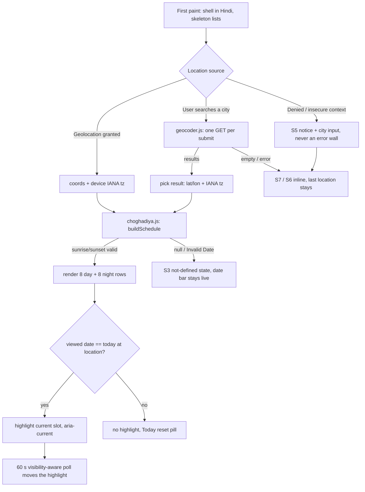

# 04 — Architecture

Project: **Choghadiya Refactor** · Owner: architect · Date: 2026-10-14 · Version: **v1.0 (initial)**
Upstream: `docs/00-brief.md` (client intent), `docs/01-research.md` (§5 pinned algorithm, §4/§7 stack), `docs/02-prd.md` (US-1..US-19, NFRs), `docs/03-ux.md` (screens, tokens §4.1, copy deck §6).
Downstream: `docs/06-threat-model.md` (security-engineer — §6/§9 below define the origin list and CSP it depends on), `docs/05-plan.md` (ticket breakdown), frontend-dev / backend-dev / devops-engineer.

---

## 1. Context & constraints

A single-route, static, client-only web app that computes the 16 daily Choghadiya
slots from real sunrise/sunset for a viewed location and date, in Hindi (default)
and English. Constraints that shape everything below:

| # | Constraint | Source |
|---|------------|--------|
| C1 | **No backend, no server logic.** Static files only, hosted on GitHub Pages at `https://time.gitick.com/` | Brief §Constraints, PRD US-19 |
| C2 | **No build step** beyond what is documented; vanilla JS; deploy = push files | Brief §Constraints, PRD US-19 AC1 |
| C3 | Split file surface: `index.html` + `style.css` + `app.js` + i18n dictionary | Brief §Constraints, PRD US-19 AC1 |
| C4 | Core calculation is **offline-capable**: only the optional city search touches the network | Brief MVP 3, PRD NFR-P4 |
| C5 | **No secrets** — geocoding is keyless; no accounts, no API keys in the repo | PRD NFR-S1 |
| C6 | Privacy: no cookies/analytics/trackers; coordinates never leave the device | Brief §Data, PRD NFR-PR1..PR3 |
| C7 | Algorithm pinned in research §5 (7-name cycle, day +5-step night) is the source of truth and must be unit-locked | Brief §Algorithm, PRD US-2 |
| C8 | WCAG 2.2 AA; mobile-first from 320 px; evergreen browsers only | PRD §6.4/§6.5 |
| C9 | The single network origin in v1 is `https://geocoding-api.open-meteo.com` | 03-ux §9.1 handoff (security depends on this list) |

The architecture is therefore deliberately small: **three hand-written JS modules,
one vendor file, one stylesheet, one HTML page, zero runtime frameworks.**

---

## 2. Architecture overview

### 2.1 Component / module diagram

```mermaid
flowchart LR
  subgraph Browser["Browser (only runtime)"]
    direction TB
    index["index.html<br/>static shell, CSP meta, landmarks"]
    appjs["app.js<br/>state, orchestration, rendering (DOM)"]
    calc["choghadiya.js<br/>pure calculation (no DOM)"]
    i18n["i18n.js<br/>58-key hi/en dictionary + t()"]
    geocoder["geocoder.js<br/>Open-Meteo client, cache, debounce"]
    suncalc["vendor/suncalc-2.1.1.js<br/>pinned, vendored ESM"]
    style["style.css<br/>tokens from 03-ux §4.1"]
    index --> appjs
    index --> style
    appjs --> calc
    appjs --> i18n
    appjs --> geocoder
    calc --> suncalc
  end

  geoapi["Geolocation API<br/>(browser-native, on-device)"]
  om["https://geocoding-api.open-meteo.com<br/>v1/search — the ONLY network origin in v1"]

  appjs -. "getCurrentPosition (on-device)" .-> geoapi
  geocoder -. "GET, HTTPS, user-typed city name only" .-> om
```

### 2.2 Runtime flow (happy paths and degradations)



### 2.3 Module responsibilities (the "surface")

| File | Owner lane | Responsibility | Must NOT do |
|------|-----------|----------------|-------------|
| `index.html` | frontend-dev | Static shell: header, date bar, day/night `<section>`s, footer, `<dialog>` sheet, `<noscript>`, CSP `<meta>` | No inline `<script>` business logic (a tiny inline bootstrap for `type="module"` fallback is acceptable only if documented) |
| `style.css` | frontend-dev | All styling; tokens exactly as 03-ux §4.1; responsive bands 03-ux §5; `[hidden]{display:none !important}` reset; `minmax(0,1fr)` row grid | No third-party `@import`, no webfonts (NFR-PR1, 03-ux §4.3) |
| `app.js` | frontend-dev | State (`AppState`), orchestration, rendering, DOM events, highlight polling, geolocation glue | No sequence math, no date/weekday math (call `choghadiya.js`) |
| `choghadiya.js` | backend-dev | **Pure** calculation: sequences, `buildSchedule`, current-slot resolution, timezone-safe formatting helpers | No DOM, no network, no `window`/`document` access — imports must be Node-safe |
| `geocoder.js` | backend-dev | Open-Meteo client: query validation, 400 ms debounce, in-memory cache, AbortController, error taxonomy | No Nominatim call (ADR-004), no per-keystroke requests, no HTML construction |
| `i18n.js` | frontend-dev | The single dictionary (58 keys from 03-ux §6, hi + en) and `t(key, lang, vars)` | No string literals for UI copy anywhere else |
| `vendor/suncalc-2.1.1.js` | devops-engineer | Verbatim copy of the `suncalc@2.1.1` ESM build (BSD-2-Clause) | Never edited by hand; never fetched from a CDN at runtime (ADR-003) |
| `tests/*.test.js` | backend-dev | `node --test` suites (see §8) | — |
| `package.json`, `Makefile`, `.github/workflows/*`, `CNAME`, `favicon.svg` | devops-engineer | Tooling, CI, deploy, release assets | — |

> **Surface note (deliberate, reversible).** The brief/PRD name `index.html + style.css + app.js + i18n dictionary (+ assets)`. `choghadiya.js` and `geocoder.js` are two additional static modules that make the pure logic unit-testable without a DOM shim and keep the two dev lanes from editing the same file (see ADR-002). If the client insists on the literal four-file list, both fold into `app.js` as clearly delimited "Part A — pure" / "Part B — DOM" sections **without changing any exported contract below** — the plan's tickets own disjoint function sets either way.

---

## 3. Chosen stack (with versions) and why

| Concern | Choice | Version / pin | Licence | Why | ADR |
|---------|--------|---------------|---------|-----|-----|
| Language | JavaScript (ES2022 modules) | — | — | No build step (C2); `type="module"` gives real files + testable exports | 002 |
| UI framework | **None** (vanilla DOM) | — | — | One screen, ~16 rows; a framework adds a build step and bytes for no user value | 002 |
| Solar times | **`suncalc`** | **2.1.1** (exact) | BSD-2-Clause | Matches mainstream Indian panchang convention (−0.833° upper-limb + refraction, research §4/R1); dependency-free; pinned + vendored | 003 |
| Geocoding | **Open-Meteo Geocoding API** | v1 (live service) | Data: GeoNames CC-BY 4.0 | Keyless, CORS-friendly, returns IANA `timezone` (solves R2), fair use <10k calls/day | 004 |
| Timezone | `Intl.DateTimeFormat` (`timeZone` option) + IANA names | Native | — | DST-correct without a tz library (R6) | 005 |
| i18n | Hand-rolled dictionary + `t()` | — | — | 2 locales × 58 keys; a library is pure overhead (research §4) | 006 |
| Storage | **None** (in-memory only) | — | — | Privacy posture (NFR-PR1..PR3); no cookies, no localStorage | 007 |
| Unit tests | `node --test` (built-in) | Node ≥ 20 LTS | MIT | Zero extra dependency; pure functions are trivially testable | 008 |
| Browser checks | Headless Chromium (CDP) + `axe-core` (dev-only) | pinned at scaffold time | axe: MIT | Matches what UX already used; axe gives the M7 gate | 008 |
| Hosting | GitHub Pages + custom domain `time.gitick.com` | — | — | Client constraint C1 | 001 |
| Local dev | `make dev` → `python3 -m http.server 8080` | — | — | Zero-install one-command dev (charter rule 8) | 001 |

Rejected alternatives are recorded per-decision in `docs/adr/` — see §3.1.

### 3.1 ADR index

| ADR | Title | Status |
|-----|-------|--------|
| [001](adr/001-static-site-github-pages.md) | Static site on GitHub Pages, no backend | Accepted |
| [002](adr/002-vanilla-es-modules-and-module-split.md) | Vanilla JS ES modules; `choghadiya.js`/`geocoder.js` split | Accepted |
| [003](adr/003-suncalc-pinned-and-vendored.md) | `suncalc@2.1.1` pinned and vendored locally | Accepted |
| [004](adr/004-geocoding-open-meteo-only.md) | Open-Meteo as the only geocoder in v1 | Accepted |
| [005](adr/005-timezone-and-date-boundary-handling.md) | Location IANA timezone + sunrise→sunrise Vedic day | Accepted |
| [006](adr/006-i18n-hand-rolled-dictionary.md) | Single hand-rolled dictionary file | Accepted |
| [007](adr/007-no-persistent-storage.md) | No cookies / localStorage / sessionStorage in v1 | Accepted |
| [008](adr/008-testing-tooling.md) | `node --test` + headless Chromium/axe | Accepted |

---

## 4. Data model

There is **no database and no persistence** (ADR-007). The "data model" is the
in-memory runtime model shared between `choghadiya.js` (producer) and `app.js`
(consumer), plus the i18n dictionary schema. **Migrations: none** — nothing is
written to disk; a schema change is a coordinated edit of the types below and the
unit tests in one ticket.

### 4.1 Entities (runtime types)

```text
Location {
  latitude:   number        // decimal degrees, -90..90
  longitude:  number        // decimal degrees, -180..180
  timezone:   string        // IANA name, e.g. "Europe/London" (never a fixed offset)
  label:      string        // display name: "मुंबई, महाराष्ट्र" / "London, England, United Kingdom"
  source:     "geolocation" | "city"
}

Slot {
  index:  number            // 0..7 within its half
  half:   "day" | "night"
  start:  Date              // instant (UTC-based), computed, never rounded in memory
  end:    Date              // instant; slot[n].end === slot[n+1].start (US-1 AC4)
  name:   "udveg" | "char" | "labh" | "amrit" | "kaal" | "shubh" | "rog"  // canonical EN keys
  tier:   "mostAuspicious" | "auspicious" | "neutral" | "inauspicious"     // quality tier
}

Schedule {
  date:        string       // "YYYY-MM-DD" — civil date AT THE LOCATION (the Vedic day start)
  weekday:     number       // 0=Sun .. 6=Sat, of `date` at the location (drives both halves)
  location:    Location
  sunrise:     Date | null  // suncalc upper-limb convention (ADR-003)
  sunset:      Date | null
  nextSunrise: Date | null  // sunrise of date+1 at the location
  daySlots:    Slot[8] | null
  nightSlots:  Slot[8] | null
  defined:     boolean      // false → S3 not-defined state (US-9)
  reason:      "solar-undefined" | null
}

AppState {                    // owned by app.js, in-memory only
  lang:         "hi" | "en"   // default "hi" (PRD A3)
  location:     Location | null
  viewedDate:   string        // "YYYY-MM-DD" at the location
  schedule:     Schedule | null
  ui: { sheetOpen, loading, notice: null|"geo-denied", sheetError: null|"geocode-network"|"geocode-empty"|"query-required", expandedSlot: string|null }
}

DICT = { hi: { [key]: string }, en: { [key]: string } }   // 58 keys, 03-ux §6 verbatim
```

### 4.2 Relations

- `Location 1 — 1 Schedule` per viewed date; `Schedule 1 — 16 Slot` (8 day + 8 night).
- The **night half belongs to the day it started on** (US-3): `Schedule(date).nightSlots`
  may extend past midnight into `date+1`; a slot at 02:00 Thursday is in
  `Schedule("Wednesday").nightSlots`. The weekday driving both halves is the weekday
  of `date` at the **location** (ADR-005).
- `Slot.name` indexes the 7-name cycle; `Slot.tier` derives from name:
  `amrit → mostAuspicious`, `shubh|labh → auspicious`, `char → neutral`,
  `udveg|kaal|rog → inauspicious`.
- `AppState.location` ↔ `DICT`: rendering binds via `t(key, lang)`; **third-party
  text (city labels, geocoder result names) is inserted with `textContent`, never
  HTML** (NFR-S2) and never through `t()`.

### 4.3 Canonical algorithm (locked by tests — research §5 is the source of truth)

```text
cycle     = [udveg, char, labh, amrit, kaal, shubh, rog]
dayStart  = {Sun: 0, Mon: 3, Tue: 6, Wed: 2, Thu: 5, Fri: 1, Sat: 4}

daySlot(i)   = cycle[(dayStart[weekday] + i) % 7]              // i = 0..7
nightSlot(i) = cycle[(dayStart[weekday] + 5 * (i + 1)) % 7]    // i = 0..7

slotStart(i) = base + i * len / 8    // base = sunrise (day) | sunset (night)
dayLen   = sunset - sunrise
nightLen = nextSunrise - sunset
```

---

## 5. API contracts

### 5.1 Internal module contracts (the interfaces tickets build against)

```js
// choghadiya.js — pure, Node-importable, no DOM
export function computeSunTimes(location, dateISO)
  // -> { sunrise: Date|null, sunset: Date|null, nextSunrise: Date|null }  (suncalc-based)
export function buildSchedule({ location, date /* "YYYY-MM-DD" */ })
  // -> Schedule (see §4.1); never throws on polar input — returns defined:false
export function daySequence(weekday /* 0..6 */)   // -> string[8], lowercase name keys
export function nightSequence(weekday)            // -> string[8]
export function tierFor(name)                     // -> Slot.tier
export function resolveCurrentSlot(schedule, now /* Date */)
  // -> Slot | null  (null when schedule.date !== today-at-location or !schedule.defined)
export function todayIn(timeZone, now = new Date())   // -> "YYYY-MM-DD"
export function formatTime(date, timeZone, lang)      // -> "06:32" (24h, both locales)
export function formatDate(dateISO, timeZone, lang)   // -> "बुधवार, 14 अक्टूबर 2026" | "Wednesday, 14 October 2026"
export function addDays(dateISO, n)                   // -> "YYYY-MM-DD" (civil-date arithmetic, tz-safe)

// geocoder.js — injectable fetch for tests
export function geocodeCity(query, { fetchImpl = fetch, signal } = {})
  // -> Promise<GeocodeResult[]>   GeocodeResult = { name, admin1, country, latitude, longitude, timezone, population }
  // throws GeocoderError { code: "network" | "http" | "bad-query" }

// i18n.js
export const DICT
export function t(key, lang, vars = {})   // "{n} results found" interpolation; throws in dev on unknown key

// app.js — no exports required; DOM-only side effects behind init()
```

Invariants enforced by unit tests: `slot[n].end.getTime() === slot[n+1].start.getTime()`;
sum of 8 day slots equals `sunset − sunrise`; night list is attributed to its start date.

### 5.2 External API contract — Open-Meteo Geocoding (the only network call in v1)

```http
GET https://geocoding-api.open-meteo.com/v1/search
    ?name={encodeURIComponent(query)}   // 2..64 chars after trim
    &count=8
    &language={lang}                    // "hi" | "en", matches UI language
    Accept: application/json
```

Response `200 application/json` (fields consumed; others ignored):

```jsonc
{
  "results": [{
    "id": 1275339, "name": "Mumbai", "latitude": 19.076, "longitude": 72.8777,
    "country": "India", "admin1": "Maharashtra", "timezone": "Asia/Kolkata",
    "population": 12691836, "feature_code": "PPLC"
  }]
}
```

| Case | Behaviour (contract) |
|------|----------------------|
| `results` absent or `[]` | `geocodeCity` resolves `[]` → UI state **S7** (no city found) |
| Network failure / timeout / non-2xx | `GeocoderError{code:"network"|"http"}` → UI state **S6** (retry); last successful location untouched |
| Bad query (empty, <2 chars) | `GeocoderError{code:"bad-query"}` → `city.required` message; **no request sent** |
| Rate discipline | Exactly one request per explicit submit **or** per 400 ms quiet period; per-query in-memory cache; `AbortController` cancels in-flight superseded requests (US-5 AC4, US-10 AC2) |

**Origin allow-list (the threat-model input):**

| Purpose | Origin | Data sent |
|---------|--------|-----------|
| City search (optional) | `https://geocoding-api.open-meteo.com` | The typed city name + `count`/`language` params. **Nothing else — no coordinates, no cookies, no identifiers.** |
| Geolocation | *(none — browser-native, on-device)* | Coordinates never leave the device (US-4 AC3) |
| Fonts/analytics/CDN | **none** | System fonts only (03-ux §4.3) |

### 5.3 Content-Security-Policy (delivered as `<meta>` in `index.html`)

```html
<meta http-equiv="Content-Security-Policy"
      content="default-src 'none';
               script-src 'self';
               style-src 'self';
               img-src 'self';
               connect-src 'self' https://geocoding-api.open-meteo.com;
               font-src 'none';
               object-src 'none';
               base-uri 'none';
               form-action 'none'">
```

Notes: GitHub Pages cannot set response headers, so `<meta>` is the delivery
mechanism; `frame-ancestors` is ignored in `<meta>` and is therefore **not** claimed.
`form-action 'none'` is safe because the search form is handled by JS with
`preventDefault()` (no native submission). This exact origin list is the input
security's `docs/06-threat-model.md` must assume; changing it requires an ADR
amendment.

---

## 6. Auth & authorisation

**None, by design.** No accounts, no sessions, no tokens, no server to authenticate
against (C1, NFR-S1). Every visitor sees the same public data; there is no
authorisation boundary to model. The only permission in the product is the
browser's own geolocation prompt, which is advisory: denial degrades to the city
input (US-8) and is never a dead end.

---

## 7. Config & secrets handling

- **Secrets: none.** Geocoding is keyless (ADR-004); there is no `.env`, no API
  key, no token in the repo or the build (C5, NFR-S1). If a future feature needs a
  key, it cannot ship on this architecture — that is a deliberate forcing function.
- **Configuration** is a frozen `CONFIG` object at the top of `app.js` +
  `choghadiya.js`, values fixed at design time:

  | Constant | Value | Where |
  |----------|-------|-------|
  | `DEBOUNCE_MS` | `400` | geocoder.js |
  | `GEOCODE_COUNT` | `8` | geocoder.js |
  | `HIGHLIGHT_POLL_MS` | `60000` (tab-visibility aware) | app.js |
  | `SLOT_COUNT` | `8` per half | choghadiya.js |
  | `ASSET_VERSION` | the release version, equal to `package.json`'s (baseline `2.1.0`, next release `2.2.0`) | index.html (`?v=` query, US-19 AC3) |
- Attribution strings (Open-Meteo / GeoNames CC-BY) live in the i18n dictionary
  (`attribution.geocoding`, `privacy.line`) — copy, not config.

---

## 8. Error handling & logging

### 8.1 Error taxonomy → UI state (no silent failures, no `NaN` ever)

| Code | Raised by | UI state | Story |
|------|-----------|----------|-------|
| `solar-undefined` | `buildSchedule` (null/Invalid sunrise, sunset or nextSunrise) | **S3** not-defined panel; date bar stays live | US-9 |
| `geo-denied` / `geo-unavailable` | Geolocation promise rejection / insecure context | **S5** `role="status"` notice + city input | US-8 |
| `geocode-network` / `geocode-http` | `geocoder.js` | **S6** `role="alert"` + Retry (re-submits same query) | US-10 |
| `geocode-empty` | `geocoder.js` resolves `[]` | **S7** no-results message, sheet stays usable | US-5 AC5 |
| `bad-query` | `geocoder.js` validation | inline `city.required`; no request sent | 03-ux S1 validation |

Rules: `buildSchedule` **never throws** on bad solar input — it returns
`defined:false`. Rendering functions never emit `NaN`, `Invalid Date`, `undefined`
or an empty slot row into the DOM (US-9 AC2) — a defensive `assertRenderable()`
guard throws in tests/dev if a non-finite time would be formatted.

### 8.2 Logging

There is no server, so there is no log pipeline. Policy:
- **Production builds log nothing user-derived** — no city names, no coordinates,
  no query strings in `console.*` (privacy posture, NFR-PR1).
- Unexpected errors are surfaced as one of the UI states above; a `console.warn`
  with a bare error code is acceptable for genuinely unexpected exceptions (never
  with payload data).
- Dev/test: `node --test` output and assertion messages are the diagnostic channel.

---

## 9. Security posture summary (handoff to `docs/06-threat-model.md`)

Threat modelling is the security-engineer's card; this section fixes the facts it
depends on:

1. **Attack surface**: one static page, one `<dialog>`, one text input, one
   third-party GET. No backend, no auth, no storage, no postMessage, no iframe.
2. **Outbound origins (exhaustive)**: `https://geocoding-api.open-meteo.com` (city
   search only). CSP §5.3 enforces it; `script-src 'self'` covers the vendored
   suncalc (ADR-003 removes the CDN origin deliberately).
3. **Injection**: the only third-party text is geocoder result fields (`name`,
   `admin1`, `country`) and they are rendered via `textContent`/`createElement`
   only (NFR-S2). `i18n` strings are our own literals. No `innerHTML`,
   no `eval`, no `document.write`, no URL-HTML sinks.
4. **Supply chain**: exactly one third-party runtime artifact —
   `vendor/suncalc-2.1.1.js`, pinned version, BSD-2-Clause, vendored byte-copy
   committed to the repo with provenance noted in ADR-003. No npm install at
   runtime or build; dev-only tooling (`axe-core`, headless Chromium) never ships.
5. **Transport**: HTTPS only (GitHub Pages + the geocoder), HSTS comes from the
   host; no mixed content (system fonts only).
6. **Privacy**: coordinates stay on-device; the typed city name is the only
   user-derived data transmitted, disclosed inline + footer (US-17).
7. **Abuse of the geocoder**: debounce/submit-only + cache cap the client's own
   call rate; the fair-use ceiling (<10k/day) is a product-level constraint
   recorded in ADR-004.

---

## 10. Testing strategy

| Layer | Tool | Scope | Gate |
|-------|------|-------|------|
| Unit (pure logic) | `node --test` (Node ≥ 20 LTS), zero deps | `choghadiya.js`: 7×16 sequence table (112 assertions, tables copied verbatim from research §5.2/§5.3), slot-boundary continuity, Mumbai 2026-10-14 fixture (03-ux §8, crosses midnight → US-3), polar fixture (US-9), DST fixture (London spring/autumn transition, US-7 AC2), `resolveCurrentSlot` at half boundaries (US-14) | Every CI run |
| Unit (client) | `node --test` with injectable `fetchImpl` | `geocoder.js`: request shaping, 400 ms debounce, one-request-per-submit, cache hit, abort on supersede, error taxonomy | Every CI run |
| Contract test | `node --test` | i18n coverage: the 58 keys of 03-ux §6 exist in **both** locales (M4 gate), `t()` interpolation, unknown-key behaviour | Every CI run |
| Browser smoke | Headless Chromium (CDP, as UX used) + `axe-core` | 16 rows render from the fixture; language toggle flips `html lang` + all `data-i18n`; sheet focus management (open→field, Esc→chip); no horizontal scroll at 320/390/430/1024; **axe: 0 critical/serious** (M7) | Pre-release (QA card) |
| Manual | QA exploratory | ±2 min vs Drik Panchang for 3 cities/dates (M3), geolocation-denied path on a real phone, 200% zoom, screen reader | QA release verdict |

The QA card owns `docs/07-test-plan.md` / `docs/08-test-report.md`; the suites
above are the developer-facing half and run in CI on every push (`.github/workflows/ci.yml`).

---

## 11. Deployment & local development

**Local, one command:**

```bash
make dev        # = python3 -m http.server 8080  → http://localhost:8080
make test       # = node --test tests/
```

(`npm run dev` / `npm test` mirror these; no `npm install` is needed to run or
test the app itself — Node ≥ 20 LTS and Python 3 are assumed present.)

**Deployment (GitHub Pages — client-authorized release definition, `docs/00-brief.md` 2026-10-14):**
1. `main` is releasable at all times; CI (`.github/workflows/ci.yml`) runs
   `make test` on every push/PR. CI does **not** deploy.
2. Releases are published to **`github.com/vishalnagda1/choghadiya` (`main`) via
   the authenticated `gh` CLI** (user `vishalnagda1`, repo + workflow scopes);
   GitHub Pages serves the repo root (static, no build) at `https://time.gitick.com/`.
   The whole packaging + tag + deploy step is one devops card (`t_169d64f7`),
   gated behind GATE 2 (QA verdict + security audit) — see `05-plan.md` §M4.
3. `CNAME` contains `time.gitick.com`; DNS stays as-is (brief release definition).
4. **Versioning (mandatory):** every release carries a git tag with a semver bump
   from `package.json` **2.1.0** — next release **v2.2.0**. `package.json`
   version, the git tag, and `ASSET_VERSION` move together in the release commit.
5. **Cache busting (US-19 AC3, research R7):** asset URLs in `index.html` carry
   `?v=${ASSET_VERSION}` (e.g. `style.css?v=2.2.0`); GitHub Pages' shared CDN
   caches by full URL, so a version bump forces a re-fetch without a build step
   or hashed filenames.
6. Post-deploy smoke: open `https://time.gitick.com/`, verify no console errors,
   16 rows, toggle, favicon, fresh (busted) asset URLs (US-19 AC2/AC3).

**Rollback:** revert the commit on `main`, re-push via the same `gh` CLI path;
Pages redeploys. No state exists anywhere else (ADR-007).

---

## 12. Scalability & performance notes (MVP-appropriate)

This is a static page; "scalability" is about bytes and geocoder etiquette, not
throughput.

- **Serving** scales trivially via the GitHub Pages CDN; there is no server-side
  state or database to grow.
- **Budgets (NFR-P1/P3):** FCP < 1.5 s on mid-range Android/4G; total shipped JS
  < ~60 KB minified gzip. Expected reality: suncalc ~3 KB + app code, system
  fonts, one CSS file — comfortably inside budget. No render-blocking third
  parties (ADR-003/006).
- **Computation** is 16 slots of arithmetic; `buildSchedule` runs in microseconds,
  so date navigation and language toggling are synchronous (< 100 ms, NFR-P2).
- **Geocoder load** is client-distributed: debounce + explicit submit + per-query
  cache keep each user well under fair use (ADR-004). If the product ever exceeds
  Open-Meteo's terms, the change is a client swap behind `geocoder.js`'s contract.
- **Not built (deliberately):** service worker/offline (out of scope v1 — though
  the core calc is already offline-capable once loaded), bundling, SSR, a CDN for
  assets beyond Pages. Each is cheap to add later because the module contracts
  above are already framework-free.

---

## 13. Traceability (architecture → PRD NFRs)

| NFR | Where satisfied |
|-----|-----------------|
| NFR-P1..P4 (perf, offline core) | §12, ADR-003 (vendored, no CDN), ADR-006 (no webfont) |
| NFR-S1..S5 (security) | §5.3 CSP, §9, ADR-003/004, §8.2; S5 (security review) is a release gate |
| NFR-PR1..PR4 (privacy) | §5.2 origin table, §6 (no storage), ADR-007, dictionary `privacy.line` |
| NFR-A1..A6 (a11y) | 03-ux §4 tokens (contrast verified), §7 semantics; enforced by FE-05 ticket + axe gate |
| NFR-B1..B4 (browsers) | ES modules + `<dialog>` + `Intl` = evergreen only (ADR-002); `<noscript>` in index.html |

---

## 14. Open items / risks owned outside this document

- Security's `docs/06-threat-model.md` may require changes; any change to the
  origin list or CSP needs an ADR amendment (§5.3).
- PRD §9 client questions are open but defaulted (Q1 "Char", Q2 60 s poll,
  Q3 sunrise/sunset small print, Q4 inline privacy + footer, Q6 convention note,
  Q7 emoji-free favicon) — all already reflected in 03-ux and here.
- The two rendering gotchas from 03-ux §10 (`[hidden]` reset, `minmax(0,1fr)` +
  420 px collapse band) are requirements, not suggestions — they are acceptance
  criteria in FE-01.

---

## 15. Revision log

| Version | Date | Author | Change |
|---------|------|--------|--------|
| v1.0 (initial) | 2026-10-14 | architect | Initial architecture: module surface, runtime data model, internal + geocoder contracts, CSP/origin list, error taxonomy, testing strategy, deploy/local-dev, 8 ADRs, plan in `05-plan.md`. |
| v1.0.1 | 2026-10-14 | architect | §7/§11: folded in client-authorized release definition (brief 2026-10-14) — `gh` CLI deploy to `github.com/vishalnagda1/choghadiya` (main) → Pages `time.gitick.com`; semver git tag from `package.json` 2.1.0 (next: v2.2.0); release step = single devops card `t_169d64f7` behind GATE 2. No deploy workflow; CI is test-only. |
